# OpenArt images

## 2026-10-12_135108_wheat-stalk-nibbled-closeup_cea49a38.png

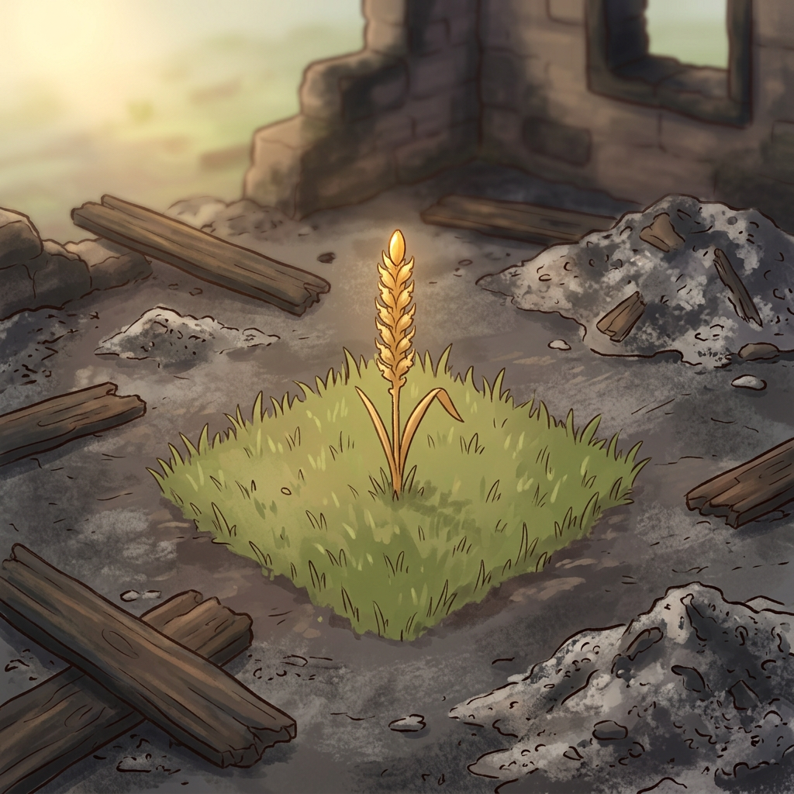

- Created: 2026-10-12T13:51:08+02:00
- Model: Nano Banana 2, 1K, 1:1
- References: farm early;style album

~~~~
Hand-painted storybook illustration for a cozy farming game, in the same world and colours as the reference pictures but a little more painterly: soft painterly shading with gentle brush texture and soft light gradients, warm earthy colours with olive greens and warm browns, clean dark-brown outlines that are thinner and softer than in a cartoon, friendly chunky-cute proportions, warm happy mood. Full-bleed square picture filling the whole frame, no white border, no text, no letters, no labels. Reference image 1 shows the game's own painted look and its burnt farm ground (ash, charred wood, ruined stone). Reference image 2 shows the colours and friendliness of the game's story pictures.

Scene: Close-up of one small square of green grass in the middle of ash-grey burnt ground. In the centre stands a single ripe golden wheat stalk; every grain has been nibbled off except one at the very top, and tiny nibble marks show. Charred planks and ash all around, a blackened stone wall softly out of focus in the background. Low morning sun makes the stalk glow. A gentle mystery: who nibbled it? No people.
~~~~

## 2026-10-12_135116_bunny-wheat-patch-proud_3e91242f.png

- Created: 2026-10-12T13:51:16+02:00
- Model: Nano Banana 2, 1K, 1:1
- References: animals;farm early

~~~~
Hand-painted storybook illustration for a cozy farming game, in the same world and colours as the reference pictures but a little more painterly: soft painterly shading with gentle brush texture and soft light gradients, warm earthy colours with olive greens and warm browns, clean dark-brown outlines that are thinner and softer than in a cartoon, friendly chunky-cute proportions, warm happy mood. Full-bleed square picture filling the whole frame, no white border, no text, no letters, no labels. Reference image 1 is the game's animal sheet: the small brown rabbit eating a leaf in its bottom-right corner is the BUNNY; paint her like that rabbit (same colours, same cute proportions) but with one ear that will not stand up and flops down. Reference image 2 shows the game's own painted look and its burnt farm ground.

Scene: A small round green patch in burnt ground, now with young green and golden wheat sprouts. The bunny sits proudly in the middle of it, looking straight at the viewer with a 'took you long enough' expression, a single nibbled grain stuck to her whiskers. Ash, charred planks and a ruined stone wall at the edges of the picture. Golden evening light, warm and triumphant. No people.
~~~~

## 2026-10-12_135120_thistle-grab-first-person_85c8ee2a.png

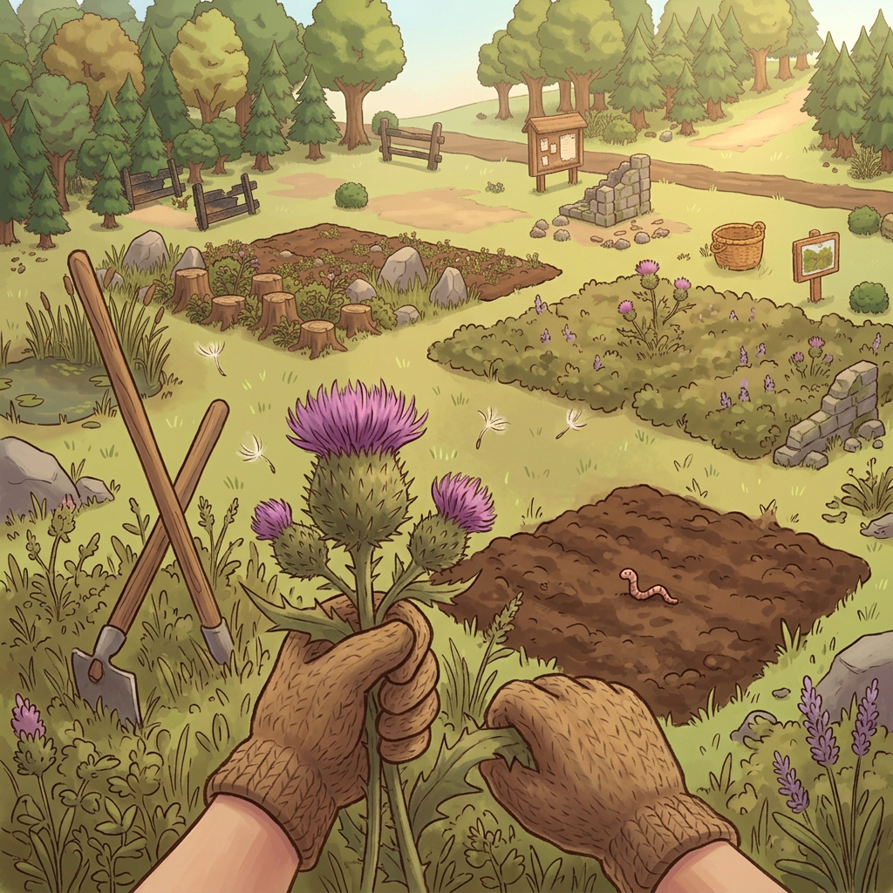

- Created: 2026-10-12T13:51:20+02:00
- Model: Nano Banana 2, 1K, 1:1
- References: farm early

~~~~
Hand-painted storybook illustration for a cozy farming game, in the same world and colours as the reference pictures but a little more painterly: soft painterly shading with gentle brush texture and soft light gradients, warm earthy colours with olive greens and warm browns, clean dark-brown outlines that are thinner and softer than in a cartoon, friendly chunky-cute proportions, warm happy mood. Full-bleed square picture filling the whole frame, no white border, no text, no letters, no labels. Reference image 1 shows the game's own painted look, including its overgrown field patches, thistles, stumps and soil.

Scene: First-person view as if through the farmer's own eyes: two hands in brown woven fibre work mitts (no bare skin visible) grab a huge prickly purple thistle in a weedy patch at the bottom edge of the picture, a wooden stick hoe leans nearby, thistle fluff drifts in the air, and beside it lies a freshly cleared square of dark earth with a tiny worm. Bright morning light. Do not show the farmer's face or body, only the hands.
~~~~

## 2026-10-12_135125_forest-edge-campfire-glowing-stones_349ad72b.png

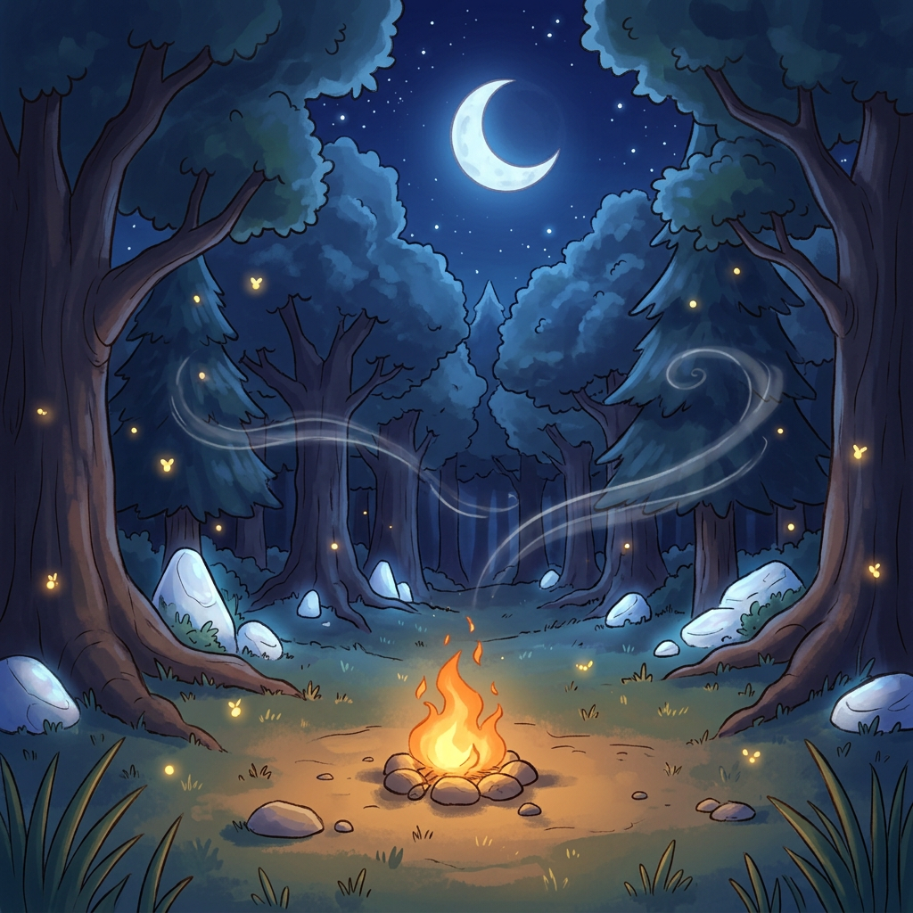

- Created: 2026-10-12T13:51:25+02:00
- Model: Nano Banana 2, 1K, 1:1
- References: farm early

~~~~
Hand-painted storybook illustration for a cozy farming game, in the same world and colours as the reference picture but a little more painterly: soft painterly shading with gentle brush texture and soft light gradients, warm earthy colours with olive greens and warm browns, clean dark-brown outlines that are thinner and softer than in a cartoon, friendly chunky-cute proportions. Full-bleed square picture filling the whole frame, no white border, no text, no letters, no labels. Night scene lit by warm firelight and cool moonlight, deep blue shadows, soft and friendly, never scary. Reference image 1 shows the game's own painted look and its forest of oak and pine trees.

Scene: Night at the forest edge seen from beside a small campfire in the foreground: tall dark trees, and between their roots white stones glowing faintly like moonlight. Fireflies drift in the air. The sky is deep blue and full of stars. A sense of a quiet melody hanging in the air, shown as faint silver swirls drifting out from deep in the forest. Awe and wonder. No people.
~~~~

## 2026-10-12_135132_grandchildren-bedside-eager_6d1a8056.png

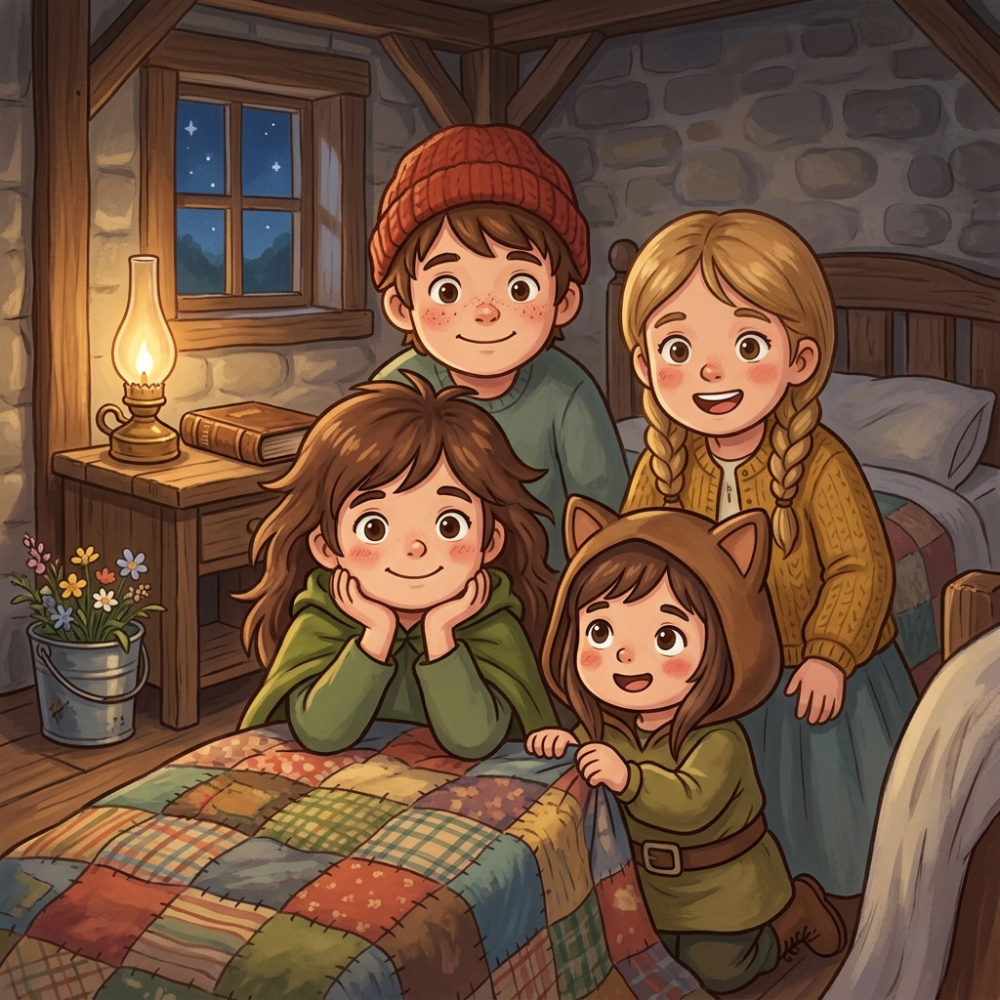

- Created: 2026-10-12T13:51:32+02:00
- Model: Nano Banana 2, 1K, 1:1
- References: Minena and Manjiva;style album

~~~~
Hand-painted storybook illustration for a cozy farming game, in the same world and colours as the reference pictures but a little more painterly: soft painterly shading with gentle brush texture and soft light gradients, warm earthy colours, clean dark-brown outlines that are thinner and softer than in a cartoon, friendly chunky-cute proportions, warm happy mood. Full-bleed square picture filling the whole frame, no white border, no text, no letters, no labels. Reference image 1 is the character sheet of the two sisters: MINENA (8 years old, wild brown hair, moss-green hooded cloak) and MANJIVA (6 years old, a head shorter, brown hood with little pointed animal ears, olive tunic with belt): keep both exactly as drawn there, just a little more painterly. Reference image 2 shows the colours and friendliness of the game's story pictures.

Scene: View from an old person's bed at night, looking out across a patchwork quilt at four grandchildren crowding eagerly around the bedside. In front, Minena with her chin on the quilt and shining eyes; beside her little Manjiva clutching the quilt; behind them an older boy of about 10 with freckles and a red knitted cap, and a girl of about 9 with two blonde braids and a mustard-yellow cardigan. All four look straight at the viewer, begging for a story they have heard many times. Cosy farmhouse bedroom with stone and timber walls, a warm oil lamp on the bedside table, a small starry window, an old leather-bound farm book, and a dented tin bucket with flowers in it. Do not show the person in the bed.
~~~~

## 2026-10-12_135139_grandchildren-bedside-listening-window_524c811a.png

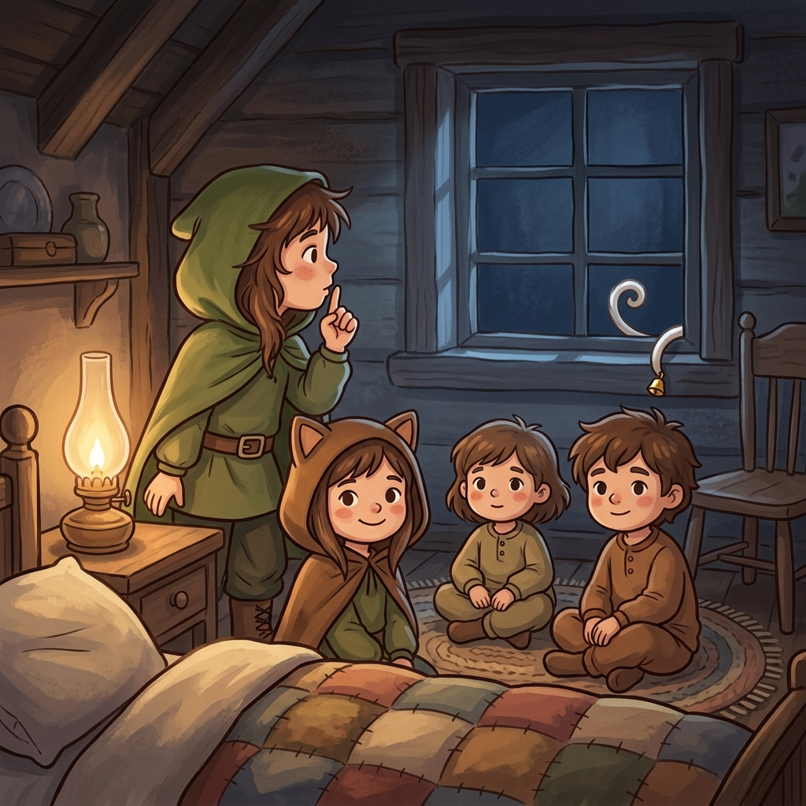

- Created: 2026-10-12T13:51:39+02:00
- Model: Nano Banana 2, 1K, 1:1
- References: Minena and Manjiva;style album

~~~~
Hand-painted storybook illustration for a cozy farming game, in the same world and colours as the reference pictures but a little more painterly: soft painterly shading with gentle brush texture and soft light gradients, warm earthy colours, clean dark-brown outlines that are thinner and softer than in a cartoon, friendly chunky-cute proportions. Full-bleed square picture filling the whole frame, no white border, no text, no letters, no labels. Night scene lit by warm lamplight and cool moonlight, soft and friendly, never scary. Reference image 1 is the character sheet of the sisters MINENA (8 years old, wild brown hair, moss-green hooded cloak) and MANJIVA (6, brown hood with animal ears): keep them exactly as drawn there. Reference image 2 shows the colours and friendliness of the game's story pictures.

Scene: View from an old person's bed in a cosy farmhouse bedroom at night. Minena turns her head toward the dark window and listens, one hand raised as if to say 'shh, did you hear that?'. Manjiva and two other grandchildren look at the viewer. Hidden detail, very subtle: on the outside windowsill at the edge of the window, only a thin white tail with a small spiral curl at its tip hangs down over the sill, and one tiny brass bell glints beside it; nothing else of whoever it belongs to is visible. Nobody in the room notices. Do not show the person in the bed.
~~~~

## 2026-10-12_135143_thistle-pile-wobbly-stick-tower_26810a05.png

- Created: 2026-10-12T13:51:43+02:00
- Model: Nano Banana 2, 1K, 1:1
- References: farm early

~~~~
Hand-painted storybook illustration for a cozy farming game, in the same world and colours as the reference pictures but a little more painterly: soft painterly shading with gentle brush texture and soft light gradients, warm earthy colours with olive greens and warm browns, clean dark-brown outlines that are thinner and softer than in a cartoon, friendly chunky-cute proportions, warm happy mood. Full-bleed square picture filling the whole frame, no white border, no text, no letters, no labels. Reference image 1 shows the game's own painted look, its ground, weeds and thistles.

Scene: A freshly cleared patch of earth with pulled thistles lying in a heap. In the middle, three sticks are balanced in a ridiculous wobbly tower with a thistle flower stuck on top like a hat. Subtle hidden detail: from behind the thistle heap at the edge of the picture, only a thin white tail with a small spiral curl at its tip sticks out, and a tiny brass bell glints on the heap; no creature is otherwise visible. Bright morning light. No people.
~~~~

## 2026-10-12_135150_lark-fence-apple-gravel-road_2e978b9b.png

- Created: 2026-10-12T13:51:50+02:00
- Model: Nano Banana 2, 1K, 1:1
- References: village cast;farm late

~~~~
Hand-painted storybook illustration for a cozy farming game, in the same world and colours as the reference pictures but a little more painterly: soft painterly shading with gentle brush texture and soft light gradients, warm earthy colours with olive greens and warm browns, clean dark-brown outlines that are thinner and softer than in a cartoon, friendly chunky-cute proportions, warm happy mood. Full-bleed square picture filling the whole frame, no white border, no text, no letters, no labels. Reference image 1 is the character sheet of the village characters: LARK is the tall thin man in the rust-brown patched coat at the top left; keep him exactly as drawn there, just a little more painterly. Reference image 2 shows the game's own painted farm and its road.

Scene: Through the farmer's own eyes: Lark sits on a wooden fence beside a fresh gravel road as if he had always been there, legs crossed, biting an apple, with an amused sideways smile, looking at the viewer. One coat pocket bulges oddly. The new farm and the forest behind him. Bright afternoon, a slightly magical feel. Do not show the farmer; Lark is the only person in the picture.
~~~~

## 2026-10-12_135157_badger-tea-kitchen-hearth_8bd6622d.png

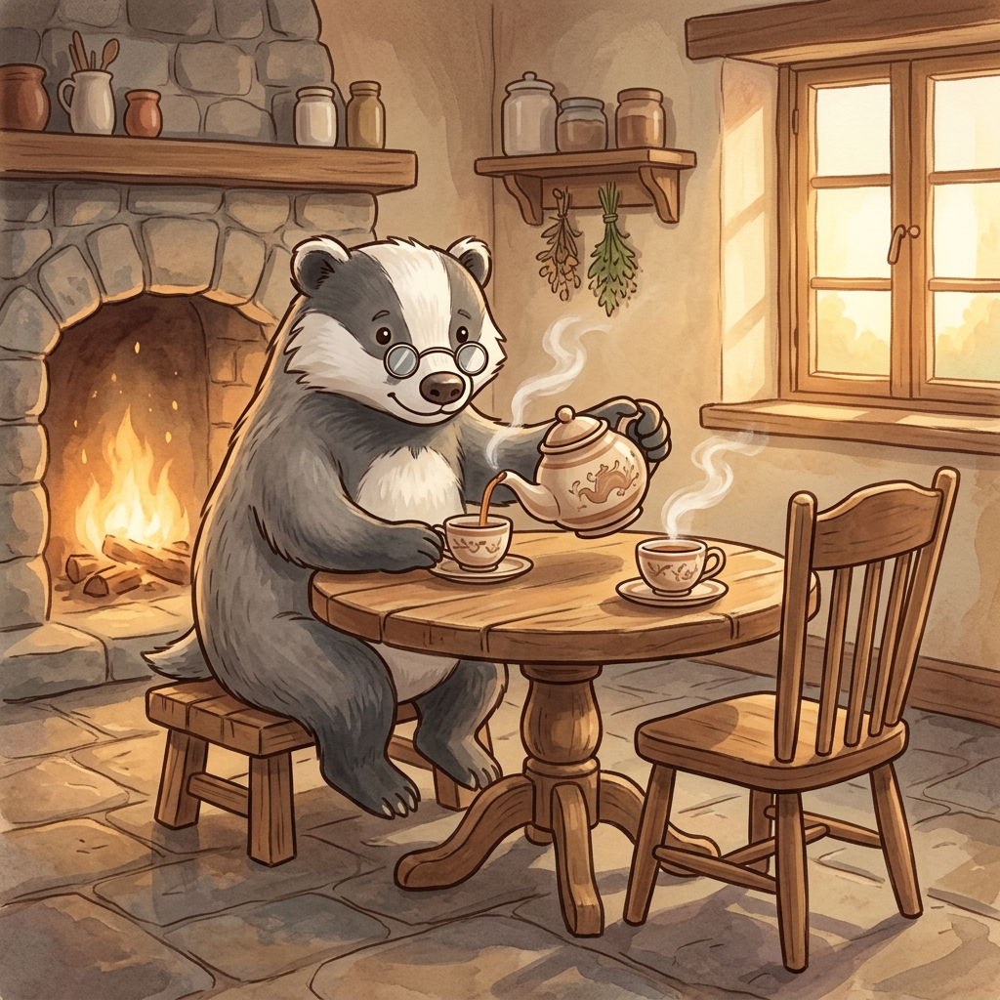

- Created: 2026-10-12T13:51:57+02:00
- Model: Nano Banana 2, 1K, 1:1
- References: badger;style album

~~~~
Hand-painted storybook illustration for a cozy farming game, in the same world and colours as the reference pictures but a little more painterly: soft painterly shading with gentle brush texture and soft light gradients, warm earthy colours with olive greens and warm browns, clean dark-brown outlines that are thinner and softer than in a cartoon, friendly chunky-cute proportions, warm happy mood. Full-bleed square picture filling the whole frame, no white border, no text, no letters, no labels. Reference image 1 is the character sheet of the old badger with round glasses: keep him exactly as drawn there, just a little more painterly. Reference image 2 shows the colours and friendliness of the game's story pictures.

Scene: A cosy farmhouse kitchen corner with a stone hearth and warm window light. The old grey badger with his round glasses carefully sets out a tea set on a small wooden table, pouring tea from a big teapot into a cup, with a kind, patient look at the viewer. An empty wooden chair is pulled out for the viewer ('sit down first'). Steam curls up from the cups. Warm, gentle, a little funny. Nobody else in the picture.
~~~~

## 2026-10-12_135201_stump-slope-farm-clearing_f0f42304.png

- Created: 2026-10-12T13:52:01+02:00
- Model: Nano Banana 2, 1K, 1:1
- References: farm early

~~~~
Painted farm-game illustration in exactly the style, three-quarter top-down view, colours and outlines of reference image 1 (the game's own painted map art, forest all around). No people, no interface, no text, no letters, full-bleed square picture, no white border.

Scene: The same farm clearing as reference image 1, seen from the same angle, but this time the focus is the slope between the farm and the forest edge: it is covered in dozens of old tree stumps, far too many for such a small farm, with weeds and young saplings growing between them. Only a few big trees remain at the top of the slope, and a small cleared dirt track runs through the stumps. The burnt ruins and the field of the farm are visible in the lower part of the picture. Grey-blue overcast light, a thoughtful mood, not scary.
~~~~

## 2026-10-12_135213_farm-book-wheat-page-bed_28a07dcf.png

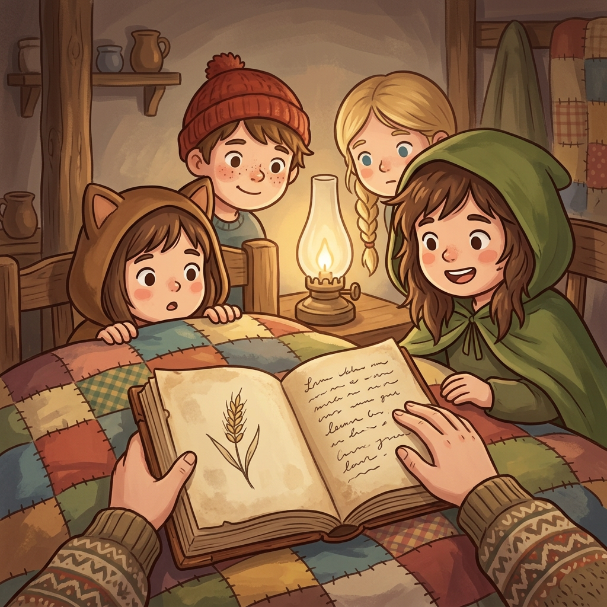

- Created: 2026-10-12T13:52:13+02:00
- Model: Nano Banana 2, 1K, 1:1
- References: Minena and Manjiva;style album

~~~~
Hand-painted storybook illustration for a cozy farming game, in the same world and colours as the reference pictures but a little more painterly: soft painterly shading with gentle brush texture and soft light gradients, warm earthy colours, clean dark-brown outlines that are thinner and softer than in a cartoon, friendly chunky-cute proportions, warm happy mood. Full-bleed square picture filling the whole frame, no white border, no text, no letters, no labels. Reference image 1 is the character sheet of the sisters MINENA (8, wild brown hair, moss-green hooded cloak) and MANJIVA (6, brown hood with animal ears): keep them exactly as drawn there. Reference image 2 shows the colours and friendliness of the game's story pictures.

Scene: First-person view from a bed at night: two hands in long knitted sleeves (no skin beyond the fingertips) open an old leather farm book on a patchwork quilt. The first page shows a little drawing of a wheat stalk and a few lines of faded handwriting (only unreadable squiggles, no real letters). Four grandchildren lean in at the edges of the picture, Minena closest in her green hood, Manjiva peeking over the quilt, a freckled boy in a red knitted cap and a blonde girl with braids behind them. Warm lamplight in a cosy farmhouse bedroom.
~~~~

## 2026-10-12_135221_grandchildren-giggling-bunny-ears_e45067b8.png

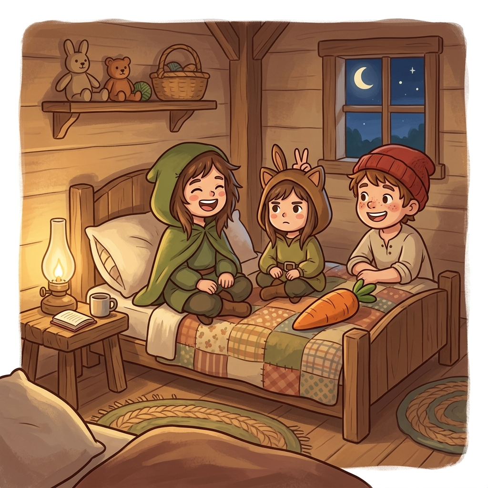

- Created: 2026-10-12T13:52:21+02:00
- Model: Nano Banana 2, 1K, 1:1
- References: Minena and Manjiva;style album

~~~~
Hand-painted storybook illustration for a cozy farming game, in the same world and colours as the reference pictures but a little more painterly: soft painterly shading with gentle brush texture and soft light gradients, warm earthy colours, clean dark-brown outlines that are thinner and softer than in a cartoon, friendly chunky-cute proportions, warm happy mood. Full-bleed square picture filling the whole frame, no white border, no text, no letters, no labels. Reference image 1 is the character sheet of the sisters MINENA (8, wild brown hair, moss-green hooded cloak) and MANJIVA (6, a head shorter, brown hood with animal ears, olive tunic): keep them exactly as drawn there. Reference image 2 shows the colours and friendliness of the game's story pictures.

Scene: Cosy farmhouse bedroom at night, view from the bed. The grandchildren are giggling: little Manjiva holds two fingers up on her hood like bunny ears with a very serious face, and Minena laughs out loud. A carrot-shaped cushion lies on the patchwork quilt. A freckled boy in a red knitted cap grins. Warm lamplight. Funny, cosy mood. Do not show the person in the bed.
~~~~

## 2026-10-12_135228_grandchildren-hush-boy-blurting_3e996ddf.png

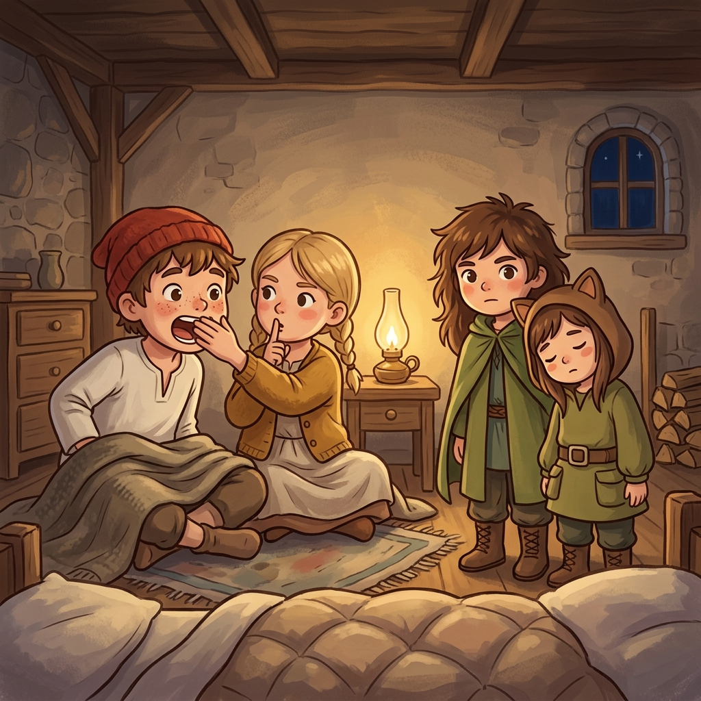

- Created: 2026-10-12T13:52:28+02:00
- Model: Nano Banana 2, 1K, 1:1
- References: Minena and Manjiva;style album

~~~~
Hand-painted storybook illustration for a cozy farming game, in the same world and colours as the reference pictures but a little more painterly: soft painterly shading with gentle brush texture and soft light gradients, warm earthy colours, clean dark-brown outlines that are thinner and softer than in a cartoon, friendly chunky-cute proportions, warm happy mood. Full-bleed square picture filling the whole frame, no white border, no text, no letters, no labels. Reference image 1 is the character sheet of the sisters MINENA (8, wild brown hair, moss-green hooded cloak) and MANJIVA (6, a head shorter, brown hood with animal ears, olive tunic): keep them exactly as drawn there. Reference image 2 shows the colours and friendliness of the game's story pictures.

Scene: Cosy farmhouse bedroom at night, view from the bed. A freckled boy of about 10 in a red knitted cap leans far forward with his mouth wide open, about to blurt something out; a girl of about 9 with two blonde braids in a mustard cardigan claps a hand over his mouth to hush him. Minena watches the viewer closely, curious and a little serious. Manjiva is half asleep against Minena's shoulder. Warm lamplight. Do not show the person in the bed.
~~~~

## 2026-10-12_135236_grandchildren-thoughtful-row-quilt_0e3215c1.png

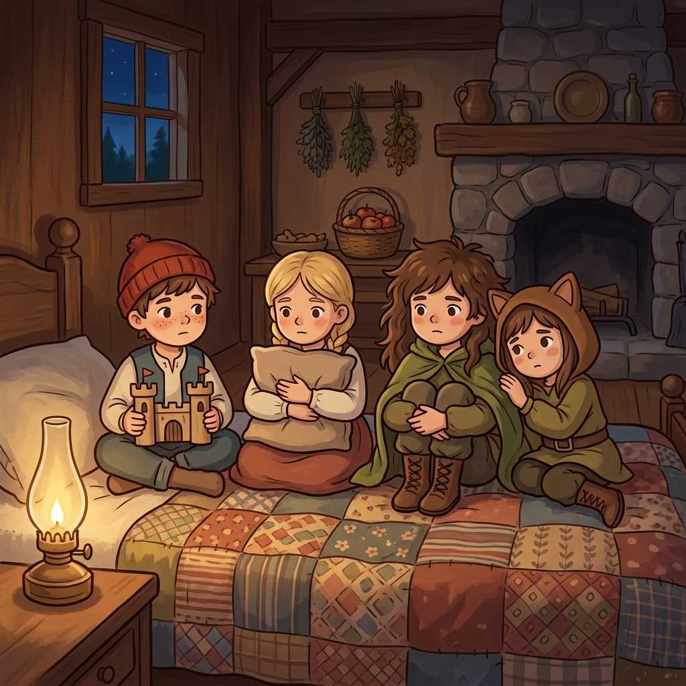

- Created: 2026-10-12T13:52:36+02:00
- Model: Nano Banana 2, 1K, 1:1
- References: Minena and Manjiva;style album

~~~~
Hand-painted storybook illustration for a cozy farming game, in the same world and colours as the reference pictures but a little more painterly: soft painterly shading with gentle brush texture and soft light gradients, warm earthy colours, clean dark-brown outlines that are thinner and softer than in a cartoon, friendly chunky-cute proportions. Full-bleed square picture filling the whole frame, no white border, no text, no letters, no labels. Reference image 1 is the character sheet of the sisters MINENA (8, wild brown hair, moss-green hooded cloak) and MANJIVA (6, a head shorter, brown hood with animal ears, olive tunic): keep them exactly as drawn there. Reference image 2 shows the colours and friendliness of the game's story pictures.

Scene: Cosy farmhouse bedroom at night, view from the bed. The four grandchildren sit in a row on the patchwork quilt, more thoughtful now: a freckled boy in a red knitted cap holds a toy wooden castle, a blonde girl with braids hugs a cushion, Minena hugs her knees, Manjiva leans against her. The oil lamp flickers low. A quiet, slightly serious but still warm mood. Do not show the person in the bed.
~~~~

## 2026-10-12_135243_grandchildren-tea-cup-carrying_532fae31.png

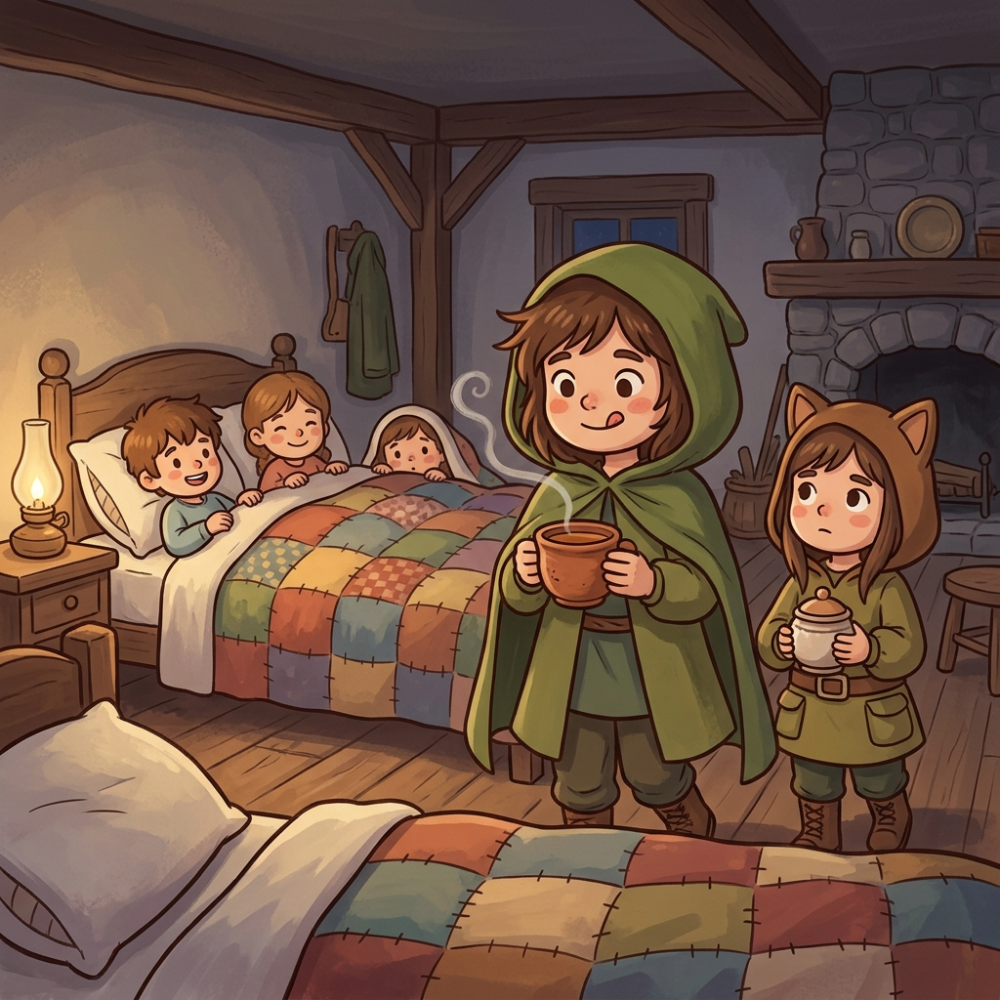

- Created: 2026-10-12T13:52:43+02:00
- Model: Nano Banana 2, 1K, 1:1
- References: Minena and Manjiva;style album

~~~~
Hand-painted storybook illustration for a cozy farming game, in the same world and colours as the reference pictures but a little more painterly: soft painterly shading with gentle brush texture and soft light gradients, warm earthy colours, clean dark-brown outlines that are thinner and softer than in a cartoon, friendly chunky-cute proportions, warm happy mood. Full-bleed square picture filling the whole frame, no white border, no text, no letters, no labels. Reference image 1 is the character sheet of the sisters MINENA (8, wild brown hair, moss-green hooded cloak) and MANJIVA (6, a head shorter, brown hood with animal ears, olive tunic): keep them exactly as drawn there. Reference image 2 shows the colours and friendliness of the game's story pictures.

Scene: Cosy farmhouse bedroom at night, view from the bed. Minena carefully carries a too-full cup of tea toward the viewer with both hands, tongue poking out in concentration, while Manjiva follows holding a sugar bowl with great seriousness. The other grandchildren watch from the quilt. Steam curls up from the cup. Tender and funny. Do not show the person in the bed.
~~~~

## 2026-10-12_135251_grandchildren-asleep-minena-awake_d9adcd02.png

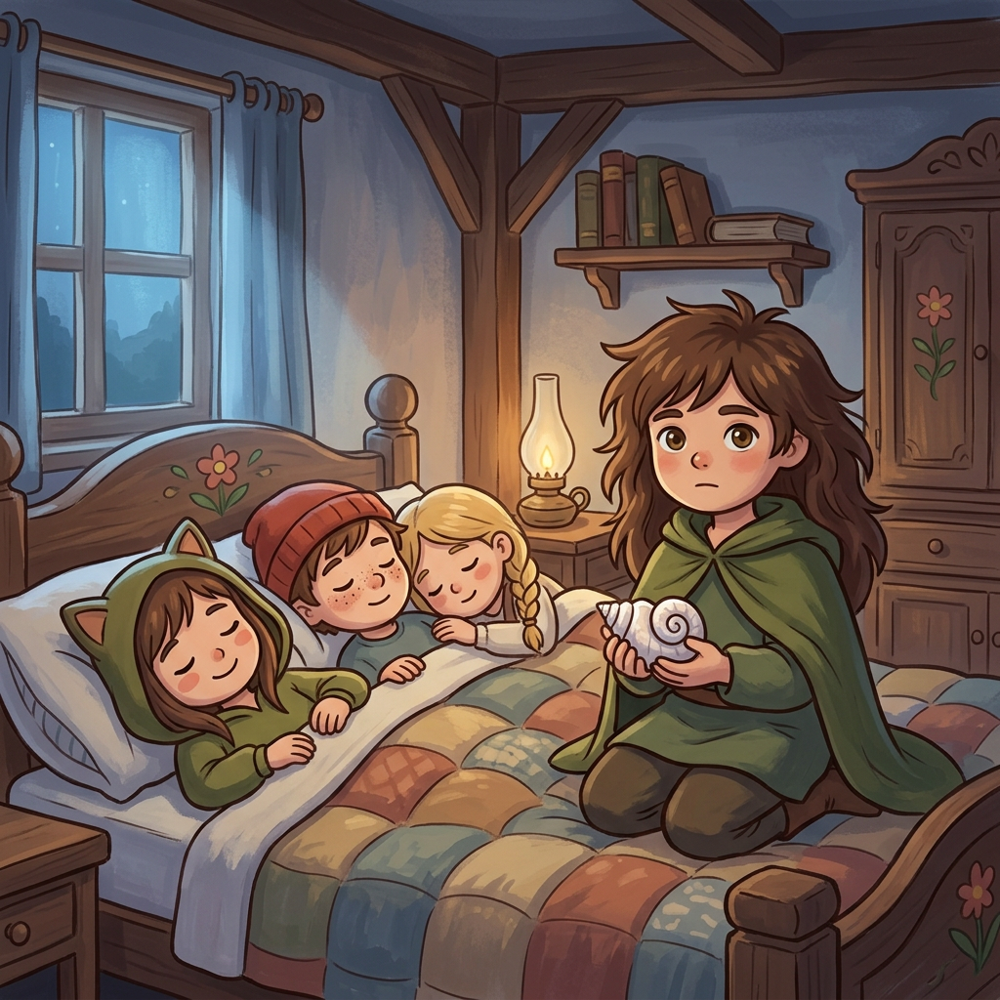

- Created: 2026-10-12T13:52:51+02:00
- Model: Nano Banana 2, 1K, 1:1
- References: Minena and Manjiva;style album

~~~~
Hand-painted storybook illustration for a cozy farming game, in the same world and colours as the reference pictures but a little more painterly: soft painterly shading with gentle brush texture and soft light gradients, warm earthy colours, clean dark-brown outlines that are thinner and softer than in a cartoon, friendly chunky-cute proportions. Full-bleed square picture filling the whole frame, no white border, no text, no letters, no labels. Reference image 1 is the character sheet of the sisters MINENA (8, wild brown hair, moss-green hooded cloak) and MANJIVA (6, brown hood with animal ears): keep them exactly as drawn there. Reference image 2 shows the colours and friendliness of the game's story pictures.

Scene: Cosy farmhouse bedroom late at night, view from the bed. Three grandchildren (Manjiva in her animal-ear hood, a freckled boy in a red cap, a blonde girl with braids) are asleep in a heap at the foot of the bed under a shared blanket. Only Minena is awake, kneeling close to the viewer with big serious hazel eyes, holding a small white spiral seashell in both hands. The lamp is almost out; cool moonlight comes through the window. A hushed, important moment. Do not show the person in the bed.
~~~~

## 2026-10-12_135257_hay-barn-dusk-golden-lights_f4398d93.png

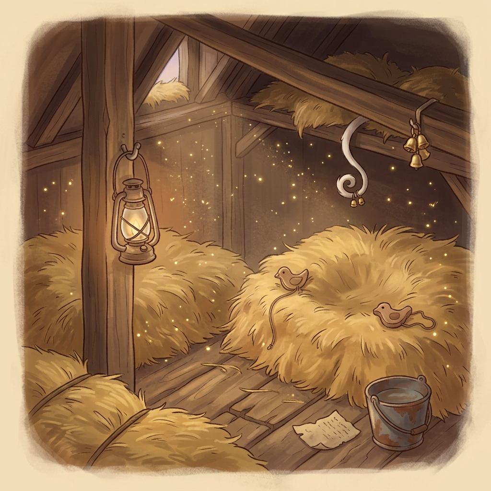

- Created: 2026-10-12T13:52:57+02:00
- Model: Nano Banana 2, 1K, 1:1
- References: farm early

~~~~
Hand-painted storybook illustration for a cozy farming game, in the same world and colours as the reference pictures but a little more painterly: soft painterly shading with gentle brush texture and soft light gradients, warm earthy colours with olive greens and warm browns, clean dark-brown outlines that are thinner and softer than in a cartoon, friendly chunky-cute proportions. Full-bleed square picture filling the whole frame, no white border, no text, no letters, no labels. Reference image 1 shows the game's own painted look and its forest. Soft dreamy memory illustration with gently faded edges, in warm gold and sepia tones.

Scene: Memory of the inside of an old hay barn at dusk: golden dust and tiny dancing golden lights float above the hay like fireflies, and an old oil lantern hangs on a hook. In the hay lies a small round dent where a child has been sitting and playing, and a little wooden toy. High on a roof beam, only a thin white tail with a spiral curl at its tip hangs down and a few tiny brass bells glint; no creature is visible. No people, no flames. Magical and a little sad.
~~~~

## 2026-10-12_135302_child-window-night-shell-feather_31a525d7.png

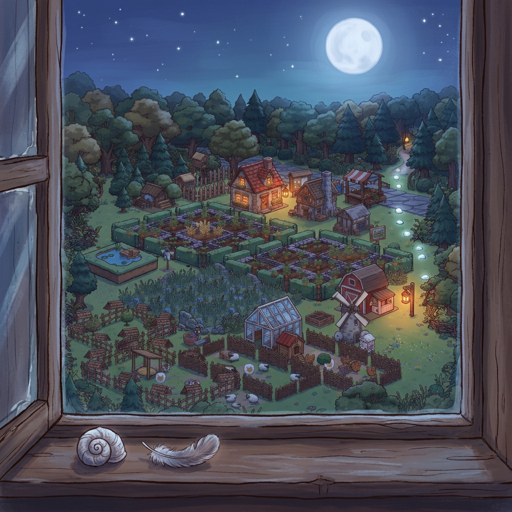

- Created: 2026-10-12T13:53:02+02:00
- Model: Nano Banana 2, 1K, 1:1
- References: farm late

~~~~
Hand-painted storybook illustration for a cozy farming game, in the same world and colours as the reference pictures but a little more painterly: soft painterly shading with gentle brush texture and soft light gradients, warm earthy colours, clean dark-brown outlines that are thinner and softer than in a cartoon, friendly chunky-cute proportions. Full-bleed square picture filling the whole frame, no white border, no text, no letters, no labels. Night scene with cool moonlight and warm lamplight, soft and friendly, never scary. Reference image 1 shows the game's own painted look and its forest.

Scene: Night view from a child's bedroom window, looking out over a moonlit farm and a dark forest edge with faintly glowing white stones. On the windowsill in the foreground lie a small white spiral seashell and a single feather. Far off among the trees, a tiny warm point of light and the faint glint of a small brass bell. No people. Quiet, hopeful, magical.
~~~~

## 2026-10-12_135308_burnt-farm-seven-years-morning_4ef5f3a2.png

- Created: 2026-10-12T13:53:08+02:00
- Model: Nano Banana 2, 1K, 1:1
- References: farm early

~~~~
Hand-painted storybook illustration for a cozy farming game, in the same world and colours as the reference pictures but a little more painterly: soft painterly shading with gentle brush texture and soft light gradients, warm earthy colours with olive greens and warm browns, clean dark-brown outlines that are thinner and softer than in a cartoon, friendly chunky-cute proportions. Full-bleed square picture filling the whole frame, no white border, no text, no letters, no labels. Reference image 1 shows the game's own painted look, its burnt ruins and the forest all around.

Scene: A burnt-down farm seven years later under a grey-gold morning sky: blackened timber frames of a barn and a house softened by weeds and wildflowers, a collapsed stone chimney, ash-grey ground, the forest edge behind the ruins. In the middle distance, a small backlit silhouette of a farmer in a wide straw hat with a bundle on their back, seen from behind, light coming from the front so no features, hair or skin are visible. Melancholy but hopeful, not scary.
~~~~

## 2026-10-12_135312_tent-burnt-ruins-sunset_2fad74be.png

- Created: 2026-10-12T13:53:12+02:00
- Model: Nano Banana 2, 1K, 1:1
- References: farm early

~~~~
Hand-painted storybook illustration for a cozy farming game, in the same world and colours as the reference pictures but a little more painterly: soft painterly shading with gentle brush texture and soft light gradients, warm earthy colours with olive greens and warm browns, clean dark-brown outlines that are thinner and softer than in a cartoon, friendly chunky-cute proportions. Full-bleed square picture filling the whole frame, no white border, no text, no letters, no labels. Reference image 1 shows the game's own painted look, its tent, campfire, crate with a green book, ruins and forest.

Scene: A small white canvas tent pitched beside the burnt ruins at sunset, with a dented tin bucket, a tin pot and an old leather book on a blanket in front of it. Warm light from behind the tent. A path leads off toward a distant village with a few chimneys. No people. Lonely but cosy.
~~~~

## 2026-10-12_135319_farm-book-rabbit-sketch-clover_ba713278.png

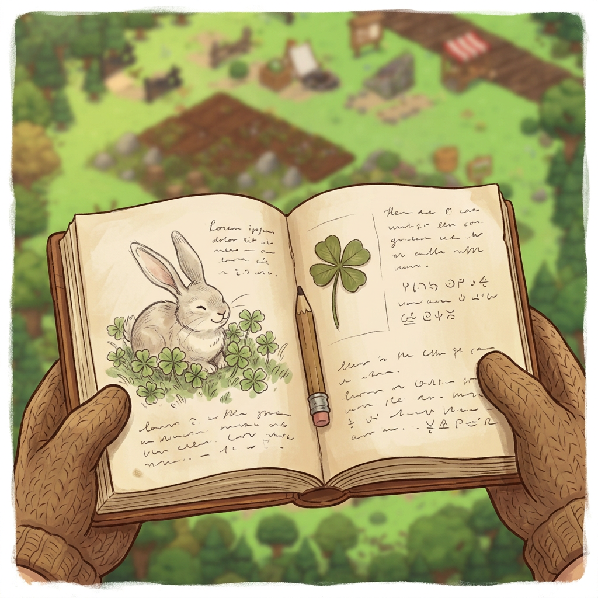

- Created: 2026-10-12T13:53:19+02:00
- Model: Nano Banana 2, 1K, 1:1
- References: farm early

~~~~
Hand-painted storybook illustration for a cozy farming game, in the same world and colours as the reference pictures but a little more painterly: soft painterly shading with gentle brush texture and soft light gradients, warm earthy colours with olive greens and warm browns, clean dark-brown outlines that are thinner and softer than in a cartoon, friendly chunky-cute proportions, warm happy mood. Full-bleed square picture filling the whole frame, no white border, no text, no letters, no labels. Reference image 1 shows the game's own painted look and the ground of its farm.

Scene: First-person view: two hands in brown woven fibre work mitts (no bare skin visible) hold open an old leather farm book. On the page are a pencil sketch of a long-eared rabbit among clover and some faded handwriting (only unreadable squiggles, no real letters). A pressed clover leaf lies in the fold. Warm daylight, the burnt farm softly out of focus behind. Do not show the farmer's face or body.
~~~~

## 2026-10-12_135322_scorched-ledger-page-workshop_18c0a8fb.png

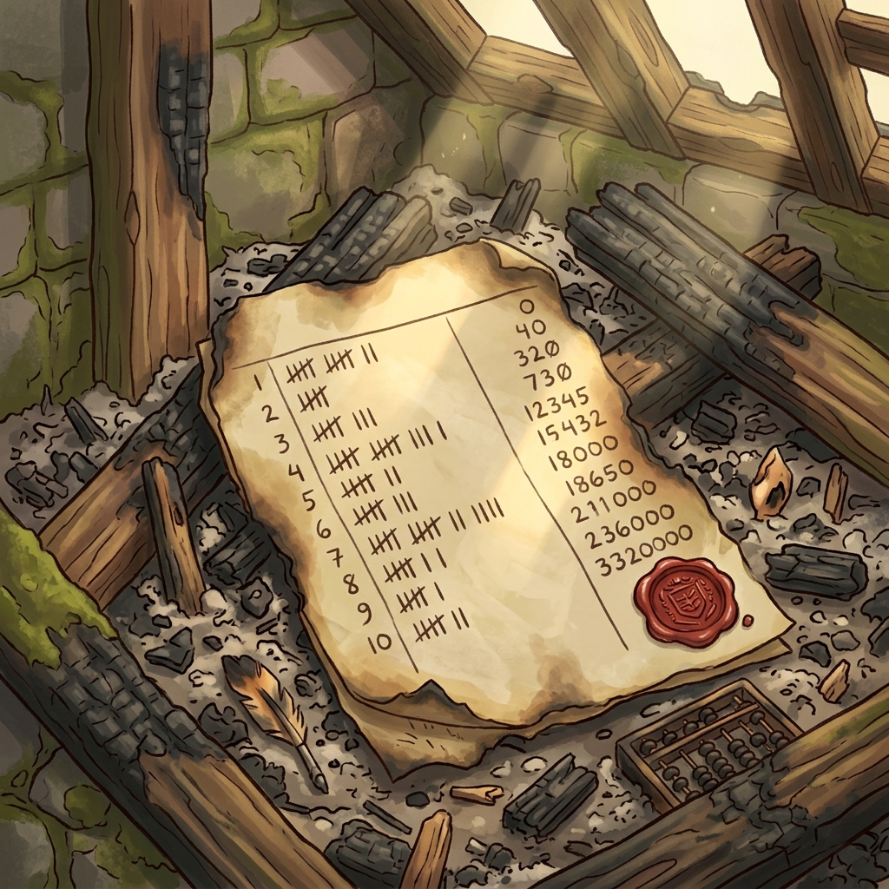

- Created: 2026-10-12T13:53:22+02:00
- Model: Nano Banana 2, 1K, 1:1
- References: farm early

~~~~
Hand-painted storybook illustration for a cozy farming game, in the same world and colours as the reference pictures but a little more painterly: soft painterly shading with gentle brush texture and soft light gradients, warm earthy colours with olive greens and warm browns, clean dark-brown outlines that are thinner and softer than in a cartoon, friendly chunky-cute proportions. Full-bleed square picture filling the whole frame, no white border, no text, no letters, no labels. Reference image 1 shows the game's own painted look and its burnt ruins and ruined walls.

Scene: Close-up of a scorched, half-burnt ledger page lying among ash and charred planks inside a collapsed workshop. The page shows columns of numbers growing bigger and bigger (only simple scribbled tally marks and unreadable numerals, no real words) with a red wax seal at the corner. Sunlight falls through the broken roof beams onto it. No people.
~~~~

## 2026-10-12_135328_merchant-campfire-porridge_ce3f861c.png

- Created: 2026-10-12T13:53:28+02:00
- Model: Nano Banana 2, 1K, 1:1
- References: farm early

~~~~
Hand-painted storybook illustration for a cozy farming game, in the same world and colours as the reference pictures but a little more painterly: soft painterly shading with gentle brush texture and soft light gradients, warm earthy colours with olive greens and warm browns, clean dark-brown outlines that are thinner and softer than in a cartoon, friendly chunky-cute proportions, warm happy mood. Full-bleed square picture filling the whole frame, no white border, no text, no letters, no labels. Reference image 1 shows the game's own painted look: its tent, campfire and muddy track.

Scene: Through the farmer's own eyes: a jolly, round travelling merchant with a big moustache and a patched cloak sits on a log by a small campfire, holding a steaming wooden bowl of porridge in both hands and looking at the viewer with surprised recognition. His small cart with a pony stands behind him on a muddy track. Evening light. The merchant is the only person in the picture; do not show the farmer.
~~~~

## 2026-10-12_135332_village-notice-board-hazelwood_e3f0d4e2.png

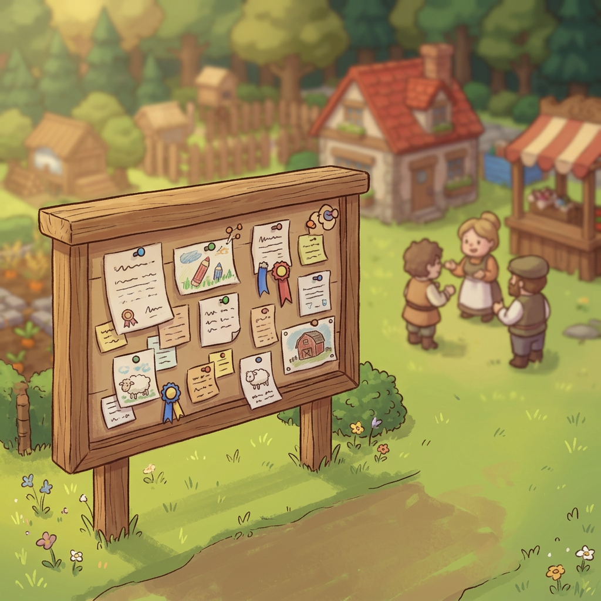

- Created: 2026-10-12T13:53:32+02:00
- Model: Nano Banana 2, 1K, 1:1
- References: farm late

~~~~
Hand-painted storybook illustration for a cozy farming game, in the same world and colours as the reference pictures but a little more painterly: soft painterly shading with gentle brush texture and soft light gradients, warm earthy colours with olive greens and warm browns, clean dark-brown outlines that are thinner and softer than in a cartoon, friendly chunky-cute proportions. Full-bleed square picture filling the whole frame, no white border, no text, no letters, no labels. Reference image 1 shows the game's own painted look and its wooden notice board.

Scene: A wooden village notice board at the edge of Hazelwood, covered in pinned paper notes, little drawings and ribbons (no readable text). Villagers chat in the blurred background by the village houses. The scene is seen from slightly further away than feels comfortable, as if the viewer is too shy to come closer. Soft morning light.
~~~~

## 2026-10-12_135340_tent-night-bell-bunny_950566af.png

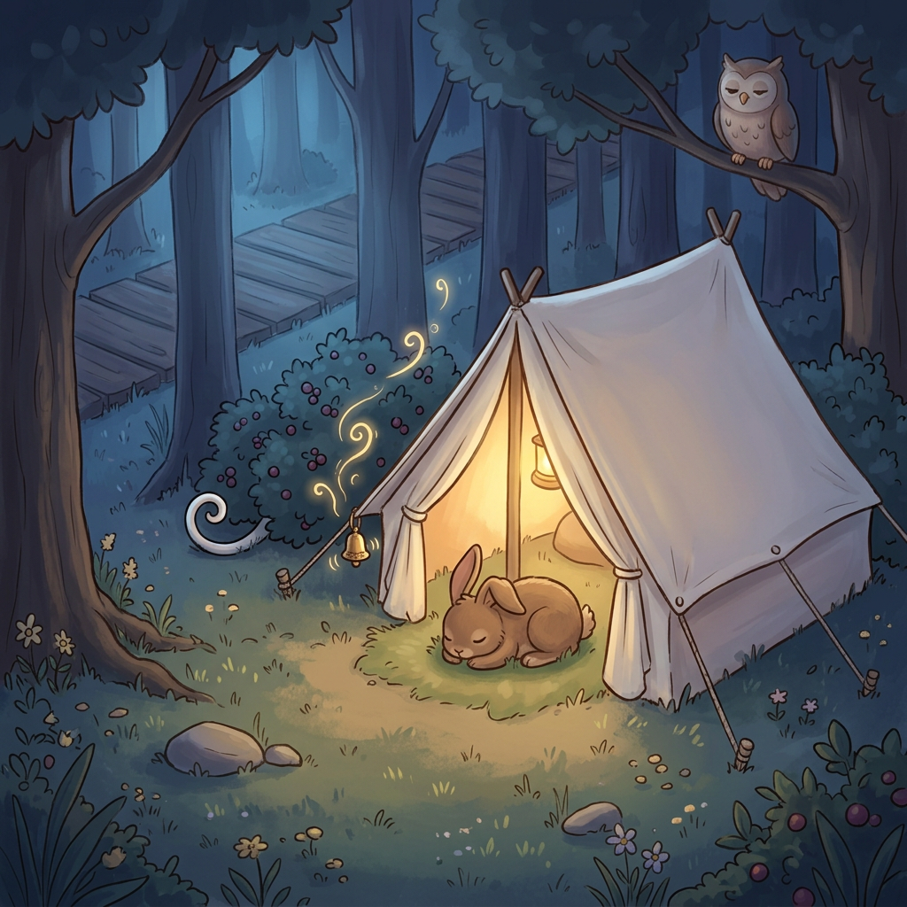

- Created: 2026-10-12T13:53:40+02:00
- Model: Nano Banana 2, 1K, 1:1
- References: animals;farm early

~~~~
Hand-painted storybook illustration for a cozy farming game, in the same world and colours as the reference pictures but a little more painterly: soft painterly shading with gentle brush texture and soft light gradients, warm earthy colours, clean dark-brown outlines that are thinner and softer than in a cartoon, friendly chunky-cute proportions. Full-bleed square picture filling the whole frame, no white border, no text, no letters, no labels. Night scene lit by a warm lamp and cool moonlight, soft and friendly, never scary. Reference image 1 is the game's animal sheet: the small brown rabbit in its bottom-right corner is the BUNNY (paint her like that, with one flopped ear). Reference image 2 shows the game's own painted look: its tent and forest.

Scene: The small white canvas tent at night seen from the outside, glowing softly from a lamp inside. The bunny sleeps curled up at the entrance. On a guy rope hangs a tiny brass bell no bigger than a fingernail, still swinging, with small musical swirls drifting up. In the deep shadow beside a bush, only the tip of a thin white tail with a spiral curl is visible; nothing else. No people.
~~~~

## 2026-10-12_135352_letter-autumn-frost-farm_cb1c0390.png

- Created: 2026-10-12T13:53:52+02:00
- Model: Nano Banana 2, 1K, 1:1
- References: farm early

~~~~
Hand-painted storybook illustration for a cozy farming game, in the same world and colours as the reference picture but a little more painterly: soft painterly shading with gentle brush texture and soft light gradients, warm earthy colours with olive greens and warm browns, clean dark-brown outlines that are thinner and softer than in a cartoon, friendly chunky-cute proportions. Full-bleed square picture filling the whole frame, no white border, no text, no letters, no labels. Reference image 1 shows the game's own painted look and farm.

Scene: First-person view: two hands in brown woven fibre work mitts (no bare skin visible) hold an unfolded letter with neat handwriting (only unreadable squiggles, no real letters). In the background autumn leaves fall over the half-cleared farm, and the first frost glitters on the grass. A slight sense of urgency. Do not show the farmer's face or body.
~~~~

## 2026-10-12_135401_log-cottage-walls-crooked_22f1e2eb.png

- Created: 2026-10-12T13:54:01+02:00
- Model: Nano Banana 2, 1K, 1:1
- References: animals;farm early

~~~~
Hand-painted storybook illustration for a cozy farming game, in the same world and colours as the reference pictures but a little more painterly: soft painterly shading with gentle brush texture and soft light gradients, warm earthy colours with olive greens and warm browns, clean dark-brown outlines that are thinner and softer than in a cartoon, friendly chunky-cute proportions, warm happy mood. Full-bleed square picture filling the whole frame, no white border, no text, no letters, no labels. Reference image 1 is the game's animal sheet: the small brown rabbit in its bottom-right corner is the BUNNY (paint her like that, with one flopped ear). Reference image 2 shows the game's own painted look and farm.

Scene: Small log cottage walls standing alone on the farm, clearly built by one inexperienced person: the logs a bit crooked, one corner sagging, a gap stuffed with moss, no roof yet. Sunny day, the forest behind. The bunny sits on a log in front looking doubtful. Charming and funny, a proud first effort. No people.
~~~~

## 2026-10-12_135408_greenstem-gate-herbs-stone-soup_4224d19c.png

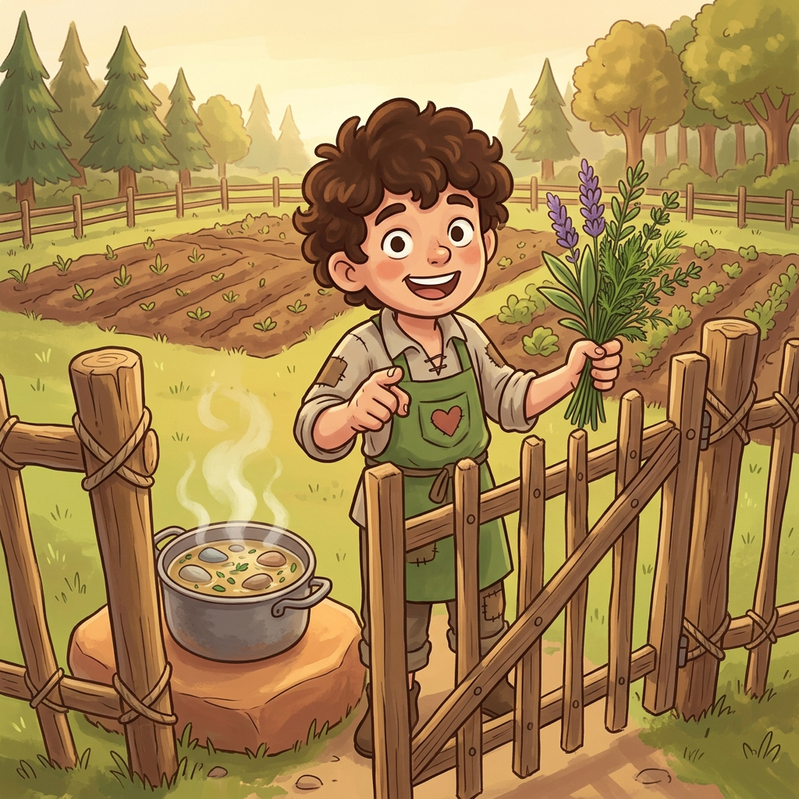

- Created: 2026-10-12T13:54:08+02:00
- Model: Nano Banana 2, 1K, 1:1
- References: village cast;farm early

~~~~
Hand-painted storybook illustration for a cozy farming game, in the same world and colours as the reference pictures but a little more painterly: soft painterly shading with gentle brush texture and soft light gradients, warm earthy colours with olive greens and warm browns, clean dark-brown outlines that are thinner and softer than in a cartoon, friendly chunky-cute proportions, warm happy mood. Full-bleed square picture filling the whole frame, no white border, no text, no letters, no labels. Reference image 1 is the character sheet of the village characters: YOUNG GREENSTEM is the curly-haired boy in the green apron holding herbs (top middle): keep him exactly as drawn there. Reference image 2 shows the game's own painted look and its stick fences and farm.

Scene: Through the farmer's own eyes: Greenstem leans over a rickety stick gate, grinning, pointing at the viewer with a bunch of herbs as if he has just recognised someone. A pot of stone soup steams on a flat stone nearby. Bright day, friendly. Greenstem is the only person in the picture; do not show the farmer.
~~~~

## 2026-10-12_135412_burnt-barn-scorch-marks-corner_f695d392.png

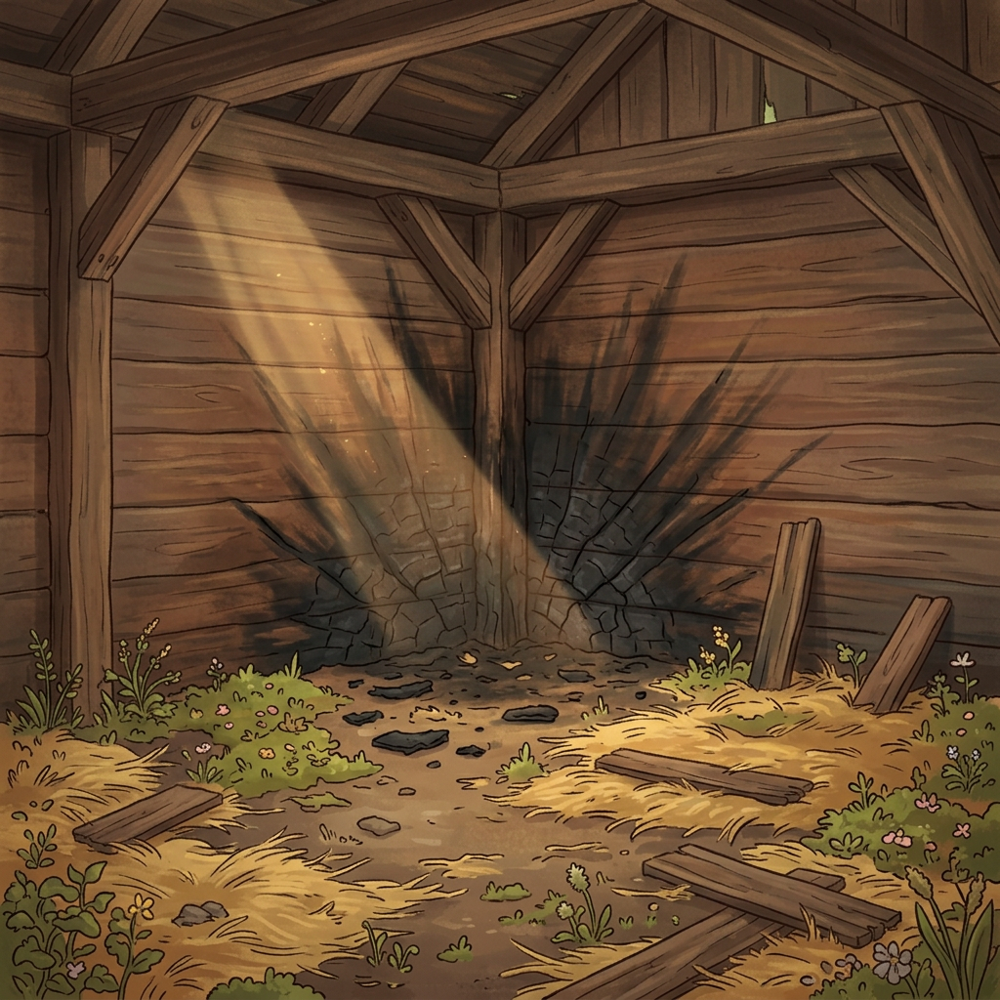

- Created: 2026-10-12T13:54:12+02:00
- Model: Nano Banana 2, 1K, 1:1
- References: farm early

~~~~
Hand-painted storybook illustration for a cozy farming game, in the same world and colours as the reference picture but a little more painterly: soft painterly shading with gentle brush texture and soft light gradients, warm earthy colours, clean dark-brown outlines that are thinner and softer than in a cartoon, friendly chunky-cute proportions. Full-bleed square picture filling the whole frame, no white border, no text, no letters, no labels. Reference image 1 shows the game's own painted look and its burnt ruins.

Scene: Inside the ruins of a burnt barn: an old timber wall where the scorch marks clearly start low down in one corner and spread upward like a dark fan, while the roof beams above are hardly burnt at all. A ray of light falls exactly onto the low corner. Old hay remains on the ground, and weeds poke through. Serious, investigative mood, not frightening. No people.
~~~~

## 2026-10-12_135417_compost-corner-empty-note_9167c655.png

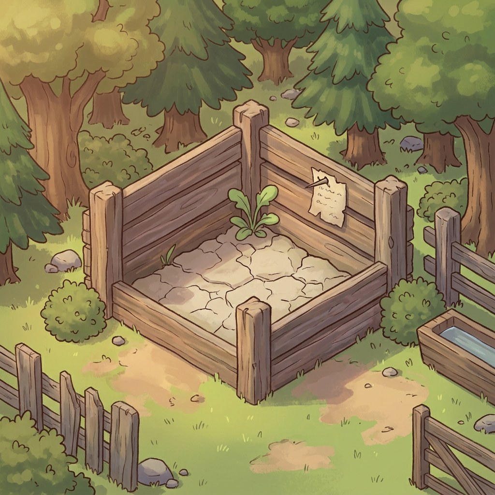

- Created: 2026-10-12T13:54:17+02:00
- Model: Nano Banana 2, 1K, 1:1
- References: farm early

~~~~
Hand-painted storybook illustration for a cozy farming game, in the same world and colours as the reference picture but a little more painterly: soft painterly shading with gentle brush texture and soft light gradients, warm earthy colours, clean dark-brown outlines that are thinner and softer than in a cartoon, friendly chunky-cute proportions. Full-bleed square picture filling the whole frame, no white border, no text, no letters, no labels. Reference image 1 shows the game's own painted look and its farm.

Scene: An old wooden compost corner, completely empty, clean and dry, with cracked pale earth. A scrap of paper with faded handwriting (only unreadable squiggles) is pinned to a post with a thorn. A single green weed grows in the corner. Soft, thoughtful afternoon light. No people.
~~~~

## 2026-10-12_135422_log-cottage-thatch-first-snowflakes_67802851.png

- Created: 2026-10-12T13:54:22+02:00
- Model: Nano Banana 2, 1K, 1:1
- References: farm late

~~~~
Hand-painted storybook illustration for a cozy farming game, in the same world and colours as the reference picture but a little more painterly: soft painterly shading with gentle brush texture and soft light gradients, warm earthy colours with olive greens and warm browns, clean dark-brown outlines that are thinner and softer than in a cartoon, friendly chunky-cute proportions. Full-bleed square picture filling the whole frame, no white border, no text, no letters, no labels. Reference image 1 shows the game's own painted look and its farm, forest around it.

Scene: The finished small log cottage with a fresh golden thatched roof, smoke rising from the chimney, a warm glowing window and a wreath of dried wheat on the door, standing in the farm clearing with the forest behind. The first snowflakes fall over the farm at dusk. Cosy and triumphant. No people.
~~~~

## 2026-10-12_135430_pond-spring-tortoise_8937fc2a.png

- Created: 2026-10-12T13:54:30+02:00
- Model: Nano Banana 2, 1K, 1:1
- References: animals;farm late

~~~~
Hand-painted storybook illustration for a cozy farming game, in the same world and colours as the reference pictures but a little more painterly: soft painterly shading with gentle brush texture and soft light gradients, warm earthy colours with olive greens and warm browns, clean dark-brown outlines that are thinner and softer than in a cartoon, friendly chunky-cute proportions, warm happy mood. Full-bleed square picture filling the whole frame, no white border, no text, no letters, no labels. Reference image 1 is the game's animal sheet: the tortoise with the patterned shell (middle left) is the TORTOISE; paint her like that, with a little moss on her shell and ancient calm eyes. Reference image 2 shows the game's own painted look and its pond.

Scene: A freshly dug pond, still half empty, with water slowly bubbling up from a spring in the middle. The ancient tortoise sits calmly at the edge exactly above the spring, eyes half closed. Reflections on the water, dragonflies, reeds, forest in the background. Patient and peaceful. No people.
~~~~

## 2026-10-12_135435_barn-frame-lantern-hook_5254e9c4.png

- Created: 2026-10-12T13:54:35+02:00
- Model: Nano Banana 2, 1K, 1:1
- References: farm late

~~~~
Hand-painted storybook illustration for a cozy farming game, in the same world and colours as the reference picture but a little more painterly: soft painterly shading with gentle brush texture and soft light gradients, warm earthy colours with olive greens and warm browns, clean dark-brown outlines that are thinner and softer than in a cartoon, friendly chunky-cute proportions. Full-bleed square picture filling the whole frame, no white border, no text, no letters, no labels. Reference image 1 shows the game's own painted look and its barn.

Scene: Close-up of a new barn frame made of fresh pale timber; in its middle, hanging from a beam, an old blackened iron lantern hook kept from the ruin, sharply in focus. Soft evening light, the farm out of focus behind. A question hangs in the air. No people.
~~~~

## 2026-10-12_135449_miller-bridge-muddy-stream_74773819.png

- Created: 2026-10-12T13:54:49+02:00
- Model: Nano Banana 2, 1K, 1:1
- References: village cast;farm late

~~~~
Hand-painted storybook illustration for a cozy farming game, in the same world and colours as the reference pictures but a little more painterly: soft painterly shading with gentle brush texture and soft light gradients, warm earthy colours with olive greens and warm browns, clean dark-brown outlines that are thinner and softer than in a cartoon, friendly chunky-cute proportions. Full-bleed square picture filling the whole frame, no white border, no text, no letters, no labels. Reference image 1 is the character sheet of the village characters: THE MILLER is the broad floury man with bushy eyebrows and folded arms (bottom middle): keep him exactly as drawn there. Reference image 2 shows the game's own painted look and its farm.

Scene: Through the farmer's own eyes: the miller stands on an old stone bridge over a low, muddy stream, arms folded, frowning at the viewer. Behind him his mill wheel barely turns in the shallow water. Overcast day. The miller is the only person in the picture; do not show the farmer.
~~~~

## 2026-10-12_135455_smithy-odinson-bo-horseshoe_e0ef10b5.png

- Created: 2026-10-12T13:54:55+02:00
- Model: Nano Banana 2, 1K, 1:1
- References: farm late

~~~~
Hand-painted storybook illustration for a cozy farming game, in the same world and colours as the reference picture but a little more painterly: soft painterly shading with gentle brush texture and soft light gradients, warm earthy colours with olive greens and warm browns, clean dark-brown outlines that are thinner and softer than in a cartoon, friendly chunky-cute proportions, warm happy mood. Full-bleed square picture filling the whole frame, no white border, no text, no letters, no labels. Reference image 1 shows the game's own painted look and its workshop with a stone chimney.

Scene: A new smithy with a stone chimney and a glowing forge. Old Odinson, a white-bearded smith with huge arms and a leather apron, nods approvingly at the viewer, and young Bo, an apprentice boy with a sooty face, holds up a glowing horseshoe with tongs. At the bottom edge, first-person hands in thick leather gloves hold a hammer (no bare skin). Sparks fly, warm orange light. Do not show the farmer's face or body.
~~~~

## 2026-10-12_135500_windmill-ruin-brass-bell_6f6b5072.png

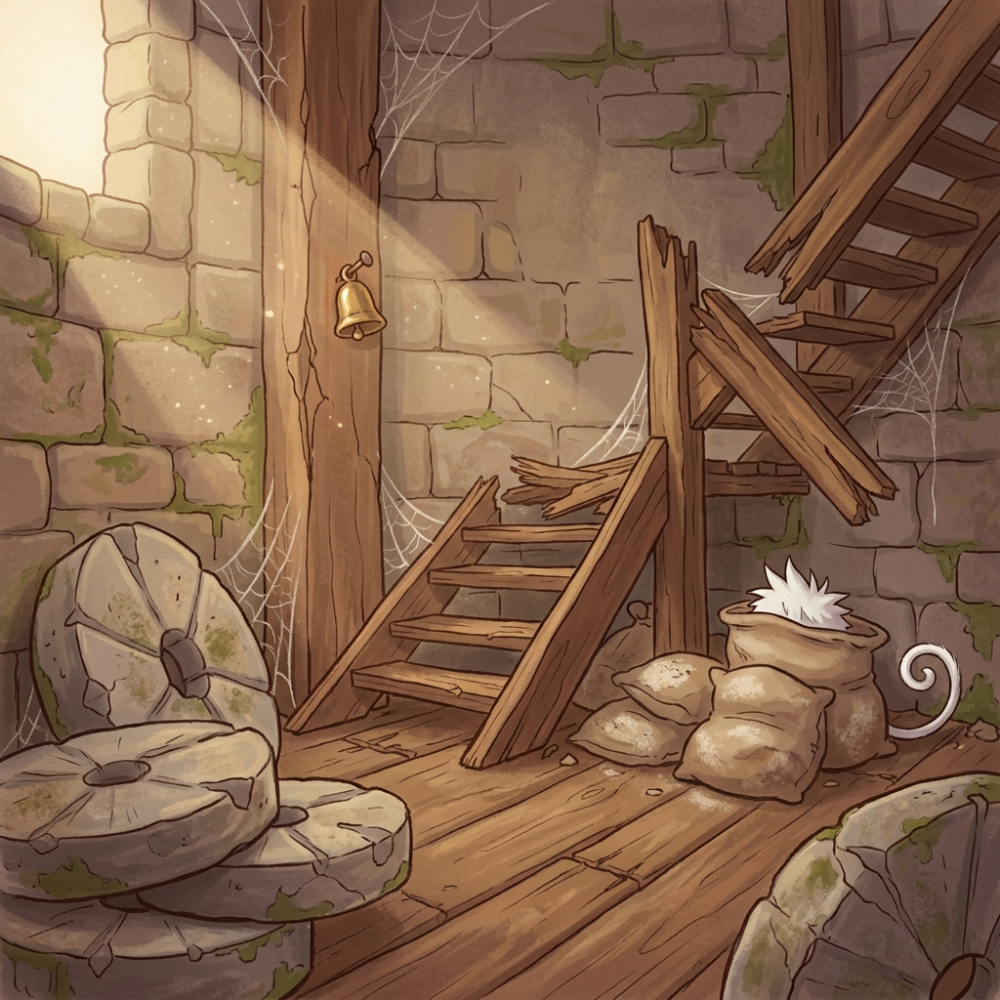

- Created: 2026-10-12T13:55:00+02:00
- Model: Nano Banana 2, 1K, 1:1
- References: farm early

~~~~
Hand-painted storybook illustration for a cozy farming game, in the same world and colours as the reference picture but a little more painterly: soft painterly shading with gentle brush texture and soft light gradients, warm earthy colours, clean dark-brown outlines that are thinner and softer than in a cartoon, friendly chunky-cute proportions. Full-bleed square picture filling the whole frame, no white border, no text, no letters, no labels. Reference image 1 shows the game's own painted look and its ruined stone and windmill.

Scene: Inside an old ruined windmill: dusty light beams, broken millstones, cobwebs, a collapsed wooden stair. On a rusty nail in a beam hangs a tiny brass bell, far too small for any cow, catching the light. Hidden detail, subtle: behind a sack of old flour a small tuft of spiky white hair sticks up and a thin white tail with a spiral curl at its tip peeks out at the side; no face and no body visible. No people.
~~~~

## 2026-10-12_135719_burnt-farm-dirt-road-view_4c83302b.png

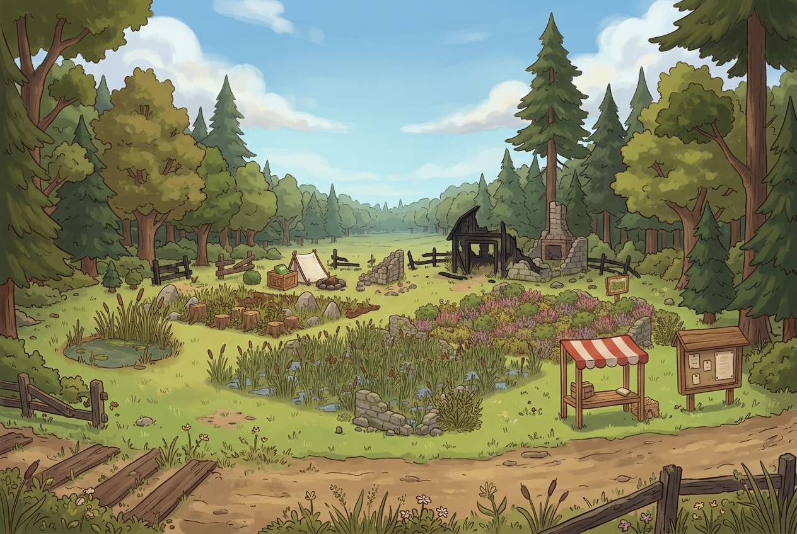

- Created: 2026-10-12T13:57:19+02:00
- Model: Nano Banana 2, 1K, 3:2
- References: farm early (layout only)

~~~~
Hand-painted storybook illustration for a cozy farming game: soft painterly shading with gentle brush texture and soft light gradients, warm earthy colours with olive greens and warm browns, clean dark-brown outlines that are thinner and softer than in a cartoon, friendly chunky-cute proportions, warm happy mood. Wide landscape picture, no white border, no text, no letters, no people, no interface.

IMPORTANT: reference image 1 only shows WHAT is on the farm and roughly how it is arranged. Do NOT copy its camera angle or its top-down isometric view. Paint the scene from EYE LEVEL, as a person standing at the edge of the clearing would see it, with a real horizon, perspective, and tall trees rising up into the sky.

Scene: Standing at the edge of a forest clearing on a dirt road, looking across a small burnt-down farm seven years after the fire. In the foreground the dirt road and tufts of grass. In the middle distance: the blackened, weed-grown ruins of a barn and a house with a collapsed stone chimney, ruined stone walls and burnt fences; a small white canvas tent with a campfire ring, a wooden crate with a green book and a woven basket; a dug field patch with weeds, rocks and old tree stumps; a marsh with reeds and puddles; a small round pond with reeds; an overgrown plot of pink and purple flowers; a wooden notice board and a little striped market stall beside the road. All of it lies in a large clearing completely surrounded by a tall, dense wall of oak, beech and dark pine forest on every side, with a blue sky and soft clouds above. Late morning light, calm and friendly, slightly melancholy but hopeful.
~~~~

## 2026-10-12_135726_burnt-farm-hill-view-framed_7f955b97.png

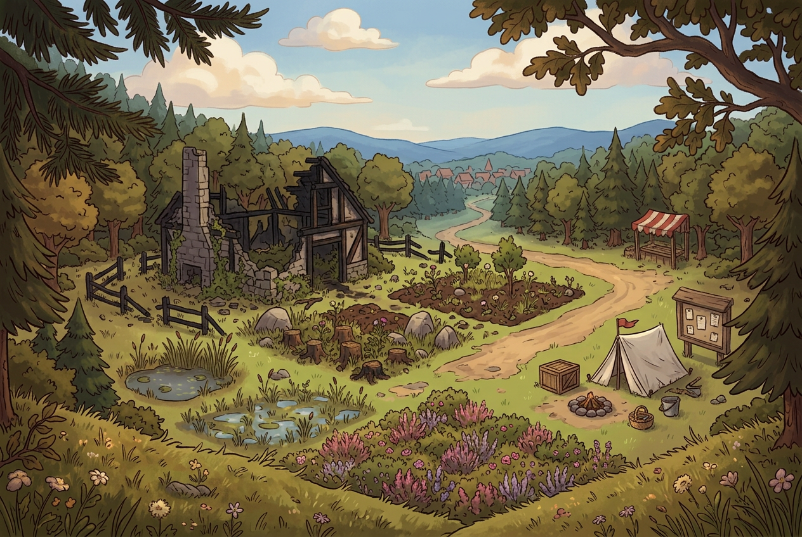

- Created: 2026-10-12T13:57:26+02:00
- Model: Nano Banana 2, 1K, 3:2
- References: farm early (layout only)

~~~~
Hand-painted storybook illustration for a cozy farming game: soft painterly shading with gentle brush texture and soft light gradients, warm earthy colours with olive greens and warm browns, clean dark-brown outlines that are thinner and softer than in a cartoon, friendly chunky-cute proportions, warm happy mood. Wide landscape picture, no white border, no text, no letters, no people, no interface.

IMPORTANT: reference image 1 only shows WHAT is on the farm and roughly how it is arranged. Do NOT copy its camera angle or its top-down isometric view. Paint the scene as seen from a NEARBY LOW HILL at the forest edge, looking down at a gentle angle over the clearing, with a real horizon, perspective and trees in the foreground framing the picture; it must not look like a map or an aerial view.

Scene: From a small grassy hill at the edge of the forest, looking down over a clearing with a burnt-down farm seven years after the fire. Dark pine and oak branches frame the top and sides of the picture. Below: the blackened, weed-grown ruins of a barn and a house with a collapsed stone chimney, ruined stone walls and burnt fences; a small white canvas tent with a campfire ring and a wooden crate; a dug field patch with weeds, rocks and old stumps; a marsh with reeds and puddles; a small round pond; an overgrown plot of pink and purple flowers; a dirt road winding away through the trees to the distant village roofs. The clearing is completely surrounded by dense forest on every side, rolling away to blue hills and sky. Late morning light, calm and friendly, slightly melancholy but hopeful.
~~~~

## 2026-10-12_135733_burnt-farm-clearing-eye-level_96984551.png

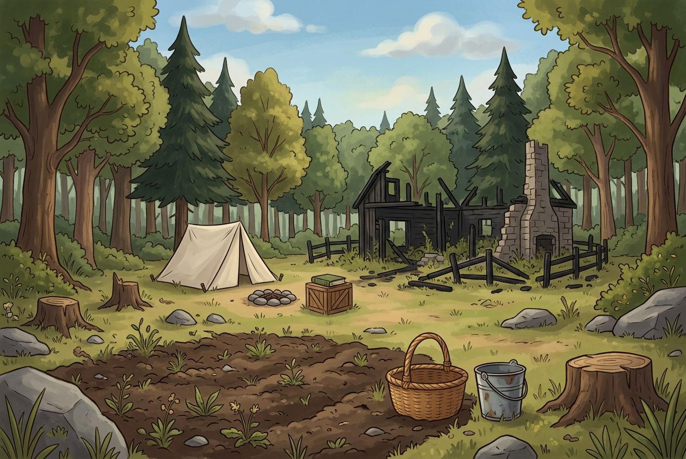

- Created: 2026-10-12T13:57:33+02:00
- Model: Nano Banana 2, 1K, 3:2
- References: style album

~~~~
Hand-painted storybook illustration for a cozy farming game, in the same world, colours and friendliness as reference image 1 but a little more painterly: soft painterly shading with gentle brush texture and soft light gradients, warm earthy colours with olive greens and warm browns, clean dark-brown outlines that are thinner and softer than in a cartoon, friendly chunky-cute proportions, warm happy mood. Wide landscape picture, no white border, no text, no letters, no people, no interface. Reference image 1 is used for the drawing style only.

Scene: Eye-level view from the middle of a small farm clearing, looking back toward the burnt ruins and the forest, seven years after a fire. In the foreground a patch of dug dark earth with weeds, a few grey rocks and old tree stumps, a woven basket and a dented tin bucket. In the middle distance a small white canvas tent with a campfire ring, a wooden crate with a green book, and the blackened, weed-grown ruins of a barn and house with a collapsed stone chimney and burnt wooden fences. Behind everything, a tall dense wall of oak, beech and dark pine forest rising on every side, with blue sky and soft clouds above. Late morning light, calm and friendly, slightly melancholy but hopeful.
~~~~

## 2026-10-12_135739_flourishing-farm-cobbled-road-view_327d29e3.png

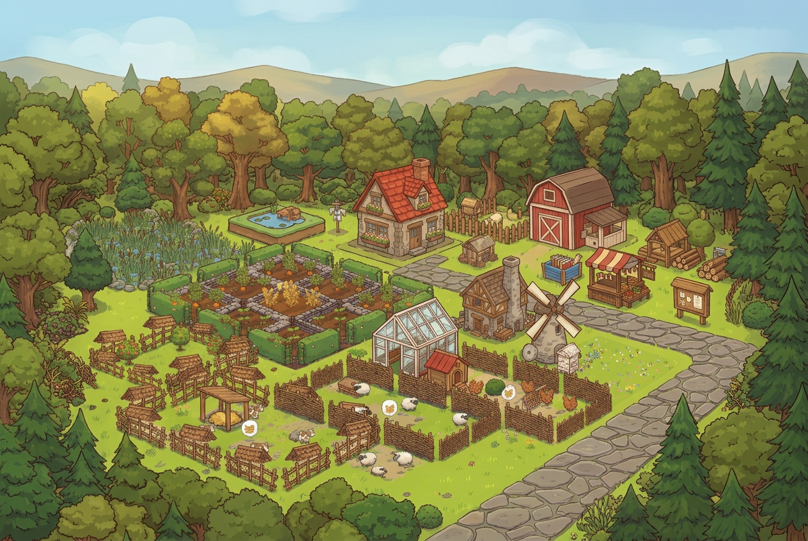

- Created: 2026-10-12T13:57:39+02:00
- Model: Nano Banana 2, 1K, 3:2
- References: farm late (layout only)

~~~~
Hand-painted storybook illustration for a cozy farming game: soft painterly shading with gentle brush texture and soft light gradients, warm earthy colours with olive greens and warm browns, clean dark-brown outlines that are thinner and softer than in a cartoon, friendly chunky-cute proportions, warm happy mood. Wide landscape picture, no white border, no text, no letters, no people, no interface.

IMPORTANT: reference image 1 only shows WHAT is on the farm and roughly how it is arranged. Do NOT copy its camera angle or its top-down isometric view. Paint the scene from EYE LEVEL, as a person standing at the edge of the clearing would see it, with a real horizon, perspective, and tall trees rising up into the sky.

Scene: Standing at the end of a cobbled road at the edge of a forest clearing, looking across a flourishing farm. In the middle distance: a red-roofed two-storey stone farmhouse with flower boxes; a timber workshop with a tall stone chimney; a lumber mill with logs; a big red barn with an attached stable; a stone windmill with four white sails; a long glass greenhouse with a little red-roofed hutch; neat stone-bordered vegetable beds with green hedges and orange carrots; a small pond with a little wooden duck house; a marsh with reeds; wooden pens with sheep, cows and chickens; a notice board and a striped market stall by the road. The farm lies in a large clearing completely surrounded by a tall, dense wall of oak, beech and dark pine forest on every side, with blue sky and soft clouds above. Warm afternoon light, calm and cheerful.
~~~~

## 2026-10-12_135746_flourishing-farm-hill-view-framed_bb42bd96.png

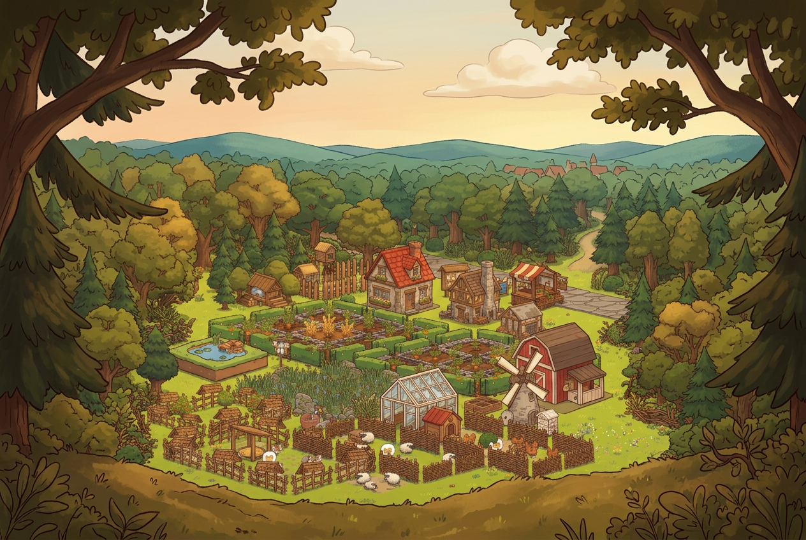

- Created: 2026-10-12T13:57:46+02:00
- Model: Nano Banana 2, 1K, 3:2
- References: farm late (layout only)

~~~~
Hand-painted storybook illustration for a cozy farming game: soft painterly shading with gentle brush texture and soft light gradients, warm earthy colours with olive greens and warm browns, clean dark-brown outlines that are thinner and softer than in a cartoon, friendly chunky-cute proportions, warm happy mood. Wide landscape picture, no white border, no text, no letters, no people, no interface.

IMPORTANT: reference image 1 only shows WHAT is on the farm and roughly how it is arranged. Do NOT copy its camera angle or its top-down isometric view. Paint the scene as seen from a NEARBY LOW HILL at the forest edge, looking down at a gentle angle over the clearing, with a real horizon, perspective and trees in the foreground framing the picture; it must not look like a map or an aerial view.

Scene: From a small grassy hill at the edge of the forest, looking down over a flourishing farm in a clearing. Dark pine and oak branches frame the top and sides of the picture. Below: a red-roofed stone farmhouse with flower boxes, a workshop with a tall stone chimney, a lumber mill, a big red barn with a stable, a stone windmill with white sails, a long glass greenhouse, neat stone-bordered vegetable beds with hedges, a pond with a little duck house, wooden pens with sheep, cows and chickens, and a cobbled road winding away through the trees to the distant village roofs. The clearing is completely surrounded by dense forest on every side, rolling away to blue hills and sky. Warm afternoon light, calm and cheerful.
~~~~

## 2026-10-12_135751_flourishing-farm-garden-path-view_03c20f09.png

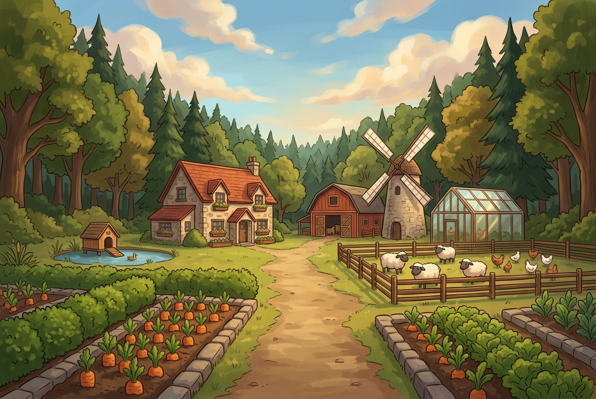

- Created: 2026-10-12T13:57:51+02:00
- Model: Nano Banana 2, 1K, 3:2
- References: style album

~~~~
Hand-painted storybook illustration for a cozy farming game, in the same world, colours and friendliness as reference image 1 but a little more painterly: soft painterly shading with gentle brush texture and soft light gradients, warm earthy colours with olive greens and warm browns, clean dark-brown outlines that are thinner and softer than in a cartoon, friendly chunky-cute proportions, warm happy mood. Wide landscape picture, no white border, no text, no letters, no people, no interface. Reference image 1 is used for the drawing style only.

Scene: Eye-level view from inside a flourishing farm, standing on a dirt path between neat stone-bordered vegetable beds with green hedges and orange carrots in the foreground, looking toward a red-roofed two-storey stone farmhouse with flower boxes, a red barn with a stable, a stone windmill with white sails and a glass greenhouse in the middle distance, with a wooden pen of sheep and chickens at the side and a small pond with a duck house. Behind everything, a tall dense wall of oak, beech and dark pine forest rising on every side, with blue sky and soft clouds above. Warm afternoon light, calm and cheerful.
~~~~

## 2026-10-12_140244_burnt-farm-morning-eye-level_377b17f7.png

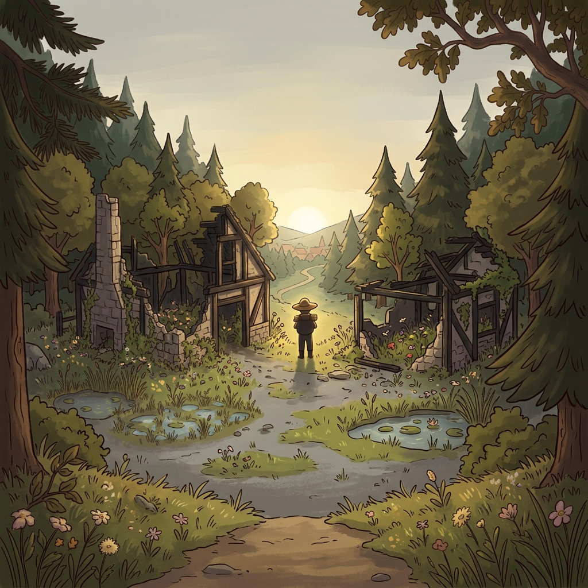

- Created: 2026-10-12T14:02:44+02:00
- Model: Nano Banana 2, 1K, 1:1
- References: farm land

~~~~
Hand-painted storybook illustration for a cozy farming game, in the same world and colours as the reference pictures but a little more painterly: soft painterly shading with gentle brush texture and soft light gradients, warm earthy colours with olive greens and warm browns, clean dark-brown outlines that are thinner and softer than in a cartoon, friendly chunky-cute proportions, warm happy mood. Full-bleed square picture filling the whole frame, no white border, no text, no letters, no labels. Reference image 1 shows the farm valley of the game as a painted picture seen from eye level and a low hill: the burnt timber ruin with its tall stone chimney, the dirt road winding off to the village, the forest on all sides. Paint this same place, with the same ruins, trees and colours, but from a new eye-level camera position. Never isometric, never top-down, never a high bird's-eye view.

Scene: A burnt-down farm seven years later under a grey-gold morning sky, seen at eye level from the dirt road at the forest edge, looking across the clearing at the ruins: blackened timber frames of a barn and a house softened by weeds and wildflowers, the collapsed stone chimney, ash-grey ground with the first green creeping in, tall dark forest behind the ruins. In the middle distance, a small backlit silhouette of a farmer in a wide straw hat with a bundle on their back, seen from behind, light coming from the front so no features, hair or skin are visible. Melancholy but hopeful, not scary.
~~~~

## 2026-10-12_140250_tent-ruins-sunset-eye-level_e4550547.png

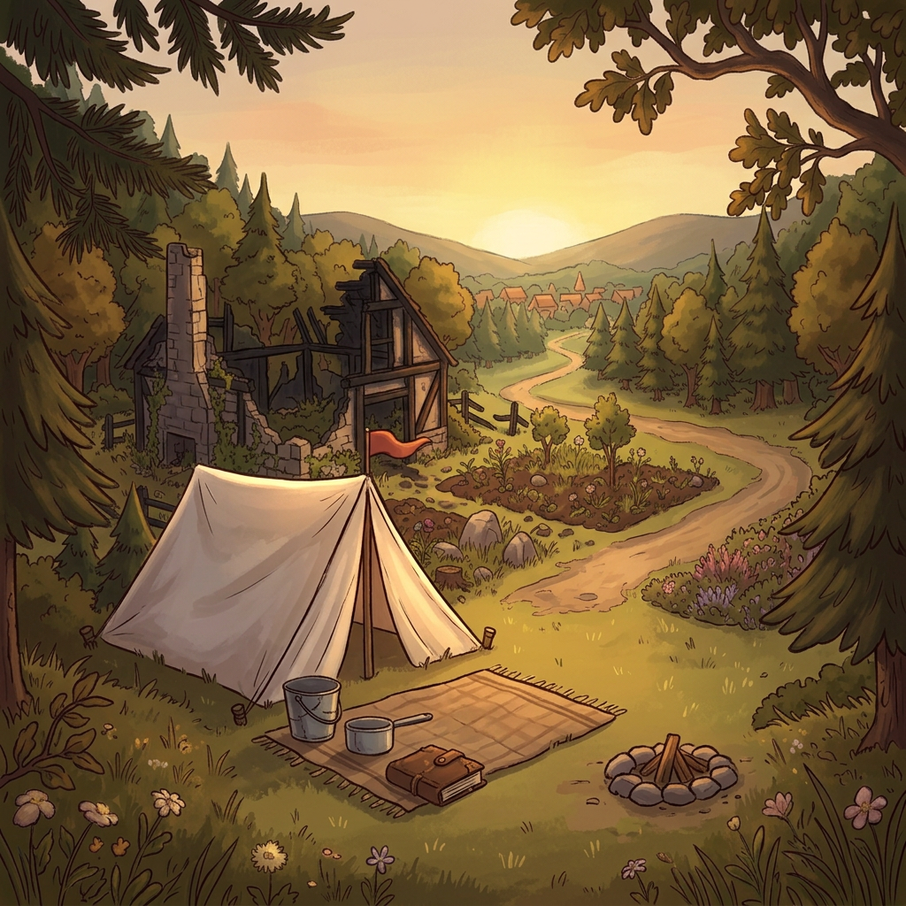

- Created: 2026-10-12T14:02:50+02:00
- Model: Nano Banana 2, 1K, 1:1
- References: farm land

~~~~
Hand-painted storybook illustration for a cozy farming game, in the same world and colours as the reference pictures but a little more painterly: soft painterly shading with gentle brush texture and soft light gradients, warm earthy colours with olive greens and warm browns, clean dark-brown outlines that are thinner and softer than in a cartoon, friendly chunky-cute proportions, warm happy mood. Full-bleed square picture filling the whole frame, no white border, no text, no letters, no labels. Reference image 1 shows the farm valley of the game as a painted picture seen from eye level and a low hill: the white canvas tent with a small red flag, the stone-ringed campfire, the wooden crate, the basket and bucket, the burnt ruin with its chimney, the dirt road to the village, the forest on all sides. Paint this same place and the same tent, with the same colours, but from a new eye-level camera position. Never isometric, never top-down, never a high bird's-eye view.

Scene: A small white canvas tent pitched beside the burnt ruins at sunset, seen at eye level from a few steps away. In front of the tent on a blanket: a dented tin bucket, a tin pot and an old leather book. Warm golden light from behind the tent, long shadows. The dirt road leads off between the trees toward a distant village with a few chimneys. No people. Lonely but cosy.
~~~~

## 2026-10-12_140258_bunny-wheat-patch-eye-level_e81ca052.png

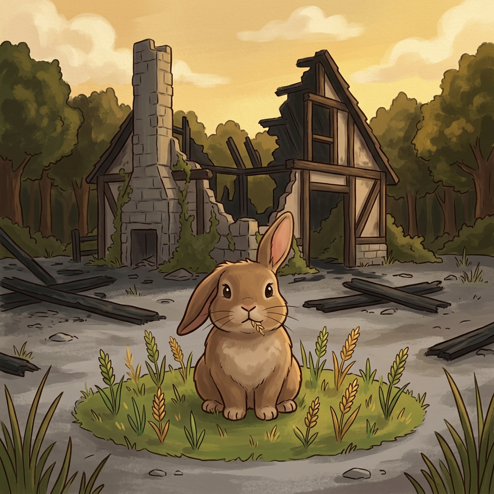

- Created: 2026-10-12T14:02:58+02:00
- Model: Nano Banana 2, 1K, 1:1
- References: animals;farm land

~~~~
Hand-painted storybook illustration for a cozy farming game, in the same world and colours as the reference pictures but a little more painterly: soft painterly shading with gentle brush texture and soft light gradients, warm earthy colours with olive greens and warm browns, clean dark-brown outlines that are thinner and softer than in a cartoon, friendly chunky-cute proportions, warm happy mood. Full-bleed square picture filling the whole frame, no white border, no text, no letters, no labels. Reference image 1 is the game's animal sheet: the small brown rabbit eating a leaf in its bottom-right corner is the BUNNY; paint her like that rabbit (same colours, same cute proportions) but with one ear that will not stand up and flops down. Reference image 2 shows the farm valley of the game as a painted picture: the burnt timber ruin with its tall stone chimney, ash and charred wood, the forest on all sides. Use it for the setting only and paint it from a new, very low eye-level camera position (the camera sits at bunny height). Never isometric, never top-down, never a high bird's-eye view.

Scene: A small round green patch in the burnt ground, now with young green and golden wheat sprouts. The bunny sits proudly in the middle of it, seen from the front at her own eye level, looking straight at the viewer with a 'took you long enough' expression, a single nibbled grain stuck to her whiskers. Behind her, softly painted, the ash-grey ground, charred planks, the ruined stone chimney and the dark forest edge. Golden evening light, warm and triumphant. No people.
~~~~

## 2026-10-12_140303_thistle-pile-tower-low-view_78a54339.png

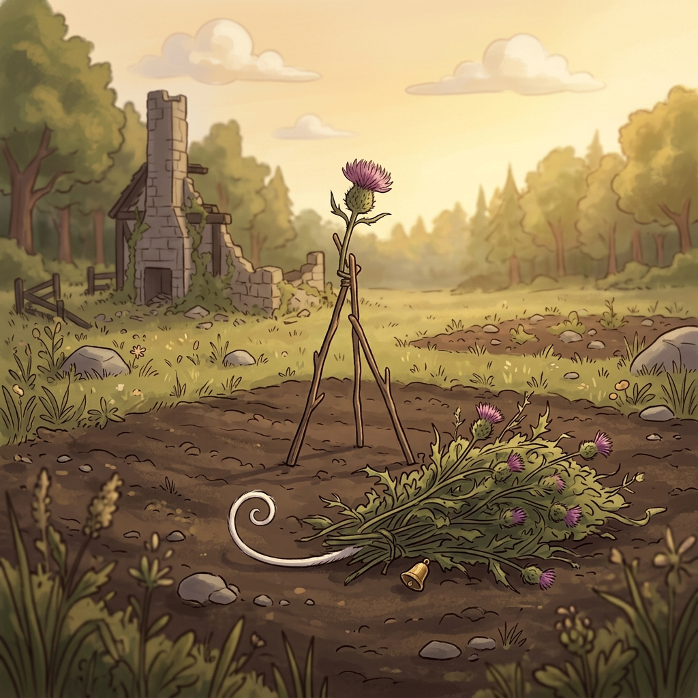

- Created: 2026-10-12T14:03:03+02:00
- Model: Nano Banana 2, 1K, 1:1
- References: farm land

~~~~
Hand-painted storybook illustration for a cozy farming game, in the same world and colours as the reference pictures but a little more painterly: soft painterly shading with gentle brush texture and soft light gradients, warm earthy colours with olive greens and warm browns, clean dark-brown outlines that are thinner and softer than in a cartoon, friendly chunky-cute proportions, warm happy mood. Full-bleed square picture filling the whole frame, no white border, no text, no letters, no labels. Reference image 1 shows the farm valley of the game as a painted picture: the cleared and weedy patches, stumps, stones, the burnt ruin with its chimney, the forest on all sides. Use it for the look of the ground and setting and paint it from a new low eye-level camera position. Never isometric, never top-down, never a high bird's-eye view.

Scene: A freshly cleared patch of dark earth with pulled thistles lying in a heap, seen from a low eye-level view. In the middle, three sticks are balanced in a ridiculous wobbly tower with a thistle flower stuck on top like a hat. Subtle hidden detail: from behind the thistle heap at the edge of the picture, only a thin white tail with a small spiral curl at its tip sticks out, and a tiny brass bell glints on the heap; no creature is otherwise visible. Behind the patch, softly painted, the weedy clearing, the ruined chimney and the forest edge. Bright morning light. No people.
~~~~

## 2026-10-12_140309_lark-fence-apple-eye-level_0ae30f16.png

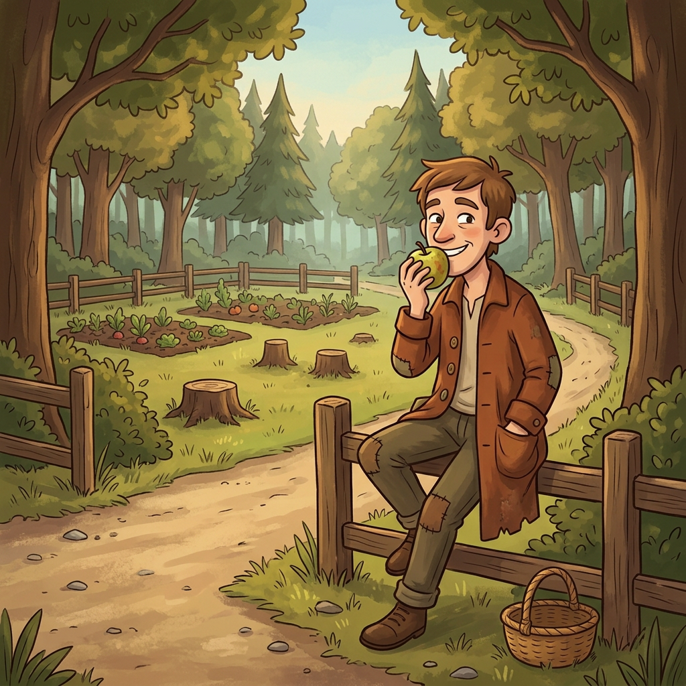

- Created: 2026-10-12T14:03:09+02:00
- Model: Nano Banana 2, 1K, 1:1
- References: village cast;farm land

~~~~
Hand-painted storybook illustration for a cozy farming game, in the same world and colours as the reference pictures but a little more painterly: soft painterly shading with gentle brush texture and soft light gradients, warm earthy colours with olive greens and warm browns, clean dark-brown outlines that are thinner and softer than in a cartoon, friendly chunky-cute proportions, warm happy mood. Full-bleed square picture filling the whole frame, no white border, no text, no letters, no labels. Reference image 1 is the character sheet of the village characters: LARK is the tall thin man in the rust-brown patched coat at the top left; keep him exactly as drawn there, just a little more painterly. Reference image 2 shows the farm valley of the game as a painted picture, with its dirt road, fences, clearing and the forest on all sides. Use it for the setting and paint it from a new eye-level camera position. Never isometric, never top-down, never a high bird's-eye view.

Scene: Through the farmer's own eyes: Lark sits on a wooden fence beside a fresh gravel road as if he had always been there, legs crossed, biting an apple, with an amused sideways smile, looking at the viewer. One coat pocket bulges oddly. Behind him, at eye level, the young farm in its clearing with a few cleared patches, a fence and the forest all around. Bright afternoon, a slightly magical feel. Do not show the farmer; Lark is the only person in the picture.
~~~~

## 2026-10-12_140316_tree-stump-slope-eye-level_e6c28211.png

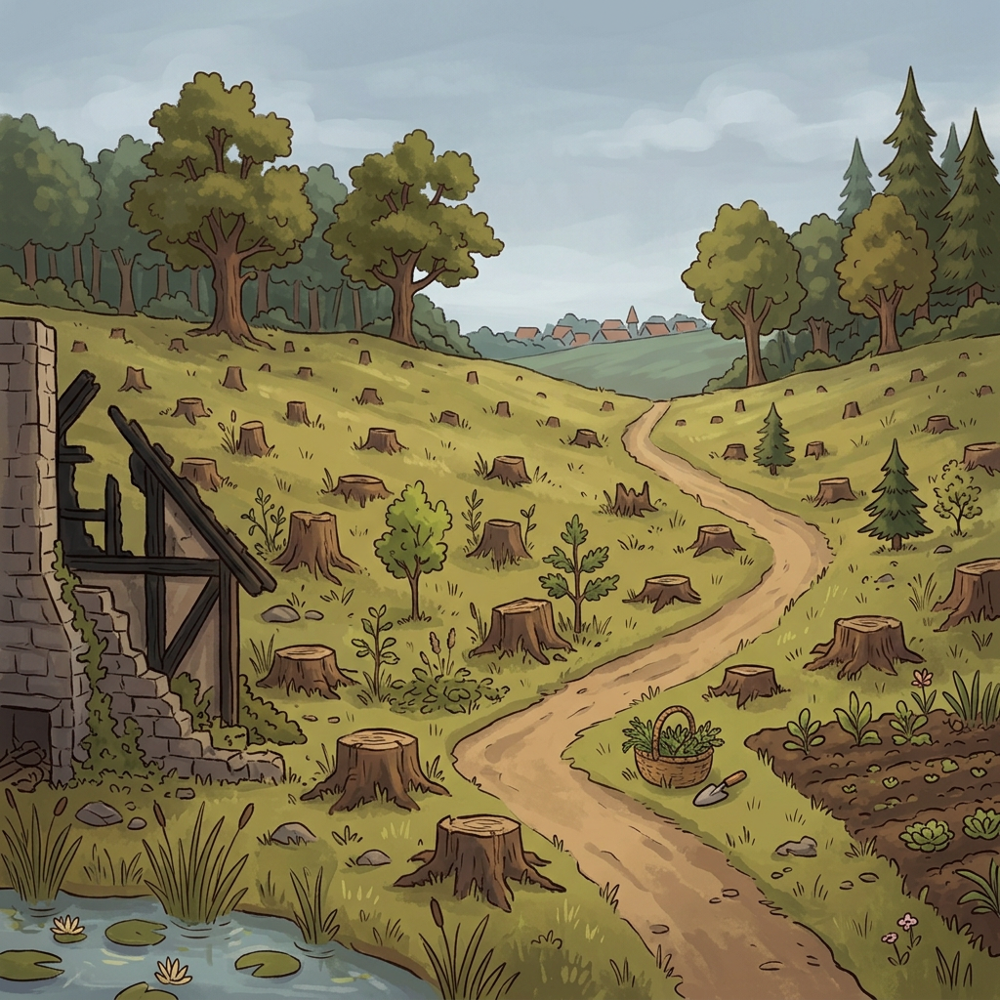

- Created: 2026-10-12T14:03:16+02:00
- Model: Nano Banana 2, 1K, 1:1
- References: farm land

~~~~
Hand-painted storybook illustration for a cozy farming game, in the same world and colours as the reference pictures but a little more painterly: soft painterly shading with gentle brush texture and soft light gradients, warm earthy colours with olive greens and warm browns, clean dark-brown outlines that are thinner and softer than in a cartoon, friendly chunky-cute proportions, warm happy mood. Full-bleed square picture filling the whole frame, no white border, no text, no letters, no labels. Reference image 1 shows the farm valley of the game as a painted picture: the clearing with its tree stumps, the burnt ruin with its chimney, the dirt road, the forest on all sides. Paint this same place but from a new eye-level camera position on the dirt track, looking up the slope toward the forest edge. Never isometric, never top-down, never a high bird's-eye view.

Scene: The slope between the farm and the forest edge, seen at eye level: it is covered in dozens of old tree stumps, far too many for such a small farm, with weeds and young saplings growing between them. Only a few big trees remain at the top of the slope against the forest, and a small cleared dirt track runs through the stumps. In the lower part of the picture a little of the burnt ruin and the farm field is visible. Grey-blue overcast light, a thoughtful mood, not scary. No people.
~~~~

## 2026-10-12_140325_letter-autumn-frost-eye-level_08f94fe7.png

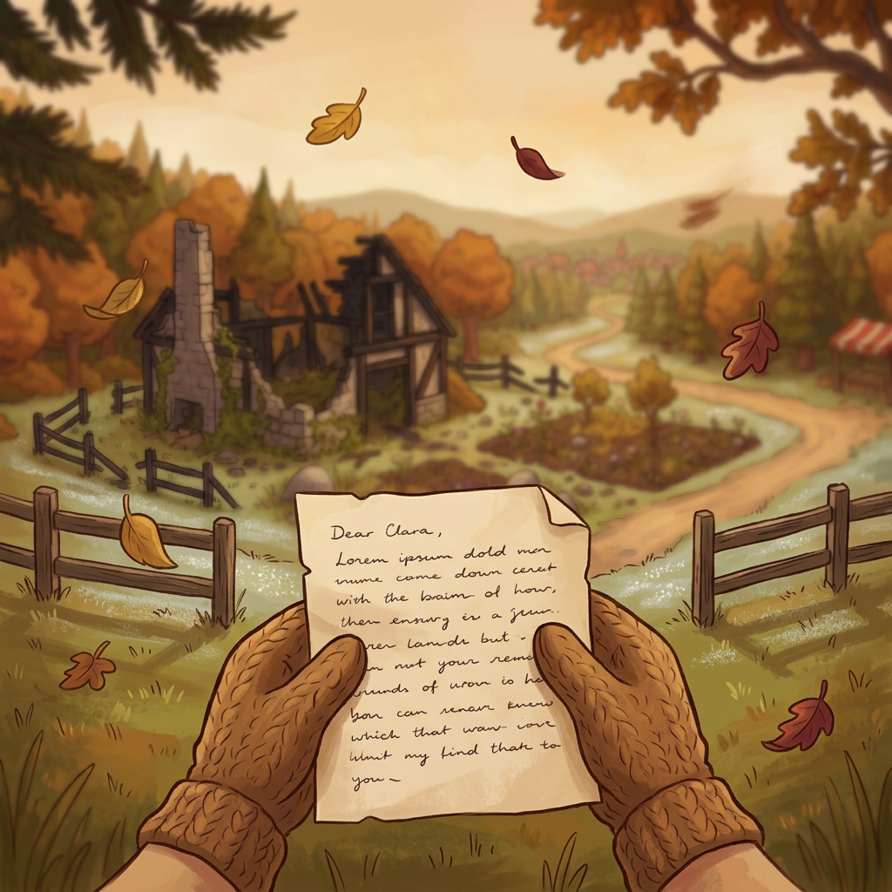

- Created: 2026-10-12T14:03:25+02:00
- Model: Nano Banana 2, 1K, 1:1
- References: farm land

~~~~
Hand-painted storybook illustration for a cozy farming game, in the same world and colours as the reference pictures but a little more painterly: soft painterly shading with gentle brush texture and soft light gradients, warm earthy colours with olive greens and warm browns, clean dark-brown outlines that are thinner and softer than in a cartoon, friendly chunky-cute proportions, warm happy mood. Full-bleed square picture filling the whole frame, no white border, no text, no letters, no labels. Reference image 1 shows the farm valley of the game as a painted picture: the cleared patches, fences, the burnt ruin with its chimney, the dirt road and the forest on all sides. Use it for the setting of the blurred background and paint it from an eye-level position. Never isometric, never top-down, never a high bird's-eye view.

Scene: First-person view: two hands in brown woven fibre work mitts (no bare skin visible) hold an unfolded letter with neat handwriting (only unreadable squiggles, no real letters) in the lower half of the picture. In the softly blurred background, at eye level, autumn leaves fall over the half-cleared farm clearing with its fence and the ruin, and the first frost glitters on the grass, forest all around in autumn colours. A slight sense of urgency. Do not show the farmer's face or body.
~~~~

## 2026-10-12_140332_log-cottage-walls-eye-level_5f99b069.png

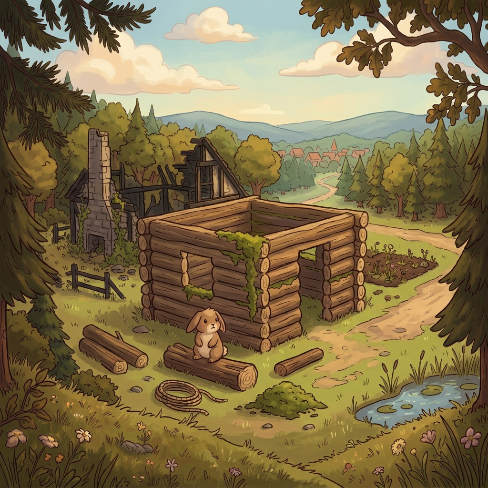

- Created: 2026-10-12T14:03:32+02:00
- Model: Nano Banana 2, 1K, 1:1
- References: animals;farm land

~~~~
Hand-painted storybook illustration for a cozy farming game, in the same world and colours as the reference pictures but a little more painterly: soft painterly shading with gentle brush texture and soft light gradients, warm earthy colours with olive greens and warm browns, clean dark-brown outlines that are thinner and softer than in a cartoon, friendly chunky-cute proportions, warm happy mood. Full-bleed square picture filling the whole frame, no white border, no text, no letters, no labels. Reference image 1 is the game's animal sheet: the small brown rabbit in its bottom-right corner is the BUNNY (paint her like that, with one flopped ear). Reference image 2 shows the farm valley of the game as a painted picture: the clearing, the burnt ruin, the dirt road and the forest on all sides. Use it for the setting and paint it from a new eye-level camera position. Never isometric, never top-down, never a high bird's-eye view.

Scene: Small log cottage walls standing alone in the farm clearing, seen at eye level from a few steps away, clearly built by one inexperienced person: the logs a bit crooked, one corner sagging, a gap stuffed with moss, no roof yet. Behind them the cleared patches, the old ruin to one side and the tall forest edge. Sunny day. The bunny sits on a log in front looking doubtful. Charming and funny, a proud first effort. No people.
~~~~

## 2026-10-12_140337_log-cottage-thatch-eye-level_7dc992bd.png

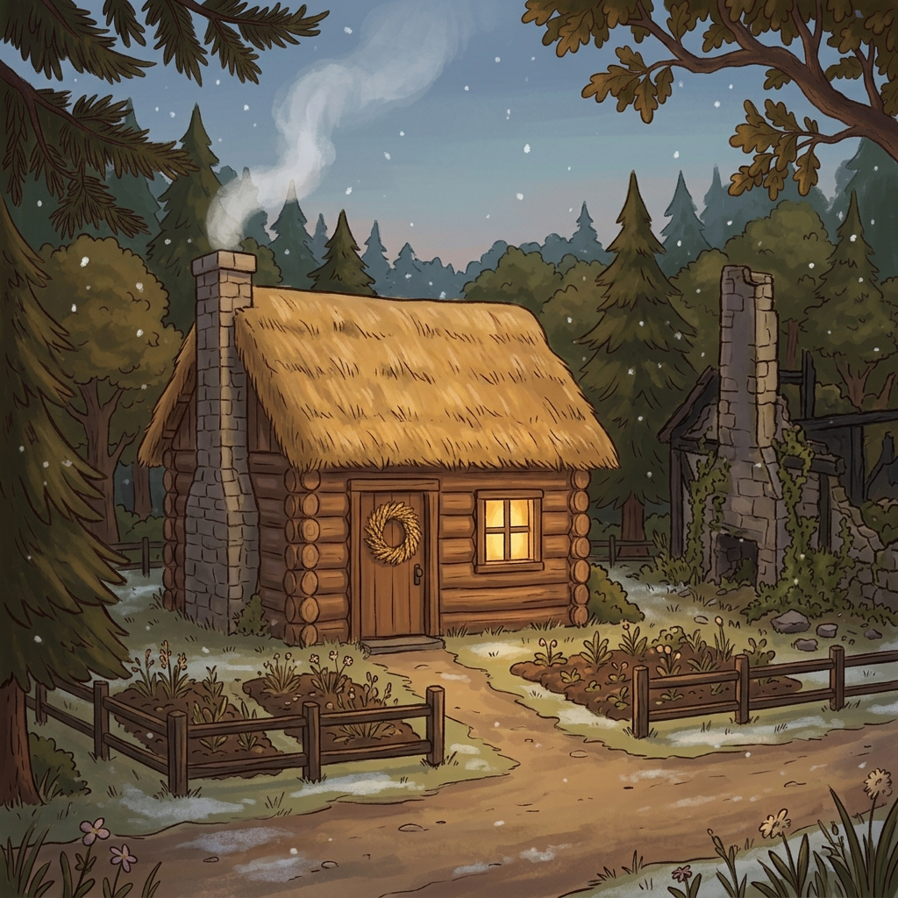

- Created: 2026-10-12T14:03:37+02:00
- Model: Nano Banana 2, 1K, 1:1
- References: farm land

~~~~
Hand-painted storybook illustration for a cozy farming game, in the same world and colours as the reference pictures but a little more painterly: soft painterly shading with gentle brush texture and soft light gradients, warm earthy colours with olive greens and warm browns, clean dark-brown outlines that are thinner and softer than in a cartoon, friendly chunky-cute proportions, warm happy mood. Full-bleed square picture filling the whole frame, no white border, no text, no letters, no labels. Reference image 1 shows the farm valley of the game as a painted picture: the clearing, the fences, the dirt road and the forest on all sides. Paint the same valley, now with a finished cottage, from a new eye-level camera position on the dirt road. Never isometric, never top-down, never a high bird's-eye view.

Scene: The finished small log cottage with a fresh golden thatched roof, smoke rising from the chimney, a warm glowing window and a wreath of dried wheat on the door, standing in the farm clearing, seen at eye level from the dirt road. Beside it a few fenced garden beds, the old ruin overgrown at the edge of the clearing, and the dark forest behind. The first snowflakes fall over the farm at dusk. Cosy and triumphant. No people.
~~~~

## 2026-10-12_140344_pond-spring-tortoise-eye-level_edaeaf0a.png

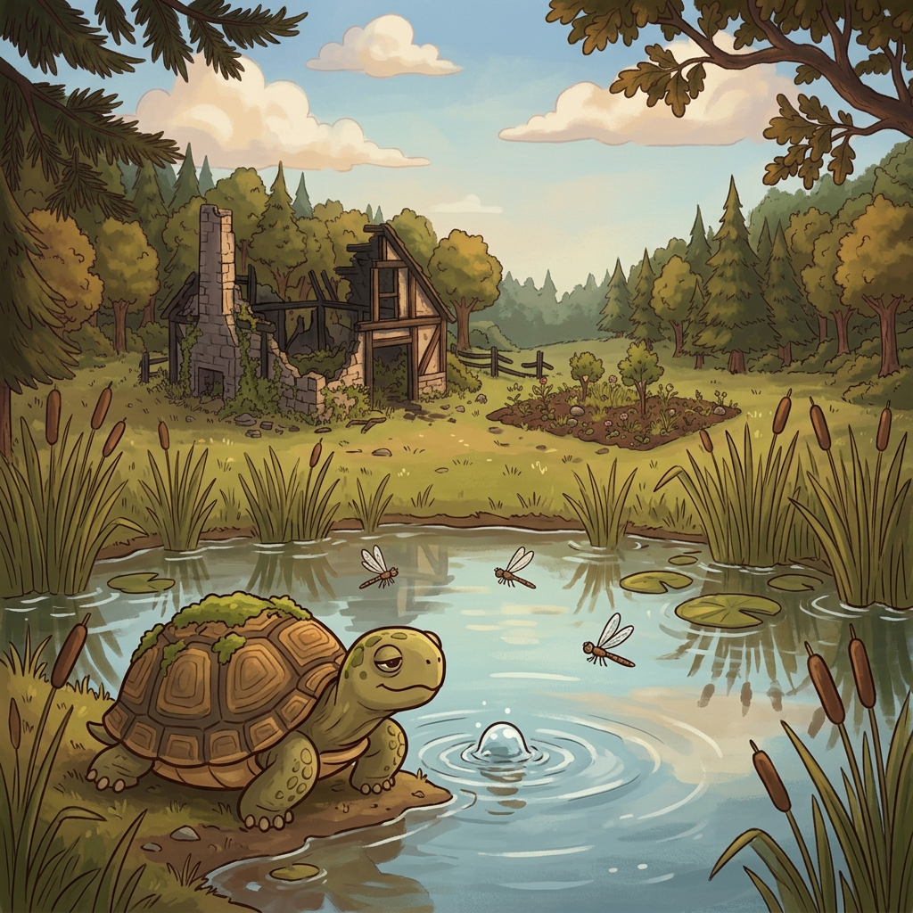

- Created: 2026-10-12T14:03:44+02:00
- Model: Nano Banana 2, 1K, 1:1
- References: animals;farm land

~~~~
Hand-painted storybook illustration for a cozy farming game, in the same world and colours as the reference pictures but a little more painterly: soft painterly shading with gentle brush texture and soft light gradients, warm earthy colours with olive greens and warm browns, clean dark-brown outlines that are thinner and softer than in a cartoon, friendly chunky-cute proportions, warm happy mood. Full-bleed square picture filling the whole frame, no white border, no text, no letters, no labels. Reference image 1 is the game's animal sheet: the tortoise with the patterned shell (middle left) is the TORTOISE; paint her like that, with a little moss on her shell and ancient calm eyes. Reference image 2 shows the farm valley of the game as a painted picture, with its small ponds and reeds in the clearing and the forest on all sides. Use it for the setting and paint it from a new low eye-level camera position at the pond's edge. Never isometric, never top-down, never a high bird's-eye view.

Scene: A freshly dug pond, still half empty, with water slowly bubbling up from a spring in the middle, seen at eye level from the pond's edge. The ancient tortoise sits calmly at the edge exactly above the spring, eyes half closed. Reflections on the water, dragonflies, reeds; in the background the clearing, the old ruin and the forest. Patient and peaceful. No people.
~~~~

## 2026-10-12_140349_barn-frame-lantern-hook-ruin_deb2d0d6.png

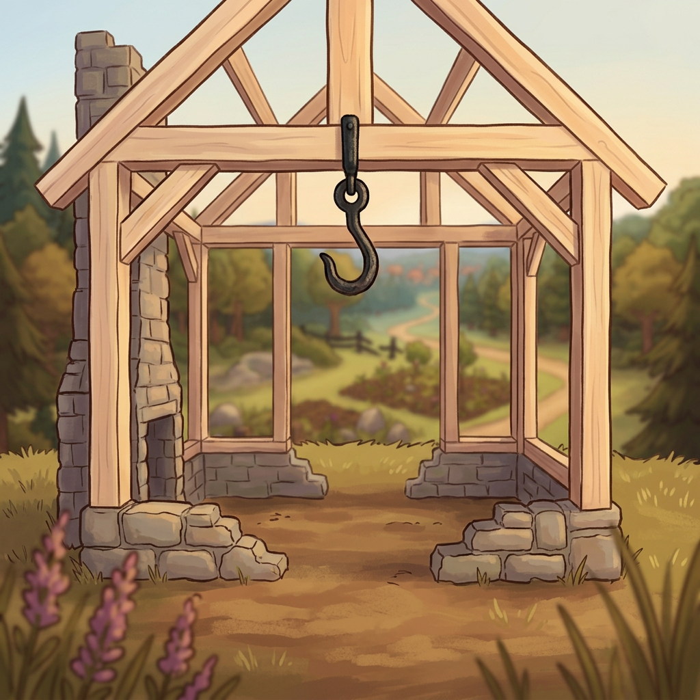

- Created: 2026-10-12T14:03:49+02:00
- Model: Nano Banana 2, 1K, 1:1
- References: farm land

~~~~
Hand-painted storybook illustration for a cozy farming game, in the same world and colours as the reference pictures but a little more painterly: soft painterly shading with gentle brush texture and soft light gradients, warm earthy colours with olive greens and warm browns, clean dark-brown outlines that are thinner and softer than in a cartoon, friendly chunky-cute proportions, warm happy mood. Full-bleed square picture filling the whole frame, no white border, no text, no letters, no labels. Reference image 1 shows the farm valley of the game as a painted picture: the clearing, the burnt ruin with its chimney, the dirt road and the forest on all sides. Use it only for the blurred background and paint the picture from a low eye-level position. Never isometric, never top-down, never a high bird's-eye view.

Scene: Close-up of a new barn frame made of fresh pale timber standing on the old ruin's footprint; in its middle, hanging from a beam, an old blackened iron lantern hook kept from the ruin, sharply in focus. Soft evening light, and through the open frame the farm clearing and the forest edge softly out of focus behind. A question hangs in the air. No people.
~~~~

## 2026-10-12_140355_smithy-forge-eye-level_4d271d79.png

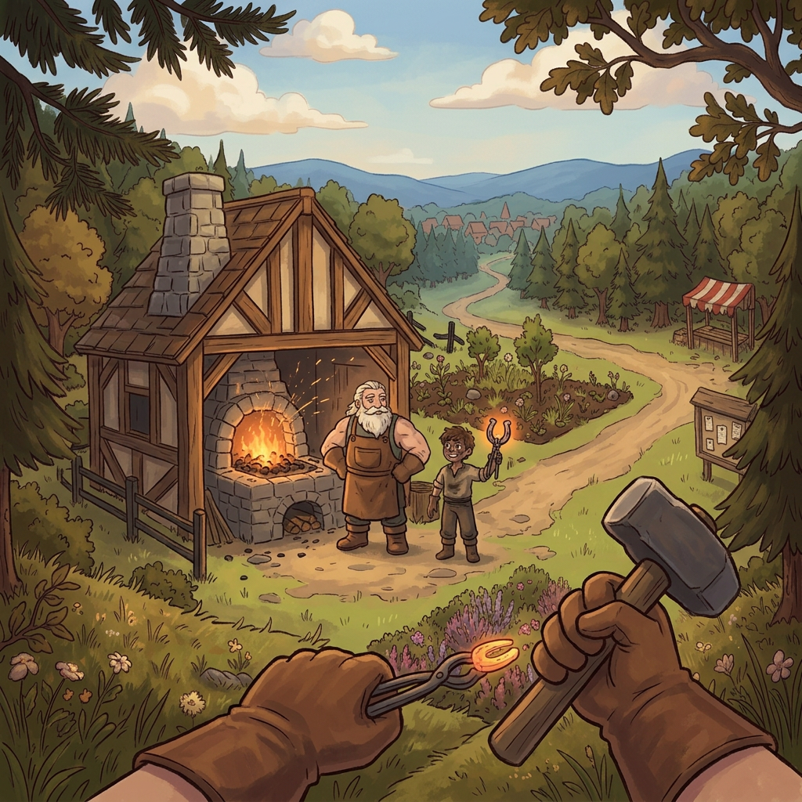

- Created: 2026-10-12T14:03:55+02:00
- Model: Nano Banana 2, 1K, 1:1
- References: farm land

~~~~
Hand-painted storybook illustration for a cozy farming game, in the same world and colours as the reference pictures but a little more painterly: soft painterly shading with gentle brush texture and soft light gradients, warm earthy colours with olive greens and warm browns, clean dark-brown outlines that are thinner and softer than in a cartoon, friendly chunky-cute proportions, warm happy mood. Full-bleed square picture filling the whole frame, no white border, no text, no letters, no labels. Reference image 1 shows the farm valley of the game as a painted picture: the clearing, the fences, the dirt road and the forest on all sides. Paint the same valley with a new smithy built at the edge of the clearing, seen from a new eye-level camera position. Never isometric, never top-down, never a high bird's-eye view.

Scene: A new smithy with a stone chimney and a glowing forge, open on the front side, seen at eye level; the farm clearing and the forest are visible behind it. Old Odinson, a white-bearded smith with huge arms and a leather apron, nods approvingly at the viewer, and young Bo, an apprentice boy with a sooty face, holds up a glowing horseshoe with tongs. At the bottom edge, first-person hands in thick leather gloves hold a hammer (no bare skin). Sparks fly, warm orange light. Do not show the farmer's face or body.
~~~~

## 2026-10-12_140447_miller-bridge-clear-stream-nod_573588b2.png

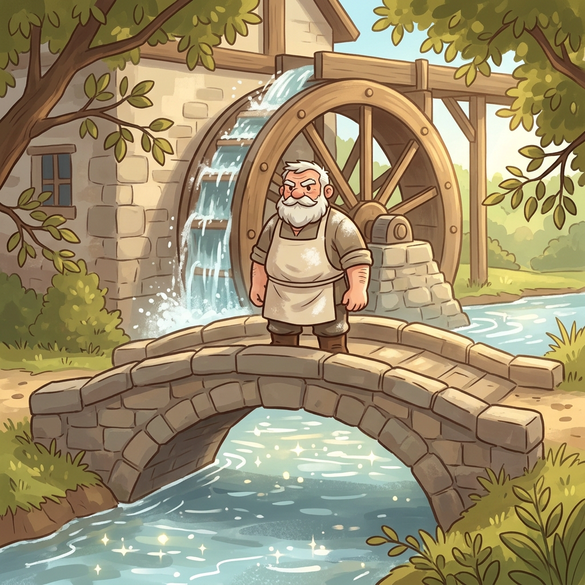

- Created: 2026-10-12T14:04:47+02:00
- Model: Nano Banana 2, 1K, 1:1
- References: village cast;style album

~~~~
Hand-painted storybook illustration for a cozy farming game, in the same world and colours as the reference pictures but a little more painterly: soft painterly shading with gentle brush texture and soft light gradients, warm earthy colours with olive greens and warm browns, clean dark-brown outlines that are thinner and softer than in a cartoon, friendly chunky-cute proportions, warm happy mood. Full-bleed square picture filling the whole frame, no white border, no text, no letters, no labels. Reference image 1 is the character sheet of the village characters: THE MILLER is the broad floury man with bushy eyebrows and folded arms (bottom middle): keep him exactly as drawn there, just a little more painterly. Reference image 2 shows the colours and friendliness of the game's story pictures.

Scene: Through the farmer's own eyes, at eye level: the same old stone bridge as before, now over a clear sparkling stream, and the mill wheel behind it turns happily in the full water. The miller stands on the bridge with his arms no longer folded, giving the viewer a single stiff nod. Sunny day, bright and fresh. The miller is the only person in the picture; do not show the farmer.
~~~~

## 2026-10-12_140453_harvest-dance-lanterns-cider_d7ecd74c.png

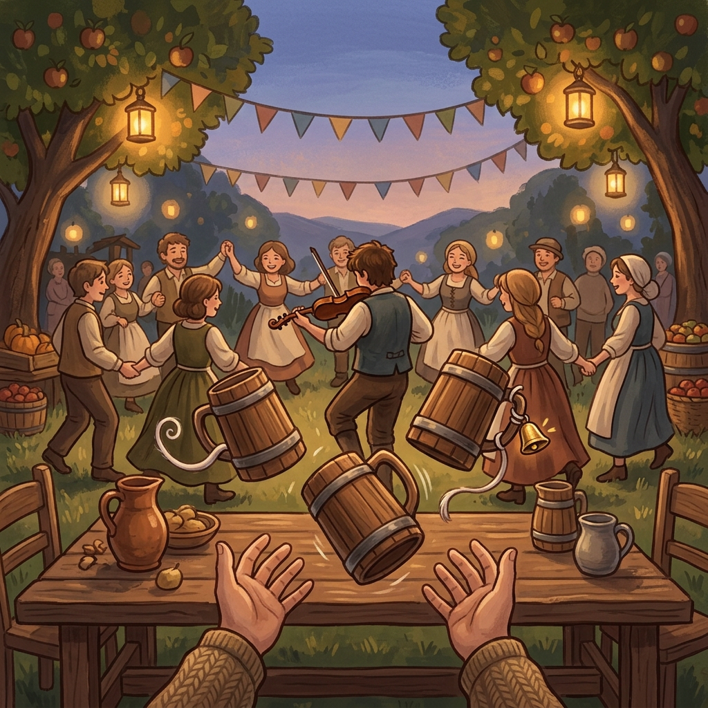

- Created: 2026-10-12T14:04:53+02:00
- Model: Nano Banana 2, 1K, 1:1
- References: style album

~~~~
Hand-painted storybook illustration for a cozy farming game, in the same world and colours as the reference pictures but a little more painterly: soft painterly shading with gentle brush texture and soft light gradients, warm earthy colours with olive greens and warm browns, clean dark-brown outlines that are thinner and softer than in a cartoon, friendly chunky-cute proportions, warm happy mood. Full-bleed square picture filling the whole frame, no white border, no text, no letters, no labels. Reference image 1 shows the colours and friendliness of the game's story pictures.

Scene: The village harvest dance on an evening, seen at eye level: lanterns hung in apple trees, bunting, villagers in simple old-world clothes dancing in a ring, a fiddler playing. In the foreground a cider table where several wooden mugs float a little in the air for a moment; one is falling and a pair of hands in long woven sleeves (no bare skin) at the bottom edge of the picture catches it. Subtle hidden detail: a thin white tail with a small spiral curl at its tip is wrapped around the handle of one floating mug, and a tiny brass bell glints beside it; no creature is otherwise visible. Joyful and magical, dusk light with warm lantern glow. Do not show the farmer's face or body.
~~~~

## 2026-10-12_140459_goat-chewing-list-closeup_a0c1f884.png

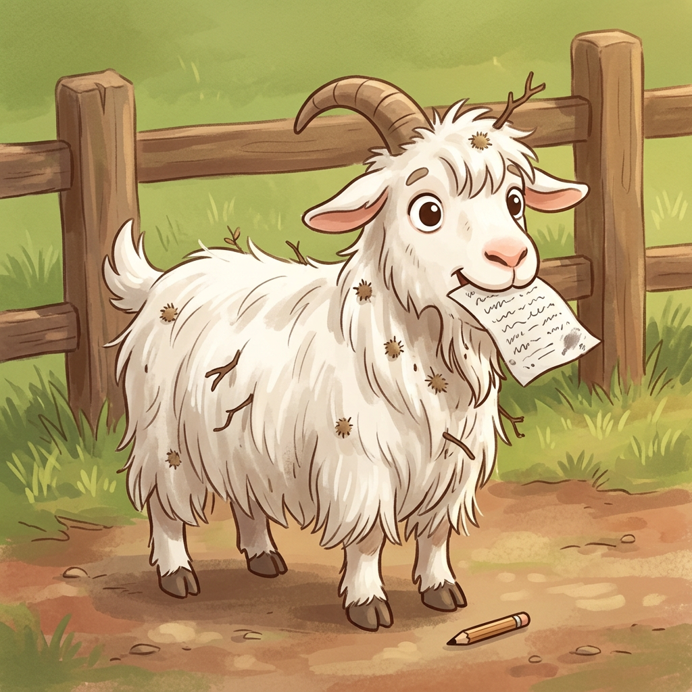

- Created: 2026-10-12T14:04:59+02:00
- Model: Nano Banana 2, 1K, 1:1
- References: animals;style album

~~~~
Hand-painted storybook illustration for a cozy farming game, in the same world and colours as the reference pictures but a little more painterly: soft painterly shading with gentle brush texture and soft light gradients, warm earthy colours with olive greens and warm browns, clean dark-brown outlines that are thinner and softer than in a cartoon, friendly chunky-cute proportions, warm happy mood. Full-bleed square picture filling the whole frame, no white border, no text, no letters, no labels. Reference image 1 is the game's animal sheet: the shaggy white goat with a bent horn is the GOAT; paint her like that, with burrs in her beard. Reference image 2 shows the colours and friendliness of the game's story pictures.

Scene: Close-up of the shaggy white goat with a bent horn and burrs in her beard, chewing a sheet of paper with total innocence, half of the list (only scribbled lines, no real letters) hanging out of her mouth. A pencil lies on the ground. Bright morning light, a few blurred wooden fence posts behind her. Funny. No people.
~~~~

## 2026-10-12_140506_goat-thistle-field-path_591cf7c5.png

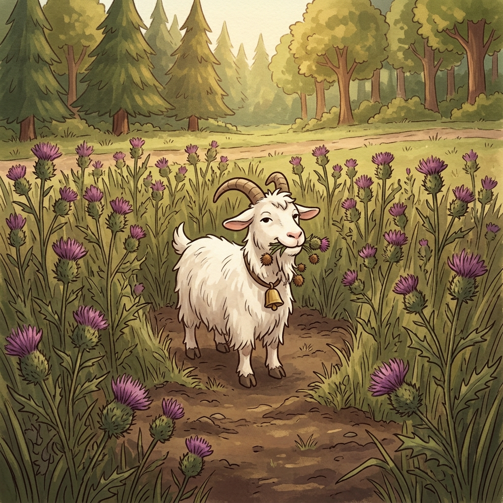

- Created: 2026-10-12T14:05:06+02:00
- Model: Nano Banana 2, 1K, 1:1
- References: animals;farm land

~~~~
Hand-painted storybook illustration for a cozy farming game, in the same world and colours as the reference pictures but a little more painterly: soft painterly shading with gentle brush texture and soft light gradients, warm earthy colours with olive greens and warm browns, clean dark-brown outlines that are thinner and softer than in a cartoon, friendly chunky-cute proportions, warm happy mood. Full-bleed square picture filling the whole frame, no white border, no text, no letters, no labels. Reference image 1 is the game's animal sheet: the shaggy white goat with a bent horn is the GOAT; paint her like that, with burrs in her beard. Reference image 2 shows the farm valley of the game as a painted picture: the clearing, the weedy patches, the dirt road and the forest on all sides. Use it for the setting and paint it from a new eye-level camera position. Never isometric, never top-down, never a high bird's-eye view.

Scene: A field in the farm clearing overgrown with tall, spiky purple thistles that nobody could clear, seen at eye level. In the middle of it the goat happily munches her way through them, leaving a perfect cleared path of bare soil behind her and looking at the viewer with her mouth full and a smug expression. The forest edge in the background. Sunny afternoon. No people.
~~~~

## 2026-10-12_140511_scarecrow-straw-hat-tail-bell_23a0c249.png

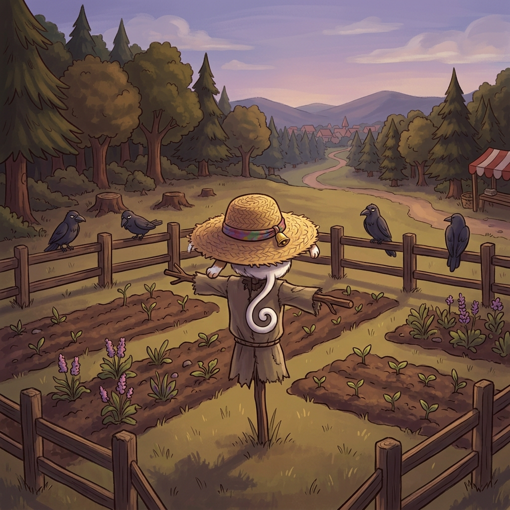

- Created: 2026-10-12T14:05:11+02:00
- Model: Nano Banana 2, 1K, 1:1
- References: farm land

~~~~
Hand-painted storybook illustration for a cozy farming game, in the same world and colours as the reference pictures but a little more painterly: soft painterly shading with gentle brush texture and soft light gradients, warm earthy colours with olive greens and warm browns, clean dark-brown outlines that are thinner and softer than in a cartoon, friendly chunky-cute proportions, warm happy mood. Full-bleed square picture filling the whole frame, no white border, no text, no letters, no labels. Reference image 1 shows the farm valley of the game as a painted picture: the clearing, fences, the dirt road and the forest on all sides. Use it for the setting and paint it from a new eye-level camera position. Never isometric, never top-down, never a high bird's-eye view.

Scene: A stick scarecrow in a field of the farm clearing at dusk, seen at eye level, wearing a wide straw hat that is clearly too nice for it. A thin white tail with a small spiral curl at its tip curls out from under the hat brim, and a tiny brass bell glints on the hat band; no creature is otherwise visible. Crows sit on the fence, unimpressed. Soft purple-gold dusk light, the forest edge behind. Funny and mysterious. No people.
~~~~

## 2026-10-12_140517_quill-gate-foundation-ledger_3063f47f.png

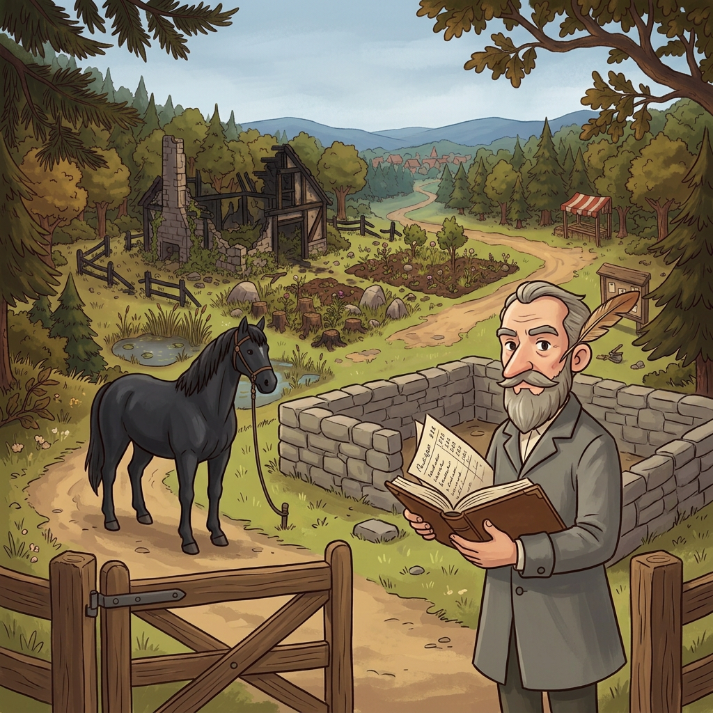

- Created: 2026-10-12T14:05:17+02:00
- Model: Nano Banana 2, 1K, 1:1
- References: village cast;farm land

~~~~
Hand-painted storybook illustration for a cozy farming game, in the same world and colours as the reference pictures but a little more painterly: soft painterly shading with gentle brush texture and soft light gradients, warm earthy colours with olive greens and warm browns, clean dark-brown outlines that are thinner and softer than in a cartoon, friendly chunky-cute proportions, warm happy mood. Full-bleed square picture filling the whole frame, no white border, no text, no letters, no labels. Reference image 1 is the character sheet of the village characters. MASTER QUILL is the thin, stiff steward with a long nose, a neat grey coat, a thick ledger under his arm and a quill behind his ear: keep him as drawn there if he is on the sheet, otherwise paint him from this description. Reference image 2 shows the farm valley of the game as a painted picture: the clearing, fences, the dirt road and the forest on all sides. Use it for the setting and paint it from a new eye-level camera position at the gate. Never isometric, never top-down, never a high bird's-eye view.

Scene: Through the farmer's own eyes: Master Quill stands very upright at the farm gate beside a new stone foundation for a house, his ledger open in one hand, looking at the viewer over his long nose. A fine black horse waits behind him on the dirt road, the farm clearing and forest behind. Cool morning light, a slightly tense mood. Master Quill is the only person in the picture; do not show the farmer.
~~~~

## 2026-10-12_140530_quill-pond-paper-boat_ec5455ae.png

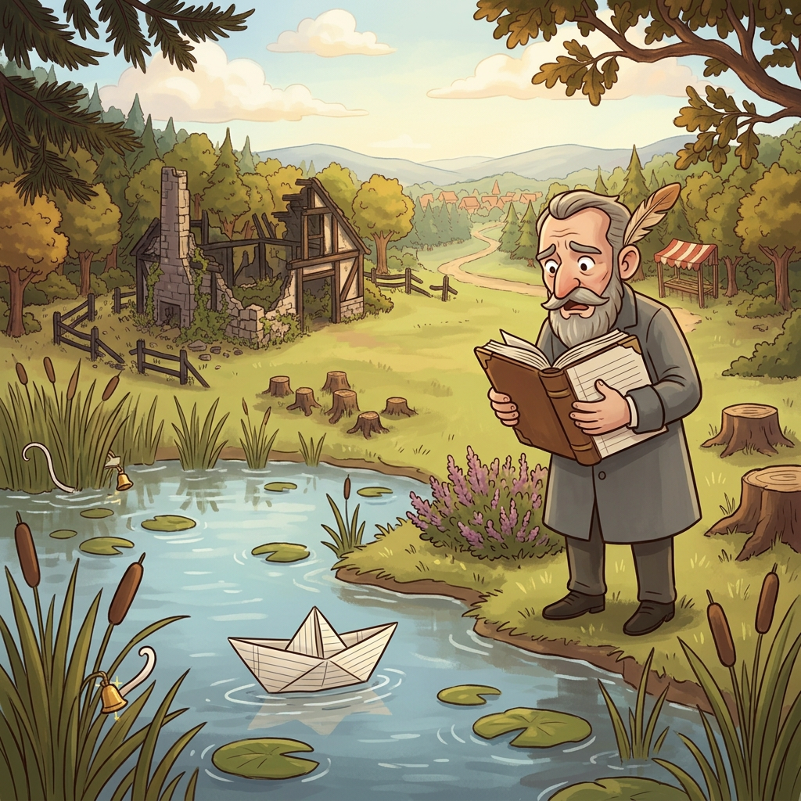

- Created: 2026-10-12T14:05:30+02:00
- Model: Nano Banana 2, 1K, 1:1
- References: village cast;farm land

~~~~
Hand-painted storybook illustration for a cozy farming game, in the same world and colours as the reference pictures but a little more painterly: soft painterly shading with gentle brush texture and soft light gradients, warm earthy colours with olive greens and warm browns, clean dark-brown outlines that are thinner and softer than in a cartoon, friendly chunky-cute proportions, warm happy mood. Full-bleed square picture filling the whole frame, no white border, no text, no letters, no labels. Reference image 1 is the character sheet of the village characters. MASTER QUILL is the thin, stiff steward with a long nose, a neat grey coat, a thick ledger and a quill behind his ear: keep him as drawn there if he is on the sheet, otherwise paint him from this description. Reference image 2 shows the farm valley of the game as a painted picture, with its ponds and reeds in the clearing and the forest on all sides. Use it for the setting and paint it from a new eye-level camera position at the pond's edge. Never isometric, never top-down, never a high bird's-eye view.

Scene: Master Quill stands at the edge of the farm pond, horrified, ledger clutched to his chest, staring at a perfect little paper boat folded from two ledger pages floating away across the water. Subtle hidden detail: behind a reed at the water's edge, only a thin white tail tip with a small spiral curl flicks away, and a tiny brass bell glints on a reed; no creature is otherwise visible. The farm clearing and forest behind. Bright morning light. Funny. Master Quill is the only person in the picture.
~~~~

## 2026-10-12_140536_glasshouse-ruin-tin-box-fraction_d2bd9474.png

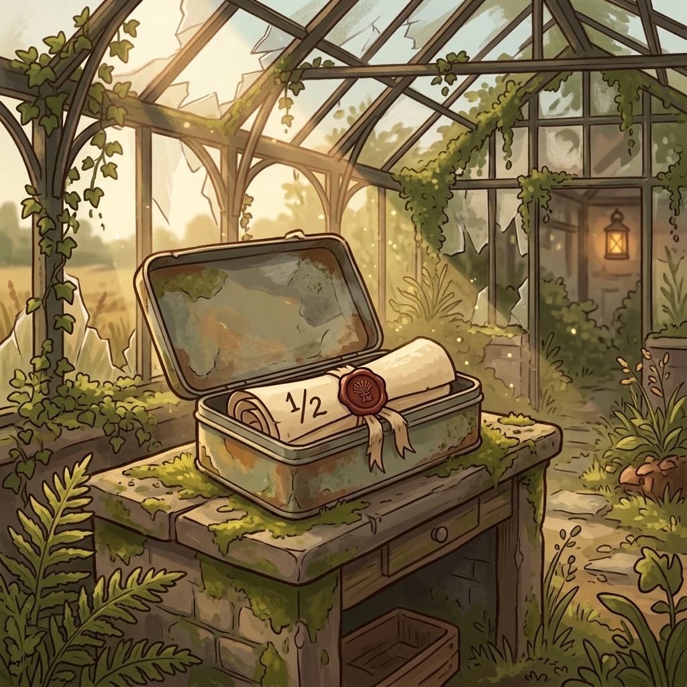

- Created: 2026-10-12T14:05:36+02:00
- Model: Nano Banana 2, 1K, 1:1
- References: style album

~~~~
Hand-painted storybook illustration for a cozy farming game, in the same world and colours as the reference pictures but a little more painterly: soft painterly shading with gentle brush texture and soft light gradients, warm earthy colours with olive greens and warm browns, clean dark-brown outlines that are thinner and softer than in a cartoon, friendly chunky-cute proportions, warm happy mood. Full-bleed square picture filling the whole frame, no white border, no text, no letters, no labels. Reference image 1 shows the colours and friendliness of the game's story pictures.

Scene: Inside the overgrown ruins of an old glasshouse: broken panes, ivy, shafts of sunlight, dust motes floating. An old dented tin box lies open on a mossy potting bench, holding a rolled document tied with a ribbon and closed with a red wax seal; a big hand-drawn fraction symbol "1/2" is the only mark on the document (no other writing at all). Warm golden light. No people.
~~~~

## 2026-10-12_140543_north-field-clover-quill-lark_ae291147.png

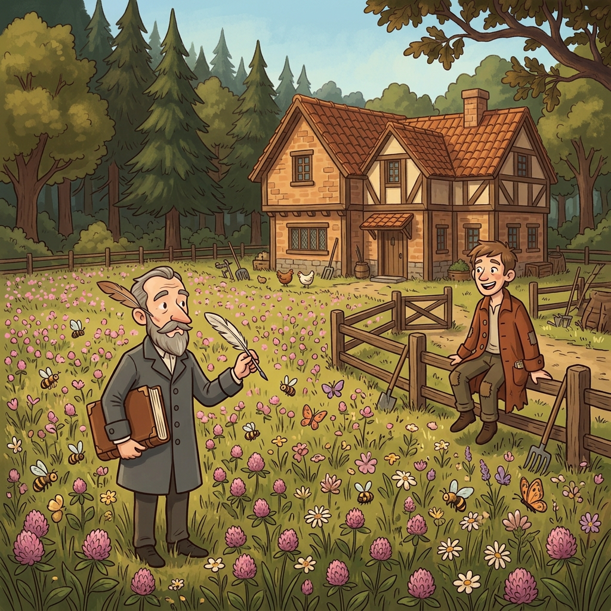

- Created: 2026-10-12T14:05:43+02:00
- Model: Nano Banana 2, 1K, 1:1
- References: village cast;farm land

~~~~
Hand-painted storybook illustration for a cozy farming game, in the same world and colours as the reference pictures but a little more painterly: soft painterly shading with gentle brush texture and soft light gradients, warm earthy colours with olive greens and warm browns, clean dark-brown outlines that are thinner and softer than in a cartoon, friendly chunky-cute proportions, warm happy mood. Full-bleed square picture filling the whole frame, no white border, no text, no letters, no labels. Reference image 1 is the character sheet of the village characters: LARK is the tall thin man in the rust-brown patched coat at the top left, MASTER QUILL is the thin stiff steward with a long nose and a neat grey coat; keep them as drawn there if they are on the sheet. Reference image 2 shows the farm valley of the game as a painted picture: the clearing, fences, the dirt road and the forest on all sides. Use it for the setting and paint it from a new eye-level camera position. Never isometric, never top-down, never a high bird's-eye view.

Scene: The North Field resting under pink clover and wildflowers, with bees and butterflies, seen at eye level. In the foreground stands Master Quill with his ledger, his pen frozen mid-air, surprised. Lark sits on the fence nearby, grinning. A new brick farmhouse stands in the background at the edge of the field with the forest behind it. Sunny, quietly triumphant. Only these two people; do not show the farmer.
~~~~

## 2026-10-12_140549_library-lark-books-by-size_1a0a3b21.png

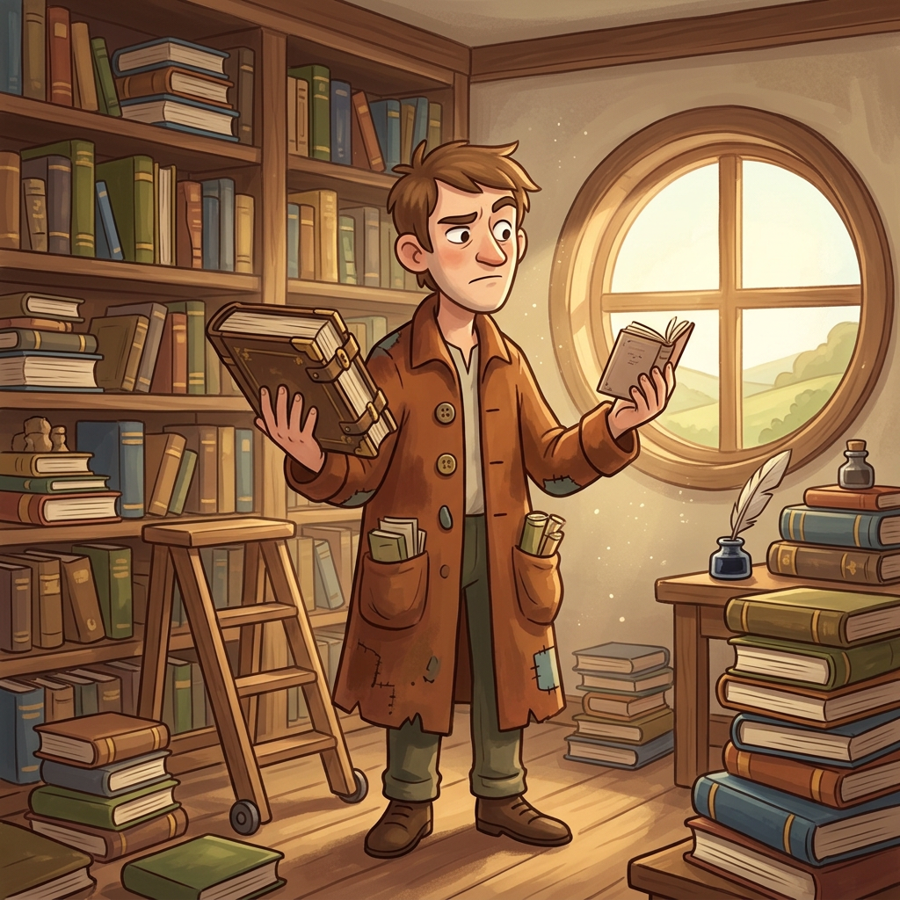

- Created: 2026-10-12T14:05:49+02:00
- Model: Nano Banana 2, 1K, 1:1
- References: village cast;style album

~~~~
Hand-painted storybook illustration for a cozy farming game, in the same world and colours as the reference pictures but a little more painterly: soft painterly shading with gentle brush texture and soft light gradients, warm earthy colours with olive greens and warm browns, clean dark-brown outlines that are thinner and softer than in a cartoon, friendly chunky-cute proportions, warm happy mood. Full-bleed square picture filling the whole frame, no white border, no text, no letters, no labels. Reference image 1 is the character sheet of the village characters: LARK is the tall thin man in the rust-brown patched coat with too many pockets at the top left; keep him exactly as drawn there, just a little more painterly. Reference image 2 shows the colours and friendliness of the game's story pictures.

Scene: A new cosy library room in the farmhouse with wooden shelves and a round window. Lark is arranging books on the shelves in a ridiculous order, from a huge heavy tome to a tiny booklet, weighing two books in his hands with great seriousness, one eyebrow raised. Stacks of books on the floor, a ladder, dust motes in the warm window light. Lark is the only person in the picture.
~~~~

## 2026-10-12_140557_pony-cart-village-square_7a121ad6.png

- Created: 2026-10-12T14:05:57+02:00
- Model: Nano Banana 2, 1K, 1:1
- References: animals;style album

~~~~
Hand-painted storybook illustration for a cozy farming game, in the same world and colours as the reference pictures but a little more painterly: soft painterly shading with gentle brush texture and soft light gradients, warm earthy colours with olive greens and warm browns, clean dark-brown outlines that are thinner and softer than in a cartoon, friendly chunky-cute proportions, warm happy mood. Full-bleed square picture filling the whole frame, no white border, no text, no letters, no labels. Reference image 1 is the game's animal sheet: the chubby hazel-brown pony with a fluffy blond mane is the PONY; paint her like that, proud of her mane. Reference image 2 shows the colours and friendliness of the game's story pictures.

Scene: The chubby pony with a fluffy blond mane trots proudly into the Hazelwood village square at eye level, pulling a small wooden cart piled with sacks, baskets and crates of farm produce (carrots, onions, cabbages, jars). Villagers in simple old-world clothes turn, smile and point; children run alongside. Cobbles, half-timbered houses, a well. Sunny, celebratory. The pony is the hero of the picture; no farmer is visible and nobody drives the cart.
~~~~

## 2026-10-12_140604_quill-rides-away-manor_3f44bc6c.png

- Created: 2026-10-12T14:06:04+02:00
- Model: Nano Banana 2, 1K, 1:1
- References: village cast;farm land

~~~~
Hand-painted storybook illustration for a cozy farming game, in the same world and colours as the reference pictures but a little more painterly: soft painterly shading with gentle brush texture and soft light gradients, warm earthy colours with olive greens and warm browns, clean dark-brown outlines that are thinner and softer than in a cartoon, friendly chunky-cute proportions, warm happy mood. Full-bleed square picture filling the whole frame, no white border, no text, no letters, no labels. Reference image 1 is the character sheet of the village characters. MASTER QUILL is the thin, stiff steward with a long nose and a neat grey coat, a thick ledger under his arm: keep him as drawn there if he is on the sheet. Reference image 2 shows the farm valley of the game as a painted picture: the clearing, fences, the dirt road and the forest on all sides. Use it for the setting and paint it from a new eye-level camera position. Never isometric, never top-down, never a high bird's-eye view.

Scene: Evening, seen at eye level from the farm gate: Master Quill rides away on a dark horse down a paved road toward a distant manor house on a hill, his ledger under his arm, seen from behind. Long shadows. The farm with its cottage and fenced fields is in the foreground. An uneasy, open-ended mood. Master Quill is the only person in the picture; do not show the farmer.
~~~~

## 2026-10-12_140621_village-street-autumn-sick-child_acb408cf.png

- Created: 2026-10-12T14:06:21+02:00
- Model: Nano Banana 2, 1K, 1:1
- References: village cast;style album

~~~~
Hand-painted storybook illustration for a cozy farming game, in the same world and colours as the reference pictures but a little more painterly: soft painterly shading with gentle brush texture and soft light gradients, warm earthy colours with olive greens and warm browns, clean dark-brown outlines that are thinner and softer than in a cartoon, friendly chunky-cute proportions, warm happy mood. Full-bleed square picture filling the whole frame, no white border, no text, no letters, no labels. Reference image 1 is the character sheet of the village characters. WREN THE HEALER is the sturdy middle-aged herb woman with greying hair in a bun, a grumpy-kind face, a shawl and a basket of herbs: keep her as drawn there if she is on the sheet, otherwise paint her from this description. Reference image 2 shows the colours and friendliness of the game's story pictures.

Scene: A Hazelwood village street in grey autumn weather, seen at eye level: half-timbered houses, a few shutters closed, a mother wrapping a scarf around a coughing child on a doorstep, and Wren the healer hurrying past with an almost empty herb basket. Fallen leaves on the cobbles. Worried but gentle mood, soft grey light.
~~~~

## 2026-10-12_140624_herb-house-ruin-torn-page_c4441b38.png

- Created: 2026-10-12T14:06:24+02:00
- Model: Nano Banana 2, 1K, 1:1
- References: style album

~~~~
Hand-painted storybook illustration for a cozy farming game, in the same world and colours as the reference pictures but a little more painterly: soft painterly shading with gentle brush texture and soft light gradients, warm earthy colours with olive greens and warm browns, clean dark-brown outlines that are thinner and softer than in a cartoon, friendly chunky-cute proportions, warm happy mood. Full-bleed square picture filling the whole frame, no white border, no text, no letters, no labels. Reference image 1 shows the colours and friendliness of the game's story pictures.

Scene: The ruin of a small herb house, seen at eye level from the doorway: hanging bunches of dried herbs, dusty glass bottles on a shelf, a cracked mortar and pestle on a stone table. In the middle of the table lies an old open book with one page torn out, the ragged torn edge clearly visible in the spine (no readable writing at all). Golden light through a broken window, ivy on the walls. No people.
~~~~

## 2026-10-12_140628_moonstone-forest-conch-shell_6f951c9f.png

- Created: 2026-10-12T14:06:28+02:00
- Model: Nano Banana 2, 1K, 1:1
- References: style album

~~~~
Hand-painted storybook illustration for a cozy farming game, in the same world and colours as the reference pictures but a little more painterly: soft painterly shading with gentle brush texture and soft light gradients, warm earthy colours with olive greens and warm browns, clean dark-brown outlines that are thinner and softer than in a cartoon, friendly chunky-cute proportions, warm happy mood. Full-bleed square picture filling the whole frame, no white border, no text, no letters, no labels. Reference image 1 shows the colours and friendliness of the game's story pictures, and its forest of oak and pine trees.

Scene: Deep in the Moonstone Forest, seen at eye level: huge mossy tree trunks, ferns, and white stones glowing faintly like moonlight between the roots. Far off between the trunks, half-hidden, a giant white spiral conch shell taller than a house sits half sunk in the moss and glows softly. Light beams fall through the canopy in blue-green twilight. Awe, mystery and quiet, never scary. No people.
~~~~

## 2026-10-12_140633_torn-page-fitted-book-sketches_761694b7.png

- Created: 2026-10-12T14:06:33+02:00
- Model: Nano Banana 2, 1K, 1:1
- References: style album

~~~~
Hand-painted storybook illustration for a cozy farming game, in the same world and colours as the reference pictures but a little more painterly: soft painterly shading with gentle brush texture and soft light gradients, warm earthy colours with olive greens and warm browns, clean dark-brown outlines that are thinner and softer than in a cartoon, friendly chunky-cute proportions, warm happy mood. Full-bleed square picture filling the whole frame, no white border, no text, no letters, no labels. Reference image 1 shows the colours and friendliness of the game's story pictures.

Scene: First-person view: two hands in long woven sleeves (no bare skin visible) hold a torn book page fitted back into its gap in an old leather book. On the page are two small pencil drawings only, no words: a sketch of an old badger with round spectacles, and a sketch of tired children sitting in a field at night under a moon. Warm lamplight, a wooden table, a serious mood. Do not show the farmer's face or body.
~~~~

## 2026-10-12_140641_still-room-floor-wren-kneeling_082f4d20.png

- Created: 2026-10-12T14:06:41+02:00
- Model: Nano Banana 2, 1K, 1:1
- References: village cast;style album

~~~~
Hand-painted storybook illustration for a cozy farming game, in the same world and colours as the reference pictures but a little more painterly: soft painterly shading with gentle brush texture and soft light gradients, warm earthy colours with olive greens and warm browns, clean dark-brown outlines that are thinner and softer than in a cartoon, friendly chunky-cute proportions, warm happy mood. Full-bleed square picture filling the whole frame, no white border, no text, no letters, no labels. Reference image 1 is the character sheet of the village characters. WREN THE HEALER is the sturdy middle-aged herb woman with greying hair in a bun, a grumpy-kind face and a shawl: keep her as drawn there if she is on the sheet, otherwise paint her from this description. Reference image 2 shows the colours and friendliness of the game's story pictures.

Scene: A low view from the floor of a herb still-room, as if the viewer is lying on the boards: a tipped-over basket, scattered herbs and bottles, a candle burned low on a shelf. Wren the healer kneels close to the viewer, worried and grumpy at the same time, one hand reaching down toward the viewer. Dim, quiet, tender light. Not scary. Wren is the only person in the picture.
~~~~

## 2026-10-12_140646_letter-red-seal-stag-cold-tea_169b263b.png

- Created: 2026-10-12T14:06:46+02:00
- Model: Nano Banana 2, 1K, 1:1
- References: style album

~~~~
Hand-painted storybook illustration for a cozy farming game, in the same world and colours as the reference pictures but a little more painterly: soft painterly shading with gentle brush texture and soft light gradients, warm earthy colours with olive greens and warm browns, clean dark-brown outlines that are thinner and softer than in a cartoon, friendly chunky-cute proportions, warm happy mood. Full-bleed square picture filling the whole frame, no white border, no text, no letters, no labels. Reference image 1 shows the colours and friendliness of the game's story pictures.

Scene: Close-up of a folded letter lying on a wooden kitchen table, closed with a big red wax seal showing a stern stag's head. A cup of tea beside it has gone cold, with no steam. A grey morning light from a small window. A feeling of escalation, a little ominous but still gentle. No people.
~~~~

## 2026-10-12_140710_kitchen-table-half-letter-animals_6ebbfb3f.png

- Created: 2026-10-12T14:07:10+02:00
- Model: Nano Banana 2, 1K, 1:1
- References: animals;badger;style album

~~~~
Hand-painted storybook illustration for a cozy farming game, in the same world and colours as the reference pictures but a little more painterly: soft painterly shading with gentle brush texture and soft light gradients, warm earthy colours with olive greens and warm browns, clean dark-brown outlines that are thinner and softer than in a cartoon, friendly chunky-cute proportions, warm happy mood. Full-bleed square picture filling the whole frame, no white border, no text, no letters, no labels. Reference image 1 is the game's animal sheet: the small brown rabbit in its bottom-right corner is the BUNNY (with one flopped ear), the tortoise with the patterned shell is the TORTOISE, the shaggy white goat with a bent horn is the GOAT, the chubby hazel-brown pony with a fluffy blond mane is the PONY: paint them like that. Reference image 2 is the character sheet of the old grey badger with round glasses: keep him exactly as drawn there. Reference image 3 shows the colours and friendliness of the game's story pictures.

Scene: A cosy farmhouse kitchen table seen at eye level. On the table lies a letter opened flat, showing only one big hand-drawn fraction symbol "1/2" (no other writing at all). The bunny, the tortoise, the goat, the pony and the badger with his spectacles crowd round the table, all staring at it with offended faces. Funny and tense at once. Warm window light. No people.
~~~~

## 2026-10-12_140718_lark-market-stand-exotic-goods_dd0ea4ee.png

- Created: 2026-10-12T14:07:18+02:00
- Model: Nano Banana 2, 1K, 1:1
- References: village cast;style album

~~~~
Hand-painted storybook illustration for a cozy farming game, in the same world and colours as the reference pictures but a little more painterly: soft painterly shading with gentle brush texture and soft light gradients, warm earthy colours with olive greens and warm browns, clean dark-brown outlines that are thinner and softer than in a cartoon, friendly chunky-cute proportions, warm happy mood. Full-bleed square picture filling the whole frame, no white border, no text, no letters, no labels. Reference image 1 is the character sheet of the village characters: LARK is the tall thin man in the rust-brown patched coat with too many pockets at the top left; keep him exactly as drawn there, just a little more painterly. Reference image 2 shows the colours and friendliness of the game's story pictures.

Scene: Through the farmer's own eyes, at eye level: Lark stands behind a colourful market stand stacked with strange exotic goods (spice jars, rolled carpets, a stuffed parrot, a brass telescope, silk cloths), arms spread wide in enthusiastic welcome with a sideways grin. Village market square behind him, bright daylight. Colourful and funny. Lark is the only person in the picture; do not show the farmer.
~~~~

## 2026-10-12_140723_marsh-night-flowers-fireflies_bc9b458d.png

- Created: 2026-10-12T14:07:23+02:00
- Model: Nano Banana 2, 1K, 1:1
- References: style album

~~~~
Hand-painted storybook illustration for a cozy farming game, in the same world and colours as the reference pictures but a little more painterly: soft painterly shading with gentle brush texture and soft light gradients, warm earthy colours with olive greens and warm browns, clean dark-brown outlines that are thinner and softer than in a cartoon, friendly chunky-cute proportions, warm happy mood. Full-bleed square picture filling the whole frame, no white border, no text, no letters, no labels. Reference image 1 shows the colours and friendliness of the game's story pictures.

Scene: Dusk at a former marsh beside a slow river, seen at eye level from the grass: hundreds of white night-blooming flowers opening at once and glowing softly in the deep blue light, fireflies, mist over the water, a first star in the sky. No one is in sight. Deep among the flowers, a few tiny brass bells hang on grass stems, glinting. Magical, tender, very quiet. No people.
~~~~

## 2026-10-12_140731_harvest-fair-tables-greenstem_db28fba1.png

- Created: 2026-10-12T14:07:31+02:00
- Model: Nano Banana 2, 1K, 1:1
- References: village cast;style album

~~~~
Hand-painted storybook illustration for a cozy farming game, in the same world and colours as the reference pictures but a little more painterly: soft painterly shading with gentle brush texture and soft light gradients, warm earthy colours with olive greens and warm browns, clean dark-brown outlines that are thinner and softer than in a cartoon, friendly chunky-cute proportions, warm happy mood. Full-bleed square picture filling the whole frame, no white border, no text, no letters, no labels. Reference image 1 is the character sheet of the village characters: YOUNG GREENSTEM is the curly-haired boy in the green apron holding herbs (top middle) and WREN THE HEALER is the sturdy middle-aged herb woman with greying hair in a bun and a shawl: keep them as drawn there if they are on the sheet. Reference image 2 shows the colours and friendliness of the game's story pictures.

Scene: The Hazelwood Harvest Fair on the village square, seen at eye level: long wooden tables filling with pies, wheels of cheese, jars of preserves and folded coloured cloth; villagers in simple old-world clothes carrying more; bunting and ribbons overhead. In the foreground Greenstem and Wren arrange a herb table together. Bright, busy and happy, warm afternoon light. Do not show the farmer.
~~~~

## 2026-10-12_140736_cottage-window-letter-five-figures_af9e2e1f.png

- Created: 2026-10-12T14:07:36+02:00
- Model: Nano Banana 2, 1K, 1:1
- References: farm land

~~~~
Hand-painted storybook illustration for a cozy farming game, in the same world and colours as the reference pictures but a little more painterly: soft painterly shading with gentle brush texture and soft light gradients, warm earthy colours with olive greens and warm browns, clean dark-brown outlines that are thinner and softer than in a cartoon, friendly chunky-cute proportions, warm happy mood. Full-bleed square picture filling the whole frame, no white border, no text, no letters, no labels. Reference image 1 shows the farm valley of the game as a painted picture: the clearing, fences, the dirt road and the forest on all sides. Use it for the view through the window and paint it from an eye-level position inside the cottage. Never isometric, never top-down, never a high bird's-eye view.

Scene: Seen at eye level inside the cottage: a folded letter lying on a wooden windowsill with a little hand-drawn picture on it of five small stick figures and a cart (no words at all). Through the open window, the farm in its clearing decorated for the Fair with bunting and ribbons on the fences and garlands on the cottage, the forest behind. Nervous excitement, warm morning light. No people.
~~~~

## 2026-10-12_140748_fair-cousin-pointing-crowd_83d991ab.png

- Created: 2026-10-12T14:07:48+02:00
- Model: Nano Banana 2, 1K, 1:1
- References: village cast;style album

~~~~
Hand-painted storybook illustration for a cozy farming game, in the same world and colours as the reference pictures but a little more painterly: soft painterly shading with gentle brush texture and soft light gradients, warm earthy colours with olive greens and warm browns, clean dark-brown outlines that are thinner and softer than in a cartoon, friendly chunky-cute proportions, warm happy mood. Full-bleed square picture filling the whole frame, no white border, no text, no letters, no labels. Reference image 1 is the character sheet of the village characters. THE COUSIN is a neat, serious young woman of about 19 in a town dress (use the character on the sheet that matches this if there is one). Reference image 2 shows the colours and friendliness of the game's story pictures.

Scene: Through the farmer's own eyes, at eye level, at the Harvest Fair on the village square: the cousin stands in the middle of the crowd, pointing straight at the viewer. The villagers have stopped and turned; a fiddler lowers his bow; a pie is held frozen mid-air. Behind the cousin stand two worried older relatives. Bunting overhead, long tables. Tense silence, but still a gentle drawing style. Do not show the farmer.
~~~~

## 2026-10-12_140759_fair-cousin-softening-bench_d02edc0b.png

- Created: 2026-10-12T14:07:59+02:00
- Model: Nano Banana 2, 1K, 1:1
- References: village cast;animals;style album

~~~~
Hand-painted storybook illustration for a cozy farming game, in the same world and colours as the reference pictures but a little more painterly: soft painterly shading with gentle brush texture and soft light gradients, warm earthy colours with olive greens and warm browns, clean dark-brown outlines that are thinner and softer than in a cartoon, friendly chunky-cute proportions, warm happy mood. Full-bleed square picture filling the whole frame, no white border, no text, no letters, no labels. Reference image 1 is the character sheet of the village characters. THE COUSIN is a neat, serious young woman of about 19 in a town dress (use the character on the sheet that matches this if there is one). Reference image 2 is the game's animal sheet: the small brown rabbit in its bottom-right corner is the BUNNY (paint her like that, with one flopped ear). Reference image 3 shows the colours and friendliness of the game's story pictures.

Scene: The same Harvest Fair, a moment later: the view has dropped lower, as if the viewer has sat down on a bench. The villagers lean in, listening quietly. The cousin has come closer, her face softening, her eyes wet. The bunny sits close against the bottom edge of the picture. Late golden light, bunting, long tables behind. Quiet, brave and warm. Do not show the farmer.
~~~~

## 2026-10-12_140806_sunroom-quill-fraction-one-tenth_6f0c1f90.png

- Created: 2026-10-12T14:08:06+02:00
- Model: Nano Banana 2, 1K, 1:1
- References: village cast;style album

~~~~
Hand-painted storybook illustration for a cozy farming game, in the same world and colours as the reference pictures but a little more painterly: soft painterly shading with gentle brush texture and soft light gradients, warm earthy colours with olive greens and warm browns, clean dark-brown outlines that are thinner and softer than in a cartoon, friendly chunky-cute proportions, warm happy mood. Full-bleed square picture filling the whole frame, no white border, no text, no letters, no labels. Reference image 1 is the character sheet of the village characters. MASTER QUILL is the thin, stiff steward with a long nose and a neat grey coat: keep him as drawn there if he is on the sheet. Reference image 2 shows the colours and friendliness of the game's story pictures.

Scene: A bright new sunroom full of plants in the farmhouse, glass walls, potted ferns and lemon trees, sunlight flooding in. Master Quill, stiff as ever but with the tiniest smile at the corner of his mouth, holds up a new document with only a big hand-drawn fraction symbol "1/10" on it (no other writing at all). Master Quill is the only person in the picture; do not show the farmer.
~~~~

## 2026-10-12_140816_alpaca-farm-gate-sunset_22fe29d2.png

- Created: 2026-10-12T14:08:16+02:00
- Model: Nano Banana 2, 1K, 1:1
- References: animals;badger;farm land

~~~~
Hand-painted storybook illustration for a cozy farming game, in the same world and colours as the reference pictures but a little more painterly: soft painterly shading with gentle brush texture and soft light gradients, warm earthy colours with olive greens and warm browns, clean dark-brown outlines that are thinner and softer than in a cartoon, friendly chunky-cute proportions, warm happy mood. Full-bleed square picture filling the whole frame, no white border, no text, no letters, no labels. Reference image 1 is the game's animal sheet: the small brown rabbit in its bottom-right corner is the BUNNY (with one flopped ear), the tortoise with the patterned shell is the TORTOISE, the shaggy white goat with a bent horn is the GOAT, the chubby hazel-brown pony with a fluffy blond mane is the PONY: paint them like that. Reference image 2 is the character sheet of the old grey badger with round glasses: keep him exactly as drawn there. Reference image 3 shows the farm valley of the game as a painted picture: the clearing, the fences, the dirt road and the forest on all sides. Use it for the setting and paint it from a new eye-level camera position at the farm gate. Never isometric, never top-down, never a high bird's-eye view.

Scene: A cream-coloured alpaca with enormous eyelashes and a long elegant neck walks with tremendous dignity through the farm gate at sunset, head held high, seen at eye level. Behind her, lined up in a welcoming row, wait the bunny, the tortoise, the goat, the pony and the badger with his spectacles. The farm with its cottage and fences, the forest behind, golden light. Triumphant and moving. No people.
~~~~

## 2026-10-12_140826_fair-supper-table-lark-moved_c48c0602.png

- Created: 2026-10-12T14:08:26+02:00
- Model: Nano Banana 2, 1K, 1:1
- References: village cast;animals;style album

~~~~
Hand-painted storybook illustration for a cozy farming game, in the same world and colours as the reference pictures but a little more painterly: soft painterly shading with gentle brush texture and soft light gradients, warm earthy colours with olive greens and warm browns, clean dark-brown outlines that are thinner and softer than in a cartoon, friendly chunky-cute proportions, warm happy mood. Full-bleed square picture filling the whole frame, no white border, no text, no letters, no labels. Reference image 1 is the character sheet of the village characters: LARK is the tall thin man in the rust-brown patched coat at the top left, YOUNG GREENSTEM the curly-haired boy in the green apron, WREN THE HEALER the sturdy herb woman with a bun and shawl, MASTER QUILL the thin stiff steward with a long nose and grey coat: keep them as drawn there if they are on the sheet. Reference image 2 is the game's animal sheet: the shaggy white goat with a bent horn is the GOAT. Reference image 3 shows the colours and friendliness of the game's story pictures.

Scene: Through the farmer's own eyes, seated at a long Fair supper table under lanterns and bunting at dusk, seen at eye level: villagers, a family with children, Greenstem, Wren and Master Quill eat and laugh together. Lark sits very still with his hands folded, looking oddly moved; a small red squirrel sits on his shoulder. At the far end of the table the goat is chewing a blue prize ribbon. Warm, golden and joyful. Do not show the farmer.
~~~~

## 2026-10-12_140832_flower-garden-milk-bowl-bells_8330d0a7.png

- Created: 2026-10-12T14:08:32+02:00
- Model: Nano Banana 2, 1K, 1:1
- References: style album

~~~~
Hand-painted storybook illustration for a cozy farming game, in the same world and colours as the reference pictures but a little more painterly: soft painterly shading with gentle brush texture and soft light gradients, warm earthy colours with olive greens and warm browns, clean dark-brown outlines that are thinner and softer than in a cartoon, friendly chunky-cute proportions, warm happy mood. Full-bleed square picture filling the whole frame, no white border, no text, no letters, no labels. Reference image 1 shows the colours and friendliness of the game's story pictures.

Scene: Night at the glowing white flower garden beside the river, seen at eye level from the grass. In the foreground a small clay bowl of milk sits on a flat stone, moonlight shining on the milk's surface. Deep among the flowers two tiny brass bells glint. No one is visible. Ajar-door feeling: tender and unresolved, soft blue moonlight with a little warm glow from the flowers. No people.
~~~~

## 2026-10-12_140856_weed-pulling-first-person_3c022297.png

- Created: 2026-10-12T14:08:56+02:00
- Model: Nano Banana 2, 1K, 1:1
- References: style album

~~~~
Hand-painted storybook illustration for a cozy farming game, in the same world and colours as the reference pictures but a little more painterly: soft painterly shading with gentle brush texture and soft light gradients, warm earthy colours with olive greens and warm browns, clean dark-brown outlines that are thinner and softer than in a cartoon, friendly chunky-cute proportions, warm happy mood. Full-bleed square picture filling the whole frame, no white border, no text, no letters, no labels. Reference image 1 shows the colours and friendliness of the game's story pictures.

Scene: First-person view: two hands in brown woven fibre work mitts (no bare skin visible) pulling a big weed out of dark crumbly soil, roots dangling, a cleared square of earth beside it, a worm wriggling. Soft morning light, the forest edge softly blurred behind. Do not show the farmer's face or body.
~~~~

## 2026-10-12_140901_field-stone-pile-lizard_eb1b37fc.png

- Created: 2026-10-12T14:09:01+02:00
- Model: Nano Banana 2, 1K, 1:1
- References: style album

~~~~
Hand-painted storybook illustration for a cozy farming game, in the same world and colours as the reference pictures but a little more painterly: soft painterly shading with gentle brush texture and soft light gradients, warm earthy colours with olive greens and warm browns, clean dark-brown outlines that are thinner and softer than in a cartoon, friendly chunky-cute proportions, warm happy mood. Full-bleed square picture filling the whole frame, no white border, no text, no letters, no labels. Reference image 1 shows the colours and friendliness of the game's story pictures.

Scene: A wheelbarrow-sized pile of grey field stones beside a freshly cleared patch of dark earth; a hand in a brown woven work mitt (no bare skin) places one more stone on top. A small lizard suns itself on the pile. Bright morning light, the forest edge blurred behind. No farmer's face or body.
~~~~

## 2026-10-12_140905_tree-stump-roots-robin_99748187.png

- Created: 2026-10-12T14:09:05+02:00
- Model: Nano Banana 2, 1K, 1:1
- References: style album

~~~~
Hand-painted storybook illustration for a cozy farming game, in the same world and colours as the reference pictures but a little more painterly: soft painterly shading with gentle brush texture and soft light gradients, warm earthy colours with olive greens and warm browns, clean dark-brown outlines that are thinner and softer than in a cartoon, friendly chunky-cute proportions, warm happy mood. Full-bleed square picture filling the whole frame, no white border, no text, no letters, no labels. Reference image 1 shows the colours and friendliness of the game's story pictures.

Scene: An old tree stump half dug out of the ground, its big roots exposed and tangled with soil, a stone hand axe and a wooden shovel leaning against it. A robin sits on top of the stump. Soft daylight, forest edge blurred behind. No people.
~~~~

## 2026-10-12_140911_wheat-sprout-closeup-water-drop_b25f2b7c.png

- Created: 2026-10-12T14:09:11+02:00
- Model: Nano Banana 2, 1K, 1:1
- References: style album

~~~~
Hand-painted storybook illustration for a cozy farming game, in the same world and colours as the reference pictures but a little more painterly: soft painterly shading with gentle brush texture and soft light gradients, warm earthy colours with olive greens and warm browns, clean dark-brown outlines that are thinner and softer than in a cartoon, friendly chunky-cute proportions, warm happy mood. Full-bleed square picture filling the whole frame, no white border, no text, no letters, no labels. Reference image 1 shows the colours and friendliness of the game's story pictures.

Scene: Extreme close-up of the first tiny green wheat sprout pushing up through dark soil, a single bright drop of water on its leaf, the spout of a wooden watering scoop at the edge of the picture. Soft morning light, shallow depth of field. Hopeful. No people.
~~~~

## 2026-10-12_140917_wheat-bundle-evening-bunny_a9914d07.png

- Created: 2026-10-12T14:09:17+02:00
- Model: Nano Banana 2, 1K, 1:1
- References: animals;style album

~~~~
Hand-painted storybook illustration for a cozy farming game, in the same world and colours as the reference pictures but a little more painterly: soft painterly shading with gentle brush texture and soft light gradients, warm earthy colours with olive greens and warm browns, clean dark-brown outlines that are thinner and softer than in a cartoon, friendly chunky-cute proportions, warm happy mood. Full-bleed square picture filling the whole frame, no white border, no text, no letters, no labels. Reference image 1 is the game's animal sheet: the small brown rabbit eating a leaf in its bottom-right corner is the BUNNY; paint her like that rabbit (same colours, same cute proportions) but with one ear that will not stand up and flops down. Reference image 2 shows the colours and friendliness of the game's story pictures.

Scene: First-person view: two hands in brown woven fibre work mitts (no bare skin visible) hold a small bundle of golden wheat stalks up against the evening sky, the bunny sitting nearby on the ground looking up hopefully. Golden hour light, a few fields softly blurred behind. Do not show the farmer's face or body.
~~~~

## 2026-10-12_140922_stone-well-looking-down_5f621d76.png

- Created: 2026-10-12T14:09:22+02:00
- Model: Nano Banana 2, 1K, 1:1
- References: style album

~~~~
Hand-painted storybook illustration for a cozy farming game, in the same world and colours as the reference pictures but a little more painterly: soft painterly shading with gentle brush texture and soft light gradients, warm earthy colours with olive greens and warm browns, clean dark-brown outlines that are thinner and softer than in a cartoon, friendly chunky-cute proportions, warm happy mood. Full-bleed square picture filling the whole frame, no white border, no text, no letters, no labels. Reference image 1 shows the colours and friendliness of the game's story pictures.

Scene: Looking straight down into a freshly dug stone-lined well: mossy round stones, a wooden bucket hanging on a rope, and at the bottom a circle of sky with the reflection of clouds on dark water. Cool light from above. No people.
~~~~

## 2026-10-12_140927_forest-track-brushwood-frog_eebaed7f.png

- Created: 2026-10-12T14:09:27+02:00
- Model: Nano Banana 2, 1K, 1:1
- References: style album

~~~~
Hand-painted storybook illustration for a cozy farming game, in the same world and colours as the reference pictures but a little more painterly: soft painterly shading with gentle brush texture and soft light gradients, warm earthy colours with olive greens and warm browns, clean dark-brown outlines that are thinner and softer than in a cartoon, friendly chunky-cute proportions, warm happy mood. Full-bleed square picture filling the whole frame, no white border, no text, no letters, no labels. Reference image 1 shows the colours and friendliness of the game's story pictures.

Scene: A muddy forest track at eye level with bundles of brushwood laid across the worst puddles, cart wheel ruts in the mud, a frog sitting on a branch beside the track. Soft overcast light, tall trees on both sides. No people.
~~~~

## 2026-10-12_140933_campfire-porridge-tent-dusk_b25bde1e.png

- Created: 2026-10-12T14:09:33+02:00
- Model: Nano Banana 2, 1K, 1:1
- References: farm land

~~~~
Hand-painted storybook illustration for a cozy farming game, in the same world and colours as the reference pictures but a little more painterly: soft painterly shading with gentle brush texture and soft light gradients, warm earthy colours with olive greens and warm browns, clean dark-brown outlines that are thinner and softer than in a cartoon, friendly chunky-cute proportions, warm happy mood. Full-bleed square picture filling the whole frame, no white border, no text, no letters, no labels. Reference image 1 shows the farm valley of the game as a painted picture: the white canvas tent, the stone-ringed campfire, the crate, the basket, the forest on all sides. Paint it from a new low eye-level camera position. Never isometric, never top-down.

Scene: A small stone-ringed campfire with a tin pot of porridge bubbling on a wooden tripod at dusk, seen at eye level, the white canvas tent behind it, a wooden crate and a basket beside it. Warm glow on the faces of the stones, blue dusk sky, first stars. No people.
~~~~

## 2026-10-12_140941_workbench-knife-basket_78e41d4b.png

- Created: 2026-10-12T14:09:41+02:00
- Model: Nano Banana 2, 1K, 1:1
- References: style album

~~~~
Hand-painted storybook illustration for a cozy farming game, in the same world and colours as the reference pictures but a little more painterly: soft painterly shading with gentle brush texture and soft light gradients, warm earthy colours with olive greens and warm browns, clean dark-brown outlines that are thinner and softer than in a cartoon, friendly chunky-cute proportions, warm happy mood. Full-bleed square picture filling the whole frame, no white border, no text, no letters, no labels. Reference image 1 shows the colours and friendliness of the game's story pictures.

Scene: A rough wooden workbench under an open sky with a stone knife, a coil of rope and a half-made basket on it, wood shavings on the ground, forest edge behind. Soft daylight. No people.
~~~~

## 2026-10-12_140948_hens-new-coop_cdf75ffa.png

- Created: 2026-10-12T14:09:48+02:00
- Model: Nano Banana 2, 1K, 1:1
- References: farm land

~~~~
Hand-painted storybook illustration for a cozy farming game, in the same world and colours as the reference pictures but a little more painterly: soft painterly shading with gentle brush texture and soft light gradients, warm earthy colours with olive greens and warm browns, clean dark-brown outlines that are thinner and softer than in a cartoon, friendly chunky-cute proportions, warm happy mood. Full-bleed square picture filling the whole frame, no white border, no text, no letters, no labels. Reference image 1 shows the farm valley of the game as a painted picture: the clearing, fences, the forest on all sides. Use it for the setting and paint it from a new eye-level camera position. Never isometric, never top-down.

Scene: Three plump hens stepping curiously out of a new little wooden coop onto the grass of the farm clearing, seen at eye level; one hen pecks at the grass in the foreground, one tilts her head at the viewer. Fresh wood, a small ramp, morning light, the forest edge behind. No people.
~~~~

## 2026-10-12_140952_scarecrow-crows-wheat-field_854168ec.png

- Created: 2026-10-12T14:09:52+02:00
- Model: Nano Banana 2, 1K, 1:1
- References: style album

~~~~
Hand-painted storybook illustration for a cozy farming game, in the same world and colours as the reference pictures but a little more painterly: soft painterly shading with gentle brush texture and soft light gradients, warm earthy colours with olive greens and warm browns, clean dark-brown outlines that are thinner and softer than in a cartoon, friendly chunky-cute proportions, warm happy mood. Full-bleed square picture filling the whole frame, no white border, no text, no letters, no labels. Reference image 1 shows the colours and friendliness of the game's story pictures.

Scene: A rickety stick scarecrow in a patched shirt standing in a young wheat field, crows perched on its outstretched arms looking unimpressed, seen at eye level, soft morning light, the forest edge behind. No people.
~~~~

## 2026-10-12_140957_compost-bin-steaming_d35f2209.png

- Created: 2026-10-12T14:09:57+02:00
- Model: Nano Banana 2, 1K, 1:1
- References: style album

~~~~
Hand-painted storybook illustration for a cozy farming game, in the same world and colours as the reference pictures but a little more painterly: soft painterly shading with gentle brush texture and soft light gradients, warm earthy colours with olive greens and warm browns, clean dark-brown outlines that are thinner and softer than in a cartoon, friendly chunky-cute proportions, warm happy mood. Full-bleed square picture filling the whole frame, no white border, no text, no letters, no labels. Reference image 1 shows the colours and friendliness of the game's story pictures.

Scene: A new wooden compost bin filled with straw, vegetable peelings and leaves, a little steam rising from it on a cool morning, a pitchfork leaning on it. Seen at eye level, dew on the grass, the forest edge blurred behind. No people.
~~~~

## 2026-10-12_141002_new-red-barn-dirt-road_37559a0a.png

- Created: 2026-10-12T14:10:02+02:00
- Model: Nano Banana 2, 1K, 1:1
- References: farm land

~~~~
Hand-painted storybook illustration for a cozy farming game, in the same world and colours as the reference pictures but a little more painterly: soft painterly shading with gentle brush texture and soft light gradients, warm earthy colours with olive greens and warm browns, clean dark-brown outlines that are thinner and softer than in a cartoon, friendly chunky-cute proportions, warm happy mood. Full-bleed square picture filling the whole frame, no white border, no text, no letters, no labels. Reference image 1 shows the farm valley of the game as a painted picture: the clearing, the burnt ruin with its chimney, the dirt road and the forest on all sides. Paint the same valley from a new eye-level camera position. Never isometric, never top-down.

Scene: A new red timber barn standing on the spot where the old burnt ruin was, seen at eye level from the dirt road: fresh pale wood, big doors open, swallows flying in, the old stone chimney base kept beside it, the forest behind. Bright morning light. No people.
~~~~

## 2026-10-12_141007_cows-pasture-gate_7e6bfd81.png

- Created: 2026-10-12T14:10:07+02:00
- Model: Nano Banana 2, 1K, 1:1
- References: farm land

~~~~
Hand-painted storybook illustration for a cozy farming game, in the same world and colours as the reference pictures but a little more painterly: soft painterly shading with gentle brush texture and soft light gradients, warm earthy colours with olive greens and warm browns, clean dark-brown outlines that are thinner and softer than in a cartoon, friendly chunky-cute proportions, warm happy mood. Full-bleed square picture filling the whole frame, no white border, no text, no letters, no labels. Reference image 1 shows the farm valley of the game as a painted picture: the clearing, fences, the forest on all sides. Use it for the setting and paint it from a new eye-level camera position. Never isometric, never top-down.

Scene: Two brown-and-white cows walking through a gate into a fresh green pasture on the farm, seen at eye level; one cow sniffs curiously toward the viewer. Wooden fences, buttercups, soft morning light, the forest edge behind. No people.
~~~~

## 2026-10-12_141011_bee-skeps-wildflowers_c42bb2d2.png

- Created: 2026-10-12T14:10:11+02:00
- Model: Nano Banana 2, 1K, 1:1
- References: style album

~~~~
Hand-painted storybook illustration for a cozy farming game, in the same world and colours as the reference pictures but a little more painterly: soft painterly shading with gentle brush texture and soft light gradients, warm earthy colours with olive greens and warm browns, clean dark-brown outlines that are thinner and softer than in a cartoon, friendly chunky-cute proportions, warm happy mood. Full-bleed square picture filling the whole frame, no white border, no text, no letters, no labels. Reference image 1 shows the colours and friendliness of the game's story pictures.

Scene: Straw bee skeps on a wooden bench among wildflowers, bees humming in and out of the skeps, seen at eye level, warm summer light, the forest edge blurred behind. No people.
~~~~

## 2026-10-12_141016_market-stall-hazelwood-carrots_7222be3f.png

- Created: 2026-10-12T14:10:16+02:00
- Model: Nano Banana 2, 1K, 1:1
- References: style album

~~~~
Hand-painted storybook illustration for a cozy farming game, in the same world and colours as the reference pictures but a little more painterly: soft painterly shading with gentle brush texture and soft light gradients, warm earthy colours with olive greens and warm browns, clean dark-brown outlines that are thinner and softer than in a cartoon, friendly chunky-cute proportions, warm happy mood. Full-bleed square picture filling the whole frame, no white border, no text, no letters, no labels. Reference image 1 shows the colours and friendliness of the game's story pictures.

Scene: A small wooden market stall at the edge of the village of Hazelwood with baskets of carrots and onions and a red-and-white striped awning, seen at eye level; a villager in simple old-world clothes stops to look at the vegetables. Cobbles, half-timbered houses behind, bright morning light. The farmer is not shown.
~~~~

## 2026-10-12_141023_pond-hollow-digging-tortoise_6366d176.png

- Created: 2026-10-12T14:10:23+02:00
- Model: Nano Banana 2, 1K, 1:1
- References: animals;farm land

~~~~
Hand-painted storybook illustration for a cozy farming game, in the same world and colours as the reference pictures but a little more painterly: soft painterly shading with gentle brush texture and soft light gradients, warm earthy colours with olive greens and warm browns, clean dark-brown outlines that are thinner and softer than in a cartoon, friendly chunky-cute proportions, warm happy mood. Full-bleed square picture filling the whole frame, no white border, no text, no letters, no labels. Reference image 1 is the game's animal sheet: the tortoise with the patterned shell (middle left) is the TORTOISE; paint her like that, with a little moss on her shell and ancient calm eyes. Reference image 2 shows the farm valley of the game as a painted picture, with its small ponds and reeds in the clearing. Paint from a new low eye-level camera position at the edge of the hollow. Never isometric, never top-down.

Scene: A muddy hollow at the edge of the farm clearing being dug out, a wooden shovel stuck in the mud, the first water seeping in at the bottom, and the tortoise sitting at the edge watching with calm interest. Forest behind, soft grey-gold light. No people.
~~~~

## 2026-10-12_141034_windmill-new-white-sails_389c3679.png

- Created: 2026-10-12T14:10:34+02:00
- Model: Nano Banana 2, 1K, 1:1
- References: farm land

~~~~
Hand-painted storybook illustration for a cozy farming game, in the same world and colours as the reference pictures but a little more painterly: soft painterly shading with gentle brush texture and soft light gradients, warm earthy colours with olive greens and warm browns, clean dark-brown outlines that are thinner and softer than in a cartoon, friendly chunky-cute proportions, warm happy mood. Full-bleed square picture filling the whole frame, no white border, no text, no letters, no labels. Reference image 1 shows the farm valley of the game as a painted picture: the clearing, the dirt road, fences, the forest on all sides. Use it for the setting and paint it from a new eye-level camera position. Never isometric, never top-down.

Scene: A new round stone windmill with four big white sails turning against a blue sky, seen at eye level from the dirt road, sacks of flour stacked at its door, a few fields and the forest behind. Bright, breezy day. No people.
~~~~

## 2026-10-12_141039_sheep-pen-wool-tuft_67043606.png

- Created: 2026-10-12T14:10:39+02:00
- Model: Nano Banana 2, 1K, 1:1
- References: farm land

~~~~
Hand-painted storybook illustration for a cozy farming game, in the same world and colours as the reference pictures but a little more painterly: soft painterly shading with gentle brush texture and soft light gradients, warm earthy colours with olive greens and warm browns, clean dark-brown outlines that are thinner and softer than in a cartoon, friendly chunky-cute proportions, warm happy mood. Full-bleed square picture filling the whole frame, no white border, no text, no letters, no labels. Reference image 1 shows the farm valley of the game as a painted picture: the clearing, fences, the forest on all sides. Use it for the setting and paint it from a new eye-level camera position. Never isometric, never top-down.

Scene: Fluffy cream sheep in a new wooden pen on the farm, seen at eye level, one of them with a tuft of wool stuck on the fence rail, another looking straight at the viewer. Green grass, soft morning light, the forest edge behind. No people.
~~~~

## 2026-10-12_141044_hand-loom-striped-cloth_6db9c28d.png

- Created: 2026-10-12T14:10:44+02:00
- Model: Nano Banana 2, 1K, 1:1
- References: style album

~~~~
Hand-painted storybook illustration for a cozy farming game, in the same world and colours as the reference pictures but a little more painterly: soft painterly shading with gentle brush texture and soft light gradients, warm earthy colours with olive greens and warm browns, clean dark-brown outlines that are thinner and softer than in a cartoon, friendly chunky-cute proportions, warm happy mood. Full-bleed square picture filling the whole frame, no white border, no text, no letters, no labels. Reference image 1 shows the colours and friendliness of the game's story pictures.

Scene: A hand loom by a sunny cottage window with a half-woven striped cloth in olive, brick red and honey yellow on it, balls of wool in a basket beside it. Warm window light, cosy. No people.
~~~~

## 2026-10-12_141049_orchard-clearing-ladder-basket_a2351019.png

- Created: 2026-10-12T14:10:49+02:00
- Model: Nano Banana 2, 1K, 1:1
- References: style album

~~~~
Hand-painted storybook illustration for a cozy farming game, in the same world and colours as the reference pictures but a little more painterly: soft painterly shading with gentle brush texture and soft light gradients, warm earthy colours with olive greens and warm browns, clean dark-brown outlines that are thinner and softer than in a cartoon, friendly chunky-cute proportions, warm happy mood. Full-bleed square picture filling the whole frame, no white border, no text, no letters, no labels. Reference image 1 shows the colours and friendliness of the game's story pictures.

Scene: An old overgrown orchard being cleared, seen at eye level: brambles cut back into neat piles, gnarled apple trees with a few red apples, a wooden ladder leaning against one of them, a wicker basket on the grass. Soft autumn light, the forest edge behind. No people.
~~~~

## 2026-10-12_141053_greenhouse-seedlings-sunlight_54b18104.png

- Created: 2026-10-12T14:10:53+02:00
- Model: Nano Banana 2, 1K, 1:1
- References: style album

~~~~
Hand-painted storybook illustration for a cozy farming game, in the same world and colours as the reference pictures but a little more painterly: soft painterly shading with gentle brush texture and soft light gradients, warm earthy colours with olive greens and warm browns, clean dark-brown outlines that are thinner and softer than in a cartoon, friendly chunky-cute proportions, warm happy mood. Full-bleed square picture filling the whole frame, no white border, no text, no letters, no labels. Reference image 1 shows the colours and friendliness of the game's story pictures.

Scene: Inside a sparkling new greenhouse with rows of seedlings in clay pots on wooden shelves, condensation on the glass panes, sunlight streaming in, a watering can on the floor. Seen at eye level. Warm and humid, lots of green. No people.
~~~~

## 2026-10-12_141059_clover-field-bee-low-view_54fd0b72.png

- Created: 2026-10-12T14:10:59+02:00
- Model: Nano Banana 2, 1K, 1:1
- References: farm land

~~~~
Hand-painted storybook illustration for a cozy farming game, in the same world and colours as the reference pictures but a little more painterly: soft painterly shading with gentle brush texture and soft light gradients, warm earthy colours with olive greens and warm browns, clean dark-brown outlines that are thinner and softer than in a cartoon, friendly chunky-cute proportions, warm happy mood. Full-bleed square picture filling the whole frame, no white border, no text, no letters, no labels. Reference image 1 shows the farm valley of the game as a painted picture: the clearing, fences, the forest on all sides. Use it for the setting and paint it from a new low eye-level camera position. Never isometric, never top-down.

Scene: A wide field at rest under purple and pink clover, seen from low at eye level, a bee landing on a clover blossom in the foreground, the forest edge and soft hills behind. Warm afternoon light. No people.
~~~~

## 2026-10-12_141105_river-meadow-animals-noon_57952782.png

- Created: 2026-10-12T14:11:05+02:00
- Model: Nano Banana 2, 1K, 1:1
- References: farm land

~~~~
Hand-painted storybook illustration for a cozy farming game, in the same world and colours as the reference pictures but a little more painterly: soft painterly shading with gentle brush texture and soft light gradients, warm earthy colours with olive greens and warm browns, clean dark-brown outlines that are thinner and softer than in a cartoon, friendly chunky-cute proportions, warm happy mood. Full-bleed square picture filling the whole frame, no white border, no text, no letters, no labels. Reference image 1 shows the farm valley of the game as a painted picture: the clearing, fences, the forest on all sides. Use it for the setting and paint it from a new eye-level camera position. Never isometric, never top-down.

Scene: A green river meadow at noon seen at eye level, a slow river behind, a few animals grazing in the grass (a pony, a goat, a cow), and among the grass the white night flowers closed up tight for the day. Sunny, peaceful. No people.
~~~~

## 2026-10-12_141109_farm-first-snow-eye-level_8c1ebb9f.png

- Created: 2026-10-12T14:11:09+02:00
- Model: Nano Banana 2, 1K, 1:1
- References: farm land

~~~~
Hand-painted storybook illustration for a cozy farming game, in the same world and colours as the reference pictures but a little more painterly: soft painterly shading with gentle brush texture and soft light gradients, warm earthy colours with olive greens and warm browns, clean dark-brown outlines that are thinner and softer than in a cartoon, friendly chunky-cute proportions, warm happy mood. Full-bleed square picture filling the whole frame, no white border, no text, no letters, no labels. Reference image 1 shows the farm valley of the game as a painted picture: the clearing, the dirt road, the forest on all sides. Paint the same valley in winter from a new eye-level camera position. Never isometric, never top-down.

Scene: The farm under its first snow, seen at eye level from the road: smoke curling from the cottage chimney, a few fences with caps of snow, animal tracks across the white yard, snow-laden pines behind. Soft blue-white light with a warm glow in the cottage window. No people.
~~~~
