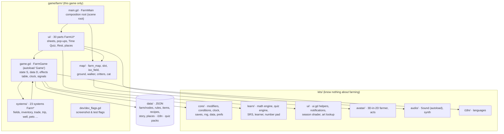
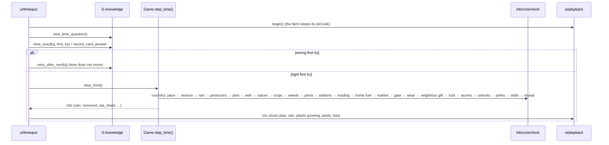

# Hazelwood Harvest: architecture review

22 October 2026 · version 0.19.0 · made with the *improve-codebase-architecture* skill (and its *codebase-design* vocabulary)

This report has two parts:

- **Part A:** how the game is built right now: layers, modules, how a tap and a Time Quiz answer travel through the code, data,
  saves, tests, tools and dependencies.
- **Part B:** where the architecture still causes friction, written up as five **deepening opportunities**, plus a top recommendation.

**What I read:** all 80 GDScript files (about 17,900 lines), the four READMEs in `game/farm/` and `kits/`, `docs/sources/2026-10-12-architecture-plan.md`,
the three project skills, `tests/check_all.sh` and the main tests, `tools/check_data.py`, the project log and `story/game/code-issues-story-timing.md`.
I counted references with scripts rather than by eye.
**Not used:** git history. The shell on your Mac was still setting up during this session, so I couldn't run `git log`. I took the
recent hot spots from `PROJECT-LOG.md` instead: phases 4 to 12 each added one or more new systems.
**Not changed:** I edited no code, `archive/todo-2026-10.md` or log. This file is the only thing written.

> **Vocabulary used in Part B** (from *codebase-design*): a **module** is anything with an interface and an implementation. Its
> **interface** is everything a caller must know to use it: function names, but also order, rules and error cases. A module is
> **deep** when a lot of behaviour sits behind a small interface, and **shallow** when callers have to know nearly as much as the
> implementation does. A **seam** is the place where the interface lives and behaviour can be changed without editing callers.
> **Leverage** is what callers gain from depth. **Locality** is what maintainers gain: a change or a bug sits in one place.
> **The deletion test:** imagine deleting the module. If its complexity reappears in many callers, the module was earning its keep.

---

# Part A: how the game works today

## A1. The big picture

A Godot 4.7 project written in GDScript only, with no third-party plug-ins. The folder `assets/addons/` holds pictures of farm
add-ons, not Godot add-ons. It runs on the iPad in the browser through Godot's web export (`gl_compatibility` renderer, portrait
834 × 1194).



**Three layers, as planned on 12 October.** The `core` and the kits know nothing about the farm. `game/farm/` builds this game from
them. Dependencies point downward with one exception: the systems and the Game call each other in both directions (A4).

**Two autoloads (global singletons):**
- `Game` (`game/farm/game.gd`, class `FarmGame`): the rules' front door. It holds the farm state `S` (one flat dictionary, the save),
  the data `D` / `nodes` / `items` / `recipes` / `meta`, the effects table (`caps()`, `g()`, `m()`), the clock, the condition counters,
  players and the learning record, and 13 signals (`changed`, `gained`, `sold`, `paid`, `celebrate`, `step_done` …).
- `Sound` (`kits/audio/sound.gd`): sound effects and music from `data/sounds.json`, with synthesised stand-ins.

## A2. The modules

| Area | Files (lines) | What it does |
|---|---|---|
| **Front door** | `game.gd` (656) | State, data loading (including quiz-pack merging and translation overlay), saves with upgrade steps, effects table, `chapter()`, `step_time()`, `setup_clock()` (the order of 23 per-step functions), the condition counters and terms, cheats |
| **Systems** (23) | `systems/*.gd` (60 to 470 each, about 4,700 in total) | One part of the rules each, reached as `G.<system>.<function>`: seasons, inventory, needs, pace, progression, fields, animals, crafting, trade, knowledge, rewards, reveal, quality, skills, story, trip, gate, lord, pets, well, nature, forest, trust |
| **Interface** | `main.gd` (470) + `ui/` (30 parts, 60 to 320 each) | `main.gd` builds the top bar, map, sheet and pop-up and refreshes on `changed`. Each part is `FarmUi<Name>` with handles `M` (the screen) and `G` (the rules) |
| **Map** | `map/` (7 files, about 2,600) | The isometric farm: layout from `data/map_layout.json`, places on footprints, fields and patches, path-finding, critters, season shader |
| **Place lookup** | `spots.gd` (136) | Static lookups over `data/farm/places.json`: which node belongs to which place, interiors, picture chains, pens |
| **Core kit** | `kits/core/` (7 small files) | `modifiers` (set / add / mult / produces folding), `conditions` (the "when" language), `clock` (ordered registration), `saves` (versions and upgrade steps), `rng` (seedable), `data` (reads folders of JSON), `prefs` |
| **Learn kit** | `kits/learn/` (about 1,400) | Rest sums (`math_engine`, curriculum classes 1 to 7), question packs (`quiz_engine`), spaced repetition, the learning record, the number pad. Has its own README. It is the cleanest module in the project |
| **Other kits** | `ui/ui.gd` (701), `avatar/` (536), `audio/` (238), `i18n/` (85) | Widgets and bars, the farmer figure, sound, languages |

## A3. How things travel through the code

**A tap on the map → an action → a redraw**

```mermaid
sequenceDiagram
  participant Child
  participant Map as map / mapview
  participant Sheets as ui/sheets
  participant Part as ui part (e.g. patches)
  participant Sys as G.fields (a system)
  participant Game as Game (S, signals)
  participant Main as main.gd
  Child->>Map: tap a place
  Map->>Sheets: open_spot(sid)
  Sheets->>Part: rebuild_sheet() → part_area / sheet_patch
  Part->>Sys: read costs, build buttons
  Child->>Part: tap "Harvest"
  Part->>Sys: harvest(area, i)
  Sys->>Game: check & subtract S["energy"], add items, roll luck, practise skill, wear polish
  Sys->>Game: save_game(); changed.emit()
  Game-->>Main: changed → queue_refresh → refresh()
  Game-->>Map: gained(source, got, lost) → things fly to the store
```

**A right first answer in the Time Quiz = one step of farm time**



**Rest:** `ui/rest` → `G.needs.rest_question()` (from the learn kit) → `needs.rest_correct()` adds energy.

## A4. Dependencies between the systems

Every system gets the whole `Game` as `G`, so it can reach any other system, all the data and the whole save. In practice:

- **Most called:** `inventory` (14 other systems call it), `needs` (10), `rewards` (9), `seasons` (8), `crafting`, `progression` and `skills` (7 each).
- **Most calling:** `trade` (calls 16 different things on `G`), `well` and `crafting` (14), `progression` (13), `fields` and `knowledge` (12).
- **17 pairs of systems call each other in both directions**, for example `fields ↔ progression`, `inventory ↔ seasons`,
  `crafting ↔ skills`, `crafting ↔ quality`, `needs ↔ well`, `pace ↔ progression`, `trade ↔ gate`.
- **The save is shared, not owned.** Each system declares its keys in `save_defaults()` (101 keys in total), but anyone may read or
  write any key. `S["energy"]` is read in 20 files and **written in 17 places across 8 systems**. `S["coins"]` is written in 12 places
  across 8 systems, and `S["water"]` in 7 places.
- **The interface** calls into the Game and its systems about 500 times (`fields` 60, `trip` 41, `progression` 39, `knowledge` 37 …) and still
  reads `G.S` directly in 16 parts. The interface no longer writes to `G.S`: the R5 goal is met.

## A5. Data

Content lives in data, as planned. According to the README's key numbers (24 Oct 2026) there are 461 nodes (goals, buildings, helpers, cards, polish,
pets …), 182 items, 131 recipes, 87 cards, six chapters and 6 story files. I didn't stage the data files, so these numbers weren't
re-counted. The data is split into:

- `data/farm/nodes/01…14-*.json` (themed slices; the order of nodes is game behaviour), `items.json`, `recipes.json`,
  `chapters.json`, `start.json`, `places.json`.
- `data/farm/rules/*.json`: 24 rule files, one per system (pricing, weight, quality, skills, trip, gate, rewards, lord, pets, well,
  nature, forest, reveal …), merged into `G.meta`.
- `data/farm/story/*.json`: story pieces with `when` conditions.
- `data/i18n/`: German overlays for UI, data, quiz and learn texts. `data/quiz_packs/`: the question packs.
- `kits/learn/curriculum/math.json`: the maths curriculum.

## A6. Saves

`user://players/<name>/farm_save.json` (the farm) and `learning.json` (the learn kit's record, kept across new games).
`SAVE_VERSION` is 4, with upgrade steps 0→1→…→4 in `Game.save_steps()`. Missing keys are filled from every system's `save_defaults()`
(`kits/core/saves.gd`). Old saves in `tests/fixtures/` are loaded on every check.

## A7. Tests and tools

- `bash tests/check_all.sh` (about 2 minutes) runs: the UI smoke test (through `tests/ui_driver.gd`), save fixtures, save versions, the
  core kit, 15 rule tests (places, quality, skills, money, story, trip, gate, lord, pets, well, nature, forest, crops, market …), the
  **golden run** (the bot plays with a fixed seed and the farm's fingerprint after every question must match a stored one), the
  data checker and the translation check.
- `tests/bot.gd` (553 lines) plays the real rules to the end (`--end`) and writes the pacing report the explorer shows.
- Python 3 tools in `tools/` (standard library only): `check_data.py` (cross-checks every id and condition), `i18n.py`, art and
  sound import, the layout editor generator, `sync_progression.py` and `update_explorer.sh` for `progression/progression-explorer.html`.
- **External dependencies, all of them:** Godot 4.7 (editor and web export templates), Python 3, a browser for the explorer and
  layout editor, bash, and git (plus the separate public `web-build` repo). Nothing is downloaded at run time.

## A8. What is already good

- **The restructuring of 12 and 13 October worked.** The two 3,000-line and 2,400-line scripts are gone. Each new mechanic since
  then (12 systems) arrived as a new file plus a rules JSON plus a test, which is exactly the "rule of the house".
- **The safety net is unusually strong** for a project this size: seeded randomness, golden runs, save fixtures, a data checker,
  and a UI driver so the smoke test doesn't depend on private functions.
- **The learn kit is a properly deep module:** a small interface (`question`, `is_right`, `result`, `pick`) over a lot of behaviour
  (curriculum, spaced repetition, medals, timers).
- **`kits/core/modifiers.gd` and the effects table** (`caps()`) are a good deep seam: hundreds of node effects and one way to ask for a number.
- **`fields.plant_plan()`** already shows the right shape for an action: it works out what planting would cost and why it can't
  happen, and both the rule and the screen use that answer. Candidate 1 below generalises it.
- **Smaller gaps:** `godot-prototype/ARCHITECTURE.md`, promised by the plan, has not been written yet; the plan still serves as the
  architecture description. There is no `GLOSSARY.md` and no `docs/adr/`. I treated the plan's §11 decisions and `archive/log-2026-10.md` §2 as
  the recorded decisions.

---

# Part B: deepening opportunities

Overview, strongest first:

| # | Candidate | Strength | Main files |
|---|---|---|---|
| 1 | **Farm actions: one module that prices, checks and pays** | 🟢 Strong | `systems/fields, animals, well, forest, trip, trade, pace, needs`, `ui/patches` and other sheets |
| 2 | **The question that moves time** (the first-try rule in one place) | 🟢 Strong | `ui/timequiz.gd`, `systems/knowledge.gd`, `tests/bot.gd` |
| 3 | **One condition language** (counters, terms, pets' WHEN cards, the checker) | 🟢 Strong | `game.gd` `counter()` / `term()`, `kits/core/conditions.gd`, `systems/pets.gd`, `tools/check_data.py` |
| 4 | **What takes the screen next** (one queue for pop-ups, gifts, celebrations, story) | 🟡 Worth exploring | `ui/modals, celebrations, gifts, storybox, rest, timequiz, mapview`, `main.gd` |
| 5 | **The farm's numbers behind their owners** (energy, coins, water) | 🔵 Speculative | `game.gd`, every system that writes `S["energy"]`, `S["coins"]`, `S["water"]` |

---

## 1. Farm actions: one module that prices, checks and pays

**Strength: 🟢 Strong**

**Files:** `systems/fields.gd` (plant, harvest, weed, pick stones, clear snow, cut tree, fetch water), `systems/animals.gd` (muck out,
collect), `systems/well.gd` (party, visit), `systems/forest.gd`, `systems/trip.gd` (go), `systems/trade.gd` (buy seeds, buy item),
`systems/pace.gd` (`missing_cost`, `pay`), `systems/needs.gd` (`ecost`), and on the interface side `ui/patches.gd`,
`ui/places/stations.gd`, `ui/places/market.gd`, `ui/forestsheet.gd`.

**Problem.** Every player action writes out the same sequence by hand:

1. work out the energy cost: `G.needs.ecost("<category>", <base>) * G.m("energy:field")`;
2. check it: `if G.S["energy"] + 0.001 < e: G.say("⚡ Too tired to …"); return false`;
3. subtract it: `G.S["energy"] -= e`;
4. for coins, check the Lord's share and send the `paid` signal (in some places only);
5. run the follow-ups: `skills.practice`, `crafting.wear_polish("use:…")`, `rewards.job_progress`, `S["stats"]`, a luck roll;
6. finish with `G.save_game(); G.changed.emit()`.

Counted in the code:

- **12** copies of the "too tired" check across 5 systems;
- **17** writes to `S["energy"]` in 8 systems; **12** writes to `S["coins"]` in 8 systems;
- **48** `save_game(); changed.emit()` endings;
- the follow-ups are wired by hand at **7** polish-wear sites, **5** skill-practice sites and **8** job-progress sites.

**The interface computes the same prices a second time.** `ui/patches.gd:121` repeats the formula in `fields.harvest()`
(`G.needs.ecost("harvest", 1.0) * G.m("energy:field")`) to show the cost and decide whether the button is enabled. Lines 60, 108 and
131 do the same for clearing snow, cutting a tree and weeding. If the rule changes (for example, wellbeing making field work
cheaper), the button and the rule can disagree without any test failing.

**The ways of paying already differ:**
- `pace.pay()` checks the Lord's share before spending coins (`missing_cost`).
- `trade.buy_seeds` and `trade.buy_item` check it themselves and send `paid`.
- `forest.check()` takes Wren's coin favour without either step.

That may be intended, but nothing in one place says so. There is also dead code: `plant()` still has a seed-buying coin path, but
`plant_plan()` always returns `buy_seeds = 0`.

**The deletion test.** Imagine an action module, then delete it: its pricing, checks, payment and follow-ups would reappear in the
dozen actions above, which is where they are today. So the module would earn its keep.

**Solution (plain English).** One farm-actions module, owned by the rules, with two questions:
- **"What would this cost, and can I do it?"** It returns the price after modifiers, the price before modifiers (for the cube bars),
  whether it's possible, and the child-friendly reason if not.
- **"Do it."** It checks again, pays energy, water, coins and items in one way (Lord's share, `paid` signal, clamping), runs the shared
  follow-ups, saves once and tells the interface once.

Each system keeps only what is particular to it (what a harvest yields, what a party bumps), and registers an action under a name with
its base cost and category in data. `plant_plan()` is the existing model for the first question.

**Benefits.**
- **Locality:** the cost rule, the "too tired" wording, the Lord's-share rule and the follow-ups each live in one place, so a bug fixed
  there is fixed for every action.
- **Leverage:** new actions in upcoming work (H1 upgrades, chapter 5 remedies, the pets' jobs) take a few lines each. The interface's
  buttons show the same price the rule charges, by construction.
- **Tests:** one action test covers pricing, refusal and payment for every action through the same interface. The golden run guards
  the move, because the order of follow-ups is behaviour and must stay the same.

**Before / after**

```
BEFORE: every action and every button prices and pays on its own

  ui/patches ─┐ recomputes ecost×m       ui/stations ─┐   ui/market ─┐
              ▼                                        ▼              ▼
  ┌────────────┐ ┌────────────┐ ┌───────────┐ ┌──────────┐ ┌──────────┐ ┌──────────┐
  │fields      │ │animals     │ │well       │ │forest    │ │trip      │ │trade     │
  │ ecost      │ │ ecost      │ │ energy-=  │ │ energy-= │ │ energy-= │ │ lord?    │
  │ tired?     │ │ tired?     │ │ tired?    │ │ coins-=  │ │ tired?   │ │ coins-=  │
  │ energy-=   │ │ energy-=   │ │ save,emit │ │ save,emit│ │ save,emit│ │ paid.emit│
  │ practise   │ │ practise   │ └───────────┘ └──────────┘ └──────────┘ │ save,emit│
  │ wear,jobs  │ │ wear,jobs  │                                         └──────────┘
  │ save,emit  │ │ save,emit  │      … 12× "too tired", 48× save+emit
  └────────────┘ └────────────┘

AFTER: one deep module at one seam

  ui/patches · ui/stations · ui/market  ──  quote("harvest", …) → {cost, base, ok, why}
                                   │
              ┌────────────────────▼────────────────────────┐
              │  farm actions   quote(action) · perform(action)│  ← small interface
              ├─────────────────────────────────────────────┤
              │ price: ecost × modifiers × season × skills    │
              │ check: energy, water, coins, items, Lord      │  ← deep implementation
              │ pay:   one way, paid / gained signals          │
              │ after: practise, wear, jobs, stats, luck       │
              │ save once, changed once                        │
              └──────────────┬──────────────────────────────┘
                             │ "what is special about me"
       fields.harvest_yield · animals.muck · well.party_bump · trip.start_walk …
```

---

## 2. The question that moves time

**Strength: 🟢 Strong**

**Files:** `ui/timequiz.gd` (`show_time_quiz` / `_time_answered`, `show_trip_question` / `_trip_answered`, `show_visit_question` /
`_visit_answered`, `show_walk_question` / `_walk_answered`), `systems/knowledge.gd` (`next_time_question`, `time_result`,
`record_card_answer`, `retry_after_next`), `systems/trip.gd` (`arrive`), `systems/well.gd` (`visited`), `tests/bot.gd`.

**Problem.** The game's central rule is: *only a right first answer moves farm time; after a wrong one the question comes back, and a
card review is recorded differently*. That rule lives in the **interface**, written out four times. The four `_…_answered` functions
are near-copies of each other:
1. record the answer, or the card review;
2. if it was wrong, call `retry_after_next`;
3. otherwise call `G.step_time()`, then the place-specific step (`trip.arrive()`, `well.visited()`, a callback);
4. then build the rain notes. The rain sentence is pasted in four places.

`show_walk_question(cfg)` is already the general version; the trip and visit variants were never folded into it. The narration also
drifts between copies: only the main Time Quiz tells the child about the scarecrow, pests or the rainbow perk.

**The bot can't use the rule.** It sits in UI code, so `tests/bot.gd` re-creates the sequence itself (`G.step_time()` then
`G.trip.arrive()`, line 260). The golden run therefore never exercises the first-try rule, `retry_after_next` or the card-review
recording. A bug there would pass every check.

**The deletion test.** If the `timequiz` part were deleted, the rule wouldn't move into one place; it would reappear in every caller
(four screens and the bot). That is the sign the rule belongs in a deeper module on the rules side.

**Solution (plain English).** The rules get one function: "a time question was answered (this question, first try or not, and what
the question was for: the farm, the walk to the village, a visit, the forest)". It records the answer, decides whether time moves,
runs the step and the place-specific follow-up, and returns one report (moved or not, the step report, the text of what happened).
The interface keeps only the drawing: one question pop-up with a title, an emoji and a button. The bot calls the same function, so the
golden run covers the real rule.

**Benefits.**
- **Locality:** the first-try rule (TODO J10) and its wording sit in one place.
- **Leverage:** every future "one question to get there" (a new walk, a merchant's riddle) is one line of data or one call.
- **Tests:** the rule becomes testable headless; the bot plays it instead of imitating it, and the golden run starts protecting it.
  The UI file shrinks by roughly 100 lines.

**Before / after**

```
BEFORE                                         AFTER
ui/timequiz                                    ui/timequiz: one pop-up (title, emoji, button)
 ├ _time_answered  ─┐                                    │ answered(q, first_try, purpose)
 ├ _trip_answered   ├ each: record · retry ·             ▼
 ├ _visit_answered  │ step_time · follow-up ·   ┌────────────────────────────────────┐
 └ _walk_answered  ─┘ rain text (×4)            │ knowledge.answer_time_question(...)  │
tests/bot.gd: step_time(); trip.arrive()  ←     │ record / card review · first-try rule│
          (imitates the rule, skips it)         │ step_time · arrive / visited / walk  │
                                                │ → {moved, info, text}                │
                                                └────────────────────────────────────┘
                                                tests/bot.gd calls the same function
```

---

## 3. One condition language

**Strength: 🟢 Strong** (it directly unblocks the open story-timing issues C5 and C6)

**Files:** `kits/core/conditions.gd`, `game.gd` (`cond`, `counter` with 27 names in a `match`, `term` with 9 terms, `seen`),
`systems/pets.gd` (`holds()`: its own little language of WHEN cards with `stat` / `item` / `op`), `systems/story.gd`,
`systems/reveal.gd`, `systems/rewards.gd` (acorns, perks), `tools/check_data.py` (`condition_ok`, `story_condition`).

**Problem.** The idea is a good one: "when" in the data is one small language, and the core kit parses it. In practice it is spread over
four places that must be kept in step by hand:

- **The vocabulary is split.** The kit parses the grammar, but every word in it (`coins`, `forest_trips`, `lord_owed`, `chapter`,
  `has:`, `season:`, `tap:`, `after:` …) is a branch of two large `match` statements in `game.gd`. Each new system has added counters
  there (the Lord, the forest, wellbeing, the trip), so the front door grows with every system and has to know about all of them.
- **The pets have a second language.** The job board's WHEN cards (`weeds_max`, `empty_patches`, `water`, `pests`, `op: "<"`) are
  evaluated in `pets.holds()` with their own `match`. They can't be used in story pieces or reveals, and the main language can't say
  "fewer than" at all. That is exactly what `story/game/code-issues-story-timing.md` asks for in **C5** (no negation) and **C6** (no terms
  for pests, rain, frost, energy, `open:<node>`, a general stats counter).
- **The checker copies the grammar.** `tools/check_data.py` finds the list of counters with a regular expression over the *source
  text* of `game.gd`'s `counter()` function. It also has two Python validators with different grammars: `condition_ok` rejects
  `season:` and `has:` terms, `story_condition` accepts them. So the same condition can be valid in a story piece and an error in a
  perk.

**The deletion test.** Delete the core `conditions.gd` and almost nothing changes, because the parsing is 20 lines and the real meaning
lives in `game.gd`, `pets.gd` and the checker. Today it is a shallow module. Deepening it means moving the meaning in.

**Solution (plain English).** One condition module that owns the whole language:
- the grammar, with `not:` and `<`;
- a **registry of terms and counters**, where each system registers its own words where it owns the data (the Lord registers
  `lord_owed`, the fields register `pests` and `empty_patches`);
- a way to **list** the words, so the checker asks the module for the vocabulary instead of reading source code.

The pets' WHEN cards become ordinary conditions with a number the child can change, so they can be used everywhere.

**Benefits.**
- **Locality:** a new word is added once, next to the data it reads.
- **Leverage:** story pieces, reveals, acorns, perks and pet jobs all gain every word at once, which removes the obstacle behind C5
  and C6 and probably C3.
- **Tests:** one test file can walk the whole vocabulary. The data checker becomes exact instead of approximate, and can't drift when
  someone formats `counter()` differently.

**Before / after**

```
BEFORE                                            AFTER
data "when" ──► kits/core/conditions (grammar)    data "when" ──► conditions
                  │ asks provider                                  ├ grammar (+ not:, <)
                  ▼                                                ├ registry: name → reader
             game.gd counter(): 27-way match                       └ vocabulary() → list
             game.gd term():    9-way match                               ▲  register(...)
pets.gd holds(): its own stat/op language           seasons · fields · lord · forest · well · pets …
check_data.py: regex over game.gd source,           check_data.py: reads vocabulary() export
               two validators that disagree                        (one validator)
```

**Note on recorded decisions:** this fits the architecture plan (§4.1 asked for "**one** condition language"). No decision needs to be
reopened.

---

## 4. What takes the screen next

**Strength: 🟡 Worth exploring**

**Files:** `ui/modals.gd` (`_after_close`), `ui/celebrations.gd`, `ui/gifts.gd`, `ui/storybox.gd` (`_quiet`), `ui/rest.gd`,
`ui/timequiz.gd`, `ui/mapview.gd` (`_fx_queue`), `main.gd` (`celebration_queue`, `after_close`, `rest_state`), `systems/rewards.gd`
(`gift_pending`, `postcard_pending`).

**Problem.** Several things compete for the child's attention: a pop-up, a big celebration, a gift card or postcard, the story box or a
bubble, a toast after the pop-up closes, the playback after the quiz, map effects. Each part decides for itself whether it may show,
by polling shared state (`M.modal.visible`, `M.playback.held`, `M.rest_state`, `M.celebration_queue`, `G.S["gift_pending"]`).
The order is buried in one `if / elif` in `modals._after_close` (toasts, then gift, else celebration). The story box has its own
`_quiet()` that checks six of these flags.

The story-timing review measured the effect: **C2** (a pile-up at chapter turns), **C7** (barks wait because they need the quiet gate)
and **C8** (delays of up to 15 steps from the idle check). Tuning any of them means editing several parts and reasoning about how their
polling interacts.

**The deletion test.** There is no module to delete. The behaviour is spread over seven parts. That is the clearest sign of missing
locality.

**Solution (plain English).** One interruption queue on the interface side. Anything that wants the screen (a celebration, gift,
postcard, story piece, after-close note) submits a request with a kind and a priority. The queue alone knows what is showing, the order
of kinds, the rationing (the story's "one moment per three questions" could move here or stay in `G.story`) and what counts as quiet.
Parts stop reading each other's flags.

**Benefits.**
- **Locality:** the order of pop-ups and the quiet rule live in one file, so fixing C2, C7 and C8 becomes a change of numbers in one place.
- **Leverage:** new kinds of interruption (merchant visits, notifications from J5) plug in with one call.
- **Tests:** the queue can be tested without drawing anything. Feed it requests and assert the order. Today that is only visible in
  screenshots.

**Why only "worth exploring":** the current system works. The pain is concentrated in story pacing, which is still being tuned with you,
so this pays off mainly if the 166 new story pieces from round 6b go in.

**Before / after**

```
BEFORE: everyone polls everyone            AFTER: one queue decides
celebrations ─┐                            celebrations ─┐
gifts ────────┤  each checks:              gifts ────────┤ submit(kind, prio, show)
storybox ─────┤  modal.visible?            storybox ─────┤          │
rest ─────────┤  playback.held?            after-close ──┘          ▼
timequiz ─────┤  rest_state?               ┌──────────────────────────────┐
mapview ──────┘  celebration_queue?        │ interruption queue             │
modals._after_close: if/elif order         │ what shows · order · quiet ·   │
                                           │ rationing · after-close notes  │
                                           └──────────────────────────────┘
```

---

## 5. The farm's numbers behind their owners

**Strength: 🔵 Speculative**

**Files:** `game.gd` (owns `energy`, `coins`, `water`, `step`, `stats`, `goals` in `save_defaults()`), and the systems that write them
(A4: 8 systems for energy, 8 for coins, 5 for water).

**Problem.** The save is one flat dictionary, and every system holds the whole Game. So any system can change any number: there are
17 two-way couplings between systems, and the energy number is changed in 17 places. Some writes clamp (`well.gd` clamps to `0…energy_max`), others rely on a check
made earlier in the same function, and `forest.gd` sets energy and coins straight to 0. Some writes send a signal, others don't. There is no single place
to ask "who changed my energy this step?", and the wellbeing dashboard's "⚡ ±n each question" has to reconstruct that.

**Solution (plain English).** The few numbers everyone touches (energy, water, coins) get an owner with a tiny interface: spend, gain,
can I afford. It clamps, signals and keeps a per-step tally for the dashboard and playback. Most of this falls out of **candidate 1**
(the action module pays through it). Doing it alone would be a lot of churn for little gain.

> ⚠️ **Touches a recorded decision.** Slice R7 decided that "the save stays one flat dictionary, not nested slices, so the interface's
> reads did not change". This candidate does **not** propose nesting the save. It only proposes that writes to three numbers go
> through one owner. Reopening R7 itself isn't worth it: the interface no longer writes the state, and saves upgrade cleanly.

**Benefits:** locality for clamping and signals; a reliable per-step tally; one place to test "energy never goes below zero".

---

# Top recommendation

**Start with candidate 1, farm actions.** It has the most leverage on what comes next. Every planned mechanic in `archive/todo-2026-10.md` (H1
upgrades that do more than save energy, the remedies, more pet jobs, merchant visits) is another action that would otherwise copy the
price-check-pay-follow-up sequence a 13th time. It also removes a real class of bug, where a button's displayed cost disagrees with the
cost charged. And it is safe to do: the golden run and the rule tests will catch any change in the order of follow-ups.
`fields.plant_plan()` is a working prototype of the "what would this cost" half, so the shape isn't guesswork.

**Candidate 2 (the question that moves time) is the cheap warm-up**, if you'd rather have a smaller first slice: it is about one
session, touches three files, and immediately makes the golden run test the first-try rule.

Candidate 3 should follow soon after, because the story work is blocked on it (C5, C6).

---

**Next step (from the skill):** which of these would you like to explore? Pick one and we can go through it question by question
(the skill's "grilling" step): what sits behind the seam, what the interface looks like, which tests survive, and how the bot and
golden run prove nothing changed. I'll record any new terms in a `GLOSSARY.md` and any rejected candidates as a short decision record,
so later reviews don't suggest them again.
